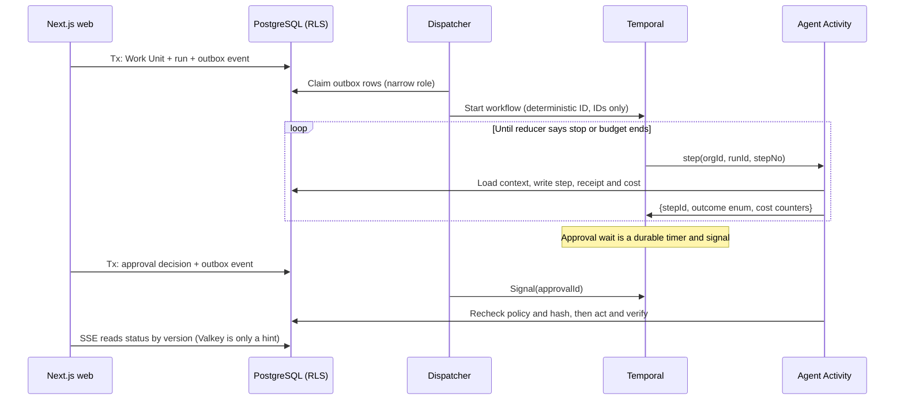

# ADR-024: Runtime contracts to settle before the first line of code

**Status:** Accepted by the project owner on 2026-11-05, with the corrections in this revision. Nothing here is implemented or tested yet. Outside security review of D4 and D5 is required before any real credential is stored.
**Date:** 2026-11-05
**Deciders:** Architecture owner for all decisions. Security owner must also approve D2, D4 and D5. Product and commercial owners decide D6 (see [document governance](../04-doc-governance.md)). Names to be filled in.

## Context

ADR-001 to ADR-023 settle the stack: Next.js App Router, separate Node workers, PostgreSQL with pgvector, Temporal, Drizzle, a policy-first model router, and container-first releases in three commercial modes. This ADR does not reopen any of them, and it does not cut the approved vision. The build plan allows sequencing by dependency and risk, and D6 only does that.

Reading the suite as a build contract shows a smaller problem: several hard-to-reverse runtime mechanics are undefined or contradict each other. Each one would otherwise be decided by whoever writes that code first, probably a coding agent, and two of them can leak customer data.

| # | Gap | Evidence | If left open |
|---|---|---|---|
| 1 | Where the agent loop runs is ambiguous | [Agent runtime](../../03-intelligence/02-agent-runtime.md) gives `agent-runtime` the loop and Temporal the lifecycle. It never says whether a run is one Activity or many | Mid-run approval waits and crash recovery get designed twice, against ADR-005 |
| 2 | Temporal history is not treated as a confidential store | A search of the whole suite finds no mention of a payload codec or continue-as-new. Temporal stores Activity inputs and outputs in its own persistence | Prompts, documents and tool arguments sit outside RLS, deletion and retention (threat SEC-005) |
| 3 | Some access must happen before a tenant is known, and no design covers it | [`schema.sql`](../../specifications/schema.sql) applies FORCE RLS to every table with `organization_id`, including `org.memberships` and `platform.outbox_events`. [Multitenancy](../../02-architecture/07-multitenancy.md) bans BYPASSRLS. The schema's own footer lists global access as not provided | Login cannot find a user's organizations. The dispatcher sees zero rows. The easy fix is BYPASSRLS |
| 4 | `org.organizations` and `identity.users` have no RLS | The RLS loop matches on the `organization_id` column, and these tables don't have one | The app role can list every tenant and user |
| 5 | The web tier's reach is wider than it needs to be | [Deployment topologies](../../02-architecture/08-deployment-topologies.md) allows web → Temporal, and Server Actions are described as starting workflows, while the [overview](../../ARCHITECTURE_OVERVIEW.md) routes starts through the outbox | Two start paths, and more exposure if the web tier is compromised |
| 6 | Identity and secrets products are not chosen, yet both are listed as required | The [Compose reference](../../specifications/deployment/compose.reference.yaml) lists IdP and secrets manager as required infra, on top of 9 other services | About 12 services with local inference on a "small" Sovereign host, against the "easy private deployment" goal |
| 7 | Live status has no mechanism | SSE is specified, but nothing says how a web replica learns about a change | Each replica invents its own, or holds long polls against the primary |
| 8 | The backlog holds two overlapping plans | 87 tickets, no cycles or missing references, 11 levels deep. The `PLAT/API/AI/SEC-1x/OPS-1x/UX/COM` tickets repeat the v1-era tickets in at least 14 pairs (see Spec corrections) | Status diverges, and agents implement the same thing twice |

**Assumption:** a small TypeScript team working with coding agents, not the 16 owner groups named in the backlog. If the team is larger, D1–D5 stand and only the D6 pacing changes.

## Decision

| # | Decision |
|---|---|
| **D1** | The Temporal workflow drives the agent loop. One Activity performs exactly one model turn or one tool call. The next-step logic is a pure reducer that the workflow can import. |
| **D2** | Only identifiers, enums and counters cross Temporal. All content stays in PostgreSQL or object storage. A payload codec is added as a second layer, not as the main control. |
| **D3** | The web tier has no Temporal client and no network path to Temporal. Starts, signals and cancels go through the outbox. Status comes from the PostgreSQL read model, with Valkey only as a wake-up hint. |
| **D4** | PostgreSQL uses narrow roles, with no BYPASSRLS anywhere. A second session variable lets a user see their own memberships before a tenant is bound, and tenant context is only available through one transaction helper. |
| **D5** | Identity is embedded in the web app (OIDC plus local accounts), with no bundled IdP. Secrets go through a `SecretBroker` port whose default adapter is envelope encryption. The web tier can seal secrets but never unseal them. |
| **D6** | Keep the spec's five slices in order, but run the offline, replay and two-tenant gates from Slice 1. All three commercial modes launch, with pilots opening in dependency order. Merge the backlog before work starts. |



### D1. Where the agent loop runs

| | A: One long Activity per run | **B: Workflow drives one Activity per step (chosen)** | C: Child workflow per step |
|---|---|---|---|
| Complexity | Low at first, high once checkpoints and resume are added | Medium: needs a discipline of a pure reducer | High |
| Approval waits lasting days | Holds a slot or must exit and rebuild state | Native timer and signal | Native |
| Crash recovery | Custom recovery code | Completed turns replay from history without re-calling the model | Native |
| Cost | Repeats paid model turns after a crash | Pays only for the failed step | More history and more server load |
| Scale limit | Worker slots | History grows per step, bounded by turn limits and `continueAsNewSuggested` | Same as B, with a larger constant |
| Familiarity | Most familiar | Requires learning workflow determinism | Least familiar |

**Why B:** the suite already says Temporal owns approval waits and that there must be no second workflow authority. Option A needs its own recovery cursor, which is exactly that second authority.

**Rules this creates:**

- `packages/agent-runtime` exports `decideNext(state, lastOutcome)`, with no Node, Drizzle or SDK imports, because workflows run in a sandboxed VM.
- Each Activity makes one model call. The AI SDK's multi-step tool loop is not used, because it would hide turns from budgets, policy checks and recovery.
- Token streaming is best effort, through a tenant-namespaced Valkey channel, and never part of the durable record.

### D2. What crosses Temporal

| | A: Full payloads in history | B: Full payloads, encrypted by codec | **C: IDs only, plus codec (chosen)** |
|---|---|---|---|
| Complexity | Lowest | Key management and decode tooling | Activities load and save their own content |
| Tenant deletion | Waits for history retention | Needs crypto-shredding | Content is already under normal deletion rules |
| RLS and ACL revocation | Bypassed | Bypassed once decoded | Rechecked on every load |
| Replay after a code change | Sees old content | Sees old content | Sees only IDs and outcomes |
| Data-handling risk | High | Depends on keys | Low: a bug in a single field is still encrypted |

**Why C:** with IDs only, replay and deletion behave properly. A codec alone would still leave decoded content flowing through workflow code. Configure the failure converter to encode messages as well, because provider errors can quote prompt text.

**Allowed shape:** `{organizationId, workUnitId, runId, stepId, agentVersionId, outcome, costMicros, turnsUsed}`. The reducer decides from enums, never from text. If a workflow appears to need text, that decision belongs in an Activity.

### D3. Web tier and status

| | A: Web calls Temporal directly | **B: Outbox only (chosen)** |
|---|---|---|
| Complexity | Dual-write handling needed | One path, already specified (ADR-009) |
| Temporal outage | Actions fail or diverge | Writes continue and queue, matching the [failure rules](../../02-architecture/01-system-architecture.md) |
| Web bundle | Carries the Temporal client and connection config | None |
| Latency | Lowest | Adds the dispatcher poll interval; must be measured |

**Status path:** Activities write status and bump a version in PostgreSQL. SSE sends changes after the client's last version, so a reconnect always recovers. A Valkey publish only tells replicas to check sooner; if Valkey is down, SSE falls back to a slower poll. The dispatcher polls with `FOR UPDATE SKIP LOCKED` and does not use LISTEN/NOTIFY, which doesn't work through a transaction-mode pooler.

**Stop latency:** a user's stop request travels through the outbox, but every side effect also rechecks PostgreSQL immediately beforehand. An action can therefore be blocked as soon as the stop commits, even if the signal is still in flight (SEC-06).

### D4. Database access

| | A: BYPASSRLS for system jobs | B: Loop over tenants | **C: Narrow roles (chosen)** |
|---|---|---|---|
| Complexity | Lowest | Medium | Medium: reviewed SQL per role |
| Blast radius if compromised | Every table in every tenant | Needs a tenant list anyway | Event metadata in one table family |
| Spec compliance | Violates multitenancy doc | Complies | Complies |
| Scale | Fine | Query count grows with tenants | Fine |

| Role | Used by | Can reach |
|---|---|---|
| `ensemus_migrator` | One migration job | Owns the schema; never used at runtime |
| `ensemus_app` | Web and tenant-bound workers | Tenant tables through RLS; no `secrets` schema |
| `ensemus_dispatcher` | Outbox dispatcher | Outbox state, plus event metadata columns (no `payload`) across tenants; nothing else |
| `ensemus_secrets` | Secret broker in the worker | `secrets` schema only |

```sql
-- Illustrative and untested. Must pass reviewed-SQL and role tests.
CREATE POLICY memberships_self ON org.memberships FOR SELECT
  USING (user_id = nullif(current_setting('app.user_id', true), '')::uuid);
```

- **Tenant binding:** `withTenantTx(ctx, fn)` is the only exported way to get a connection, and a lint rule blocks importing the raw pool. It uses `set_config('app.organization_id', $1, true)`, because `SET LOCAL` cannot take a bind parameter, and interpolating a value into it invites injection.
- **Short transactions:** never hold one across rendering or a model call. Parallel Suspense reads each take a connection, so size the pool for that and measure the extra round trips against the 300 ms read target.
- **Webhooks:** resolve the tenant from a global `integrations.webhook_routes` table that maps an opaque token to an organization, then bind the tenant and verify the signature.
- **Scheduled work:** Temporal Schedules carry the organization ID. Activities re-load the run by `(organization_id, id)` rather than trusting input (SEC-015).

### D5. Identity and secrets footprint

| | A: Bundle an IdP and a vault | **B: Embedded auth + envelope encryption (chosen)** | C: Customer must supply both |
|---|---|---|---|
| Complexity | Two more stateful services to upgrade, back up and license | One port and adapters; security-critical code we own | Lowest for us; hardest for customers |
| Sovereign footprint | About 12 services | About 10 | About 10, but a blocker for sites without an IdP |
| Security strength | Strongest: dynamic credentials and per-secret audit | Good if reviewed; no dynamic credentials | Depends on the customer |
| Licensing | Each needs perpetual-redistribution review (HashiCorp Vault moved to BUSL in 2023; verify current terms) | Fewer components to review | Customer's responsibility |

**How B works:**

- Web holds only a public sealing key. It encrypts submitted credentials and stores ciphertext it can never read.
- The broker runs in the worker, unwraps data keys with a KEK from a mounted file or external KMS, and uses standard AES-256-GCM. No custom cryptography.
- A customer's own Vault or KMS is another adapter behind the same port.

**Why this boundary matters:** the web tier is the largest attack surface, as the React Server Components RCE of December 2025 (CVE-2025-55182) showed. Compromising it should not yield provider keys.

**The project owner chose B on 2026-11-05, and [Secrets and egress](../../04-security/02-secrets-and-egress.md) has been amended to match.** Outside security review is still required, and it is the decision most likely to change. If the review rejects B, a vault adapter replaces the default behind the same `SecretBroker` port.

**Correction (2026-11-05):** an earlier revision treated Slice 3 as the latest point to settle this. The broker is built in M1, because `CONNECT-01` depends on `FOUND-05` and comes before the model work. Which auth library to use needs a separate spike; none has been evaluated here.

### D6. Build sequence

Keep the [build plan's](../../06-delivery/01-build-plan.md) five slices in their order, and move three gates to the start, because they get far more expensive to retrofit:

| Gate | From | What it does |
|---|---|---|
| Air-gap | Slice 1 | CI runs the Compose stack on an internal-only network and fails on any outbound attempt. Sovereign *productization* stays last; offline *capability* is checked from day one |
| Replay corpus | First workflow | Each release commits sample histories, and CI replays them with `Worker.runReplayHistories`. Long approval waits and skipped Sovereign upgrades make this essential |
| Two-tenant | First table | Same-named resources in two tenants, with tests run as `ensemus_app` |

**Commercial modes: all three are launch targets (corrected 2026-11-05).** The project owner chose this over the original "BYOM first" recommendation. Pilots open in dependency order: BYOM after M5, because it needs no inference billing; Sovereign after M6, once the offline path is proven; and Cloud after M8, once credits and billing exist. See the [delivery plan](../../06-delivery/06-end-to-end-delivery-plan.md). `MODEL-04` still ships in M4 with its ledger fields and entitlement check, because that history cannot be backfilled.

**Keep workflows few and generic.** Long-lived workflows are the hardest code to change. Prefer a small number of interpreters that read versioned plans from PostgreSQL over one workflow per business process. This also gives Agent Studio's visual graphs (`AGENT-09`) a natural compile target. A Work Unit with no execution plan starts no workflow, so manual work never depends on Temporal.

## Trade-off analysis

- **The main cost is more boilerplate per step.** D1 and D2 mean every step loads, saves and returns a small result. In exchange, recovery, deletion, policy rechecks and cost accounting all happen at one seam, instead of being rebuilt per feature.
- **D3 gives up a little latency for a much smaller web tier.** If the measured start delay hurts interactive use, the fix is a shorter poll or a wake-up hint, not a Temporal client in web.
- **D5 gives up a real vault's features to remove two stateful services.** This is the weakest trade here, which is why it needs explicit security approval.
- **D6 spends effort early on gates with no visible features.** Air-gap and replay failures found in Phase 5 would mean redoing work across every prior slice.

## Consequences

**Easier:** crash and restart reasoning, tenant deletion, per-step budgets and audit, Temporal outages, Sovereign install and support, and giving coding agents one unambiguous pattern to copy.

**Harder:** workflow code needs determinism discipline and review. Roles and policies are hand-written SQL. The broker and auth code are security-critical and need external review. Debugging a run means joining PostgreSQL steps with Temporal history, so build a run timeline early (`AGENT-06`).

**Revisit when:**

- D3: measured start or stop latency misses the interactive target.
- D1: runs routinely exceed history limits, which would suggest the turn limits are wrong.
- D5: a customer or auditor requires dynamic credentials, or the security review rejects it.
- D4: shared-pool contention appears in `OPS-01` load tests.

**Mode impact:** all decisions apply equally to Cloud, BYOM and Sovereign. Only the KEK source and model profile differ.

**Rollback:** D3, D5 and the status path can be changed behind ports. D1, D2 and D4 become expensive once real workflows and tenants exist, so they should be settled before Slice 1 merges.

## Acceptance tests

| Test | Backlog |
|---|---|
| Kill the worker during a model call: the run resumes without repeating completed turns or side effects | `AI-13`, `WORK-08` |
| Approval wait survives a worker restart **and** a release upgrade | `WORK-07`, replay gate |
| Plant a canary in a document, prompt, tool argument and provider error, then dump Temporal persistence and logs: canary absent | `FOUND-04`, `SEC-02` |
| Web container cannot open a connection to Temporal | `ASSUR-01` |
| As `ensemus_app` with no tenant bound: zero tenant rows, and only one's own memberships once `app.user_id` is set | `FOUND-03` |
| `ensemus_dispatcher` cannot read `work.*` or event payloads; `ensemus_app` cannot read `secrets.*` | `ASSUR-02` |
| With the web tier's full credentials and environment, a stored provider key cannot be decrypted | `FOUND-05` |
| The Compose stack passes Slice 1 end to end with outbound traffic blocked | `PLAT-16` |
| SSE: disconnect, change status, reconnect on another replica: correct state, scoped to the tenant | `API-13` |

## Spec corrections (applied 2026-11-05)

| Item | Where | Change |
|---|---|---|
| Package and worker names conflict (`db/security/memory/workers/workflows/workers/outbox` vs `database/policy/knowledge/workers/workflow/workers/dispatcher`) | [System architecture §2](../../02-architecture/01-system-architecture.md), [Monorepo](../../02-architecture/11-monorepo-and-module-contracts.md) | Adopt the monorepo doc's names |
| `WorkUnitState` omits `ready` | [`ports.reference.ts:12`](../../specifications/typescript/ports.reference.ts) | Match the schema and work kernel |
| `SET LOCAL` shown as the binding mechanism | [Next.js doc:23](../../02-architecture/10-nextjs-application-and-authorization.md), [Multitenancy:11](../../02-architecture/07-multitenancy.md) | Use `set_config(..., true)` with a bind parameter |
| Web → Temporal egress allowed | [Deployment:31](../../02-architecture/08-deployment-topologies.md) | Remove it; Server Actions commit to the outbox |
| Worker image uses floating `node:lts-alpine` | [`Dockerfile.worker.reference`](../../specifications/deployment/Dockerfile.worker.reference) | Pin by digest. The Temporal worker loads a native module; the docs I checked don't confirm musl support, and my recollection is that only glibc builds ship. Prove it in `PLAT-12` or use a Debian-based image |
| Duplicate backlog tickets | [`implementation-backlog.csv`](../../specifications/implementation-backlog.csv) | Merge: `FOUND-01/PLAT-10`, `FOUND-03/PLAT-13`, `FOUND-07/PLAT-14`, `OPS-03/PLAT-14`, `MODEL-02/AI-10`, `MODEL-03/AI-11`, `AGENT-02+03/AI-12`, `COMM-02/SEC-11`, `COMM-04/PLAT-16`, `COMM-06/COM-10`, `OPS-01/OPS-12`, `OPS-02/OPS-10`, `AGENT-08/UX-10`, `SEC-03/SEC-12` (matched by title and acceptance text). On review, 10 tickets were merged and 4 pairs were kept but narrowed, because each held work the other lacked. See [`backlog-retired-tickets.csv`](../../specifications/backlog-retired-tickets.csv) |
| Missing dependencies | Same file | `API-10` must depend on `FOUND-02` and `FOUND-03`; its acceptance test needs auth and RLS |
| Requirements with no ticket | Same file | Add `UX-01` (role-aware home, search, approvals), and clients and projects from Phase 1 |

## Spike needed: Server Action encryption key

Next.js encrypts Server Action closure variables, and [its self-hosting guide](https://nextjs.org/docs/app/guides/self-hosting) shows the shared key being set at build time. The spec requires one image across all modes and no secrets in images. If the key ends up in the image, Sovereign customers would hold the same key as Ensemus Cloud. **This is unverified.** In `PLAT-11`, confirm whether a per-deployment key can be injected at runtime, and add a lint rule so sensitive values are never captured in closures, whatever the answer. Also set `deploymentId` per release to handle version skew.

## Action items

1. [ ] Security owner reviews D2, D4 and D5, with D5 as the explicit yes/no.
2. [x] Apply the spec corrections and merge the backlog, then regenerate `MANIFEST.json` (done 2026-11-05; see the change log).
3. [ ] Slice 0: monorepo, CI, roles and `withTenantTx`, images, and the air-gap job (`FOUND-01`, `FOUND-03`, `FOUND-05`, `PLAT-11`, `PLAT-12`, `PLAT-16`).
4. [ ] Slice 1: join org → read → create Work Unit → outbox → dispatcher → workflow → one step → artifact → completed, with a deterministic step and no model (`FOUND-02`, `API-10`, `API-11`, `WORK-01`, `WORK-06`, `WORK-07`, `API-13`).
5. [ ] Measure Slice 1: tenant-transaction overhead, dispatcher start delay and SSE fan-out. Replace hypotheses with numbers before Slice 2.
6. [ ] Slices 2–5 as in the build plan, with the reducer arriving in Slice 3. The `SecretBroker` is built in M1.
7. [ ] Spikes before they're needed: auth library (Slice 0), S3-compatible store license and maintenance status for Sovereign (Slice 1), pgvector filtered recall per tenant (Slice 4).

## Commercial questions that affect the build

These join the [unresolved executive decisions](../03-decisions-and-adrs.md) and must not be decided during implementation:

1. **Who gets security patches after Sovereign maintenance lapses?** The software must keep running, but a perpetually licensed, internet-reachable web tier with no patches is a real risk to customers and to the brand.
2. **Which design partner pilots each mode?** All three modes are launch targets; the pilot order follows dependencies.
3. **Which single workflow proves the product?** The PRD's deal-won → client onboarding example is the natural first target for Slice 3 onward.

## Approvals

| Role | Name | Decision | Date |
|---|---|---|---|
| Project owner | | Accepted D1–D6, with D5 option B and all three modes as launch targets | 2026-11-05 |
| Architecture owner | | | |
| Security owner (D2, D4, D5) | | | |
| Product / commercial owner (D6) | | | |
