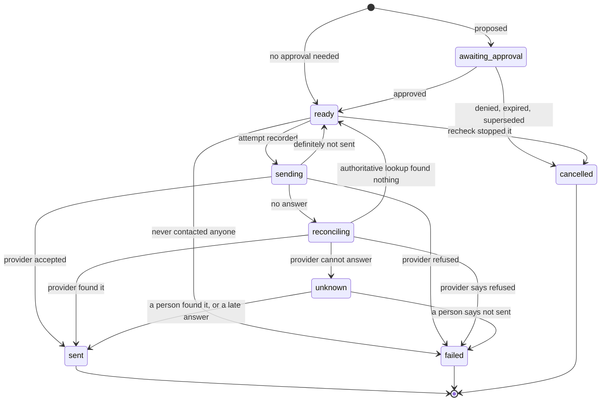
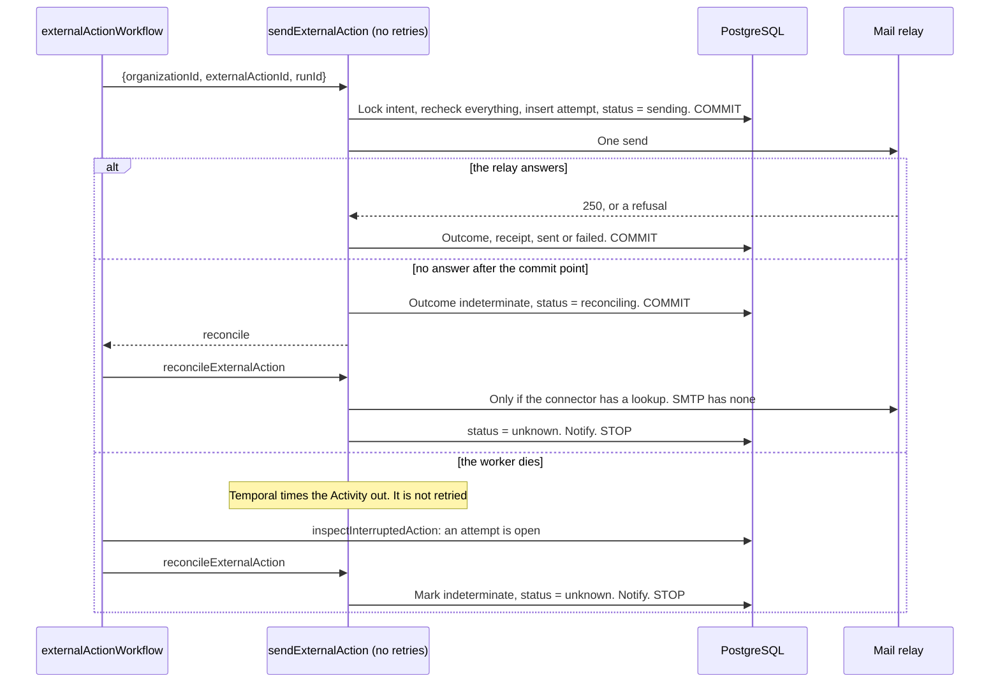
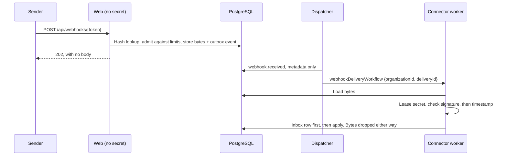
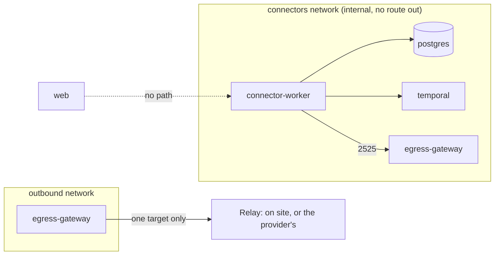

# ADR-027: Verified external actions

**Status:** Proposed. D2, D4, D5 and the use of `ensemus_app` by both tiers need outside security review before any real credential is stored, alongside ADR-024 D4 and D5. No real credential has been stored or used: every test uses generated values. The tables, triggers, types and ports exist, and the behaviour they describe is being built in M3.
**Date:** 2026-11-06
**Deciders:** Project owner; security owner for D2, D4 and D5.
**Backlog:** `WORK-08`, `CONNECT-01`, `CONNECT-02`, `CONNECT-06`. Exit: Slice 2, `QA-007`, `QA-008`, `QA-019`, `AI-TS-01`, with fault injection at timeout-after-send.

## Context

M3 is the first time Ensemus changes something it cannot take back. An email that has gone cannot be recalled, and the worst failure is not losing one but sending it twice, or telling someone it went when nobody knows.

Four facts shape everything below:

- **Temporal retries, and workers die.** An Activity can run again after a timeout, and a worker can crash between sending and recording that it sent. Exactly-once across a network does not exist, and this does not claim it.
- **SMTP has no status lookup.** After the end of a message, the only signal that the server took it is one reply. If that reply never comes, nobody on this side can find out.
- **The web tier cannot unseal** (ADR-024 D5), and verifying a webhook signature takes a secret. ADR-024 D4 and the integrations doc assumed the Route Handler verifies. It cannot.
- **The shipped stack makes zero outbound attempts** (`PLAT-16`). Sending email has to add a way out without adding one for installs that do not use it.

## Decisions

| # | Decision |
|---|---|
| **D1** | An intent is a row holding one exact effect and the hash of it, and it is immutable. Its lifecycle has an honest `unknown` state, and changing a recipient means a new intent and a new approval. |
| **D2** | The worker commits an attempt row before any byte leaves. A database trigger refuses another attempt while an earlier one could have sent. So there is at most one effect after a timeout, a crash or a replay, and if the provider cannot say what happened, the intent stays `unknown` and goes to a person. |
| **D3** | A connector is a typed object in the SDK: declared capabilities, a compare-and-swap cursor, idempotent pages, fail-closed ACL mapping, and credentials only through a lease from `SecretBroker`. |
| **D4** | The web tier stores bounded raw bytes under an opaque token and replies at once. The connector worker verifies the signature and timestamp later, and only then does anything believe it. |
| **D5** | One service holds connector credentials, on an internal network with no route out. One gateway with no secrets forwards to the one target an operator configured. Neither runs unless a connector is enabled. |
| **D6** | A person sees `sent`, `failed` and `unknown` as three different things, on whose word they rest. Only someone who answers for the work can resolve `unknown`, and that never sends anything. |

### D1. The intent and its lifecycle

`integrations.external_actions` holds the tool, its version, the target connection, the exact payload, and `request_hash`, which is `actionHash` over those. No role can update any of them: the column grants in migration 0013 stop at status fields, and a test proves `UPDATE` of the payload is refused. Approvals already work this way (`work.approvals.action`), and the intent reuses `canonicalJson` and `actionHash`, so one hash means one thing everywhere.

**An email's payload holds everything a reviewer relies on:** sender, every recipient, reply-to, subject and body. The sender is read from the connection when the intent is proposed and frozen there, so an administrator changing a connection's address cannot change what an approver already agreed to. Nothing is looked up again at send time, so a client record's address changing does not change where a mail goes.

**How QA-007 widens.** M2 narrowed `QA-007` to what existed then: a work review binds a digest and a file list, and `checkExecution` refuses a changed action at unit level, with nothing sending anything. In M3 it means what it says, over the real send path, and four things have to hold:

1. Changing recipients is `reviseExternalAction`, which writes a new intent with a new hash and a new approval. The old intent ends `cancelled` with `SUPERSEDED`, and its approval is cancelled even if it was already approved, so the old decision cannot be spent. It is refused once any attempt exists.
2. The approval and the intent carry the same hash, and the insert trigger refuses a mismatch. One approval authorizes one intent, by a unique index.
3. Just before each attempt, the worker recomputes the hash from the stored payload and compares it with the intent and the approval. A row edited behind the application's back ends `cancelled` with `PAYLOAD_CHANGED`, and the transition trigger independently refuses to move towards a send unless the approval is approved, unexpired and for this hash.
4. An approval still has one time limit. An action not attempted by the approval's `expires_at` is cancelled with `APPROVAL_EXPIRED`, not sent late.

**Why `unknown` is a state and not a flag.** It has different rules from everything around it: nothing automated may leave it towards another attempt, and the UI, the notifications and the evidence rules all treat it differently. The kernel's existing `unknown_external_state` language means the same thing.

**Restricted work cannot propose one.** Its data class denies external egress by default (`data-egress-matrix.csv`), and a per-tenant policy for it does not exist yet. The `classification` check on the table leaves `restricted` out, so this holds even if a service forgets.

**Rejected: mutable payload plus a version.** Editing in place and re-hashing makes "what was approved" a question about history rather than a fact on a row. **Rejected: approval only, no intent row.** An approval records a decision, and the effect needs its own record, retries and receipts. Manual sends with no approval would have nowhere to live, and M4's agents need this table anyway.

### D2. The effect boundary

**What "at most one" rests on.** An attempt row is a claim. It is committed before the connector opens a socket, in the same transaction as the move to `sending`, and it stays open (`outcome` null) until something knows what happened. The `check_new_attempt` trigger locks the intent and refuses a new attempt unless the intent is `ready` and every earlier attempt is `not_sent`. No code path can get round this, including a bug in this codebase, because it is below the application.

**Each layer on its own stops a duplicate, and they fail differently:**

| Layer | What it stops | If it were missing |
|---|---|---|
| The send Activity has `maximumAttempts: 1` | Temporal retrying blind | The trigger still refuses the second attempt, and a retry reconciles instead |
| `beginAttempt` commits before contact | A crash leaving no trace of a possible send | Nothing else records intent, so this one has no substitute |
| `check_new_attempt` trigger and its row lock | A retry, a zombie Activity, two workers, or a bug | A bug could send twice. This is the last line and it is in reviewed SQL |
| Replay from history | A workflow re-executing a completed send | Temporal's model: replay never re-runs an Activity |
| The dispatcher's `REJECT_DUPLICATE` | An outbox event delivered again starting a second run | The trigger still holds |

**The recheck.** Under the intent's lock, just before the attempt: the status is `ready`, the approval is approved, unexpired and for this hash, the recomputed hash matches, the Work Unit is not stopped, and the connection is active. This is ADR-024's "every side effect rechecks PostgreSQL immediately beforehand" (`SEC-06`), which is why a stop works before its signal arrives. It runs in `beginAttempt`, and `checkBeforeSend` is the pure rule.

**The commit point.** A connector reports one of four outcomes: `accepted`, `rejected`, `not_sent` and `indeterminate`. Only `not_sent` allows another attempt, and a connector has to say so on purpose: it throws `NotSent` or returns it. Any other error and the deadline passing count as `indeterminate`, so a connector that forgets to think about this cannot cause a second send. For SMTP the commit point is the first byte of the terminating `CRLF . CRLF`. Before it, a timeout or refused connection means nothing was accepted, and up to `MAX_SEND_ATTEMPTS` (5) tries with a durable timer between them are allowed. After it, silence is `indeterminate`.

**How email reconciles, plainly: it does not.** SMTP has no way to ask whether a message was taken. `reconcile` returns `cannot_answer`, the manifest declares `reconcile: 'none'`, and a timeout after the terminator always ends in `unknown`. We do not read the relay's log, an IMAP Sent folder or the bounce stream in M3, and we do not guess. What a person gets instead is the Message-ID: it is derived from the intent as `<{id}@{domain}>`, so it is the same on every attempt, it is on the receipt, and someone can search the relay's log for it. If the same Message-ID ever did go twice, some receivers would drop the repeat, but nothing here relies on that.

The cost is a false `unknown`: a crash in the moment between the commit and the first byte is reported as unknown when nothing went. That is the right way round, because the opposite mistake sends a client two emails or tells someone an email went when it did not. A connector with a real lookup does better: `found` is `sent`, `refused` is `failed`, and `not_found` is `ready` only from a lookup declared `authoritative`. Anything else stays unknown. No connector in M3 has one, so that path is covered only by the test double.

**A late answer is believed.** A zombie Activity, one that Temporal gave up on but which finishes anyway, can record `accepted` after the intent reached `unknown`. The trigger allows `unknown → sent` when an attempt is accepted. It sends nothing, and it is true.

**Why not one Activity that sends and retries itself, or provider idempotency alone.** SMTP has none. Where a provider does offer one (`nativeIdempotency`), the same `idempotency_key` goes to it, and these rules stay anyway, because not every provider's window or semantics can be checked from here.

**What this does not cover.**

- **A database restore.** A restore to before a send loses the attempt row, and the intent goes back to `ready`. If Temporal still has the finished run, `REJECT_DUPLICATE` stops it. If Temporal was restored too, the mail can be sent again. Until `OPS-02` in M6, the runbook must keep the connector worker stopped after a restore until someone has reviewed intents that were not settled at the backup's time. This is a gap, and the code does not close it.
- **Two messages to one person, by a person.** Someone can resolve `unknown` as not sent when it did go, and ask again. The record shows who decided and why.
- **Delivery.** `sent` means the relay accepted it. A bounce later does not change the receipt in M3.
- **The relay's own behaviour.** A relay that loses a message after a 250 is outside what any of this can see.

### D3. The connector SDK

`packages/connectors` holds a TypeScript contract, not a plugin host. A connector is an object from an explicit list built at startup, so one that is not on the list does not exist. Import rules (`eslint.config.mjs`) keep it from the database, Temporal, the secrets package and any socket. What it can reach comes from its context.

- **Capabilities** are declared in a manifest of plain data, which the web tier may read: its tools, its `reconcile` level, whether it takes our idempotency key, its streams, whether it reports source permissions, its webhook scheme, and whether it needs the network at all. The conformance suite checks that a connector does what it declares and refuses what it does not.
- **Cursor protocol.** `sync_cursors` holds the provider's opaque cursor, a `generation` for compare-and-swap, and a lease. A pass takes the lease, reads a page, and commits the page and the next cursor in one transaction, if the generation still matches. A crash repeats a page, and losing the race stops the pass. A cursor stays in PostgreSQL and never crosses Temporal, because it can hold provider data. An expired cursor (`CursorExpired`) sends the stream back to a full sync.
- **Idempotent incremental sync.** Resources are unique on `(organization, connection, external ID)`, as the data model requires. A page that repeats a version already stored changes nothing. A full sync moves `full_sync_generation`, and anything it did not see has gone at the source.
- **Source ACL mapping.** Every grant the source reports is kept, with who it mapped to here. A principal nobody matches keeps its row with no target and grants nothing, and `aclStateOf` makes the resource `partial` or `unmapped`. M5's retrieval must treat anything but `mapped` as denied for what it cannot place. `domain` and `anyone` map to nothing in M3, because treating a provider's "anyone with the link" as anyone in this tenant is a decision nobody has made. Only one mapping exists: an email address to an active membership.
- **Reconcile** is defined in D2. It is read-only and retried freely.
- **Credentials** come only through `CredentialLease`, which backs on to `SecretBroker.withSecret`, in the connector worker. It lends a buffer for one call and wipes it. There is no method that returns one, as in ADR-024 D5. Application tables hold `credential_secret_id` and never a value, with a composite foreign key so that a connection cannot name another tenant's secret.

**No hosts in tenant settings.** A connection's `config` is checked against the connector's own schema and can never name a host or port. That closes SSRF from tenant settings at the source. D5 closes it again underneath.

**Rejected: an existing connector framework or MCP for this.** The integrations doc already says MCP is never automatically trusted, and M5 adds it behind the policy gateway. Nothing here needs a framework, and each one would be another component to license-review.

### D4. Webhooks

**Where verification happens: in the connector worker, after storing.** The web tier takes the bytes, and it cannot verify them, because it can seal but never unseal (ADR-024 D5). This amends ADR-024 D4 and the integrations doc, which assumed the Route Handler verifies.

| Option | Verdict |
|---|---|
| Keep webhook secrets readable by the web tier | **Rejected.** The web tier is the largest attack surface. Compromising it would yield every signing secret, and so the ability to forge any callback. It breaks a rule that does not bend |
| A worker RPC the web calls to verify | **Rejected.** A new network path from web towards the secrets, and the callback now waits on the worker, so a worker outage becomes refused or lost callbacks |
| Asymmetric signatures only | **Rejected for now.** The web tier could verify with a public key, but the providers that matter mostly use HMAC |
| **Store, reply, verify later (chosen)** | Costs some storage and means a sender cannot tell at the HTTP level that its signature failed. Nothing unverified is ever believed, and a worker outage loses nothing |

**The address** is `POST /api/webhooks/{token}`, outside `/api/v1`, because it is not a client API and takes no session. The token is 256 random bits, shown once, and only its SHA-256 is stored, so a database read yields no usable address. `integrations.webhook_endpoints` is the `webhook_routes` table ADR-024 D4 named. The lookup binds only the hash (`app.webhook_token_hash`, as invitation links do in migration 0003), which reveals that one row. The tenant is then bound from the row, so nothing about the tenant comes from the request. `withWebhookEndpointTx` is the only way the web tier gets a context with no session.

**Limits, all enforced before anything is believed:**

| Limit | Value | Where |
|---|---|---|
| Body size | Default 256 KiB per endpoint, 1 MiB hard ceiling | Declared length, then counted bytes, then a `CHECK`, and at the proxy |
| Rate | Default 120 deliveries and 16 MiB a minute, per endpoint | `integrations.admit_webhook_delivery`, one atomic update |
| Backlog | Default 256 MiB of unprocessed bytes per endpoint | The same update |
| Stored headers | An allowlist for the scheme, each cut at 1 KiB, 8 KiB in all | Application, and a `CHECK` |
| Unknown tokens | 300 a minute per address, and 3,000 a minute per replica | In memory, before any database use |
| Database use | A small pool of its own, so a flood cannot starve the product | `apps/web` |
| Time | A body nobody processed in 24 hours is dropped, and the row goes after 7 days | The tenant's upkeep Activity |

These are starting values, not measurements. `OPS-01` should test them.

**What an unauthenticated caller can make the system do:**

- **Without a token:** a 404 after one indexed lookup, the same as a disabled endpoint. Nothing is stored. Limited in memory before that.
- **With a token, and no secret:** store up to the limits above, in that one tenant, and cause one short workflow and one signature check per delivery. It ends `rejected`, the bytes go, and there is one audit row an hour per code. The caller hears 202 either way, so it learns nothing about signatures.
- **What it cannot do:** read anything, reach another tenant, trigger a send, start a sync, write the inbox, or learn whether a tenant exists.
- **The real cost:** someone with a leaked URL can fill that endpoint's window and delay genuine callbacks, which get a 429 and retry. The cure is to replace the endpoint. An unbounded form of this would be a storage attack, which is why the backlog limit exists.

**Dedupe.** `platform.inbox_events` gets its first use. The consumer is `webhook:{endpoint}`, and the event ID is derived from the endpoint and the sender's event ID, since the column is a UUID. **The row is written only after the signature passes.** Writing it earlier would let anyone use up a real event's ID in advance and silently drop it. The insert and the effects share a transaction, so a crash repeats both or neither.

There is also a cheaper check at the door. `request_digest` covers the stored headers and the body, and is unique per endpoint, so an exact repeat of a request stores nothing and answers the same 202. This is safe from the same attack, because an attacker's bytes only match if they already hold a validly signed request, and then a match does no harm.

**What replay of a valid old payload gets (QA-019):**

| Replayed | Result |
|---|---|
| The same request, while its row exists (7 days) | 202 at the door. No row, no workflow, no effect |
| A valid signature with a time outside the window (default 5 minutes) | 202, stored, then `rejected` with `TIMESTAMP_OUTSIDE_WINDOW`. Bytes dropped, no effect |
| A new request inside the window, with an event ID already applied | 202, stored, then `duplicate` from the inbox. Bytes dropped, no effect |

The HTTP answer is always 202, because the web tier cannot know. An operator sees the outcome on the delivery row.

**The scheme.** `ensemus_hmac_sha256_v1`: HMAC-SHA-256 over `{timestamp}.{event id}.{raw body}`, compared in constant time, on the bytes as stored. The signature covers the time and the ID, so neither can be changed separately. Two secrets can be valid during a rotation.

**What a verified delivery can do.** It is still a request. `action_proposed` becomes an intent that needs a person's approval, on a Work Unit and connection in the endpoint's tenant, and `sync_requested` only reads. No webhook can send anything by itself. `inbound_webhook` is a real connector, the generic signed callback for a customer's own systems, and it is what Slice 2 runs on, so no test double ships in an image.

**During a restore,** ingress goes through the serving gate (ADR-026) and answers 503, so a sender retries instead of writing into a tenant that is being put back.

### D5. Network

**The rule: one service has credentials, and it has no route out. One service has a route out, and it has no credentials.**

- **`connector-worker`** runs from the worker image, polls only `ensemus-connectors`, and is on the `connectors` network alone, which is `internal: true`. Docker gives it no default route, so it cannot reach anything but PostgreSQL, Temporal and the gateway, whatever is in a connector, a dependency or a webhook body. It holds the app and secrets database URLs, the private sealing key and the codec key. All parsing of what strangers send happens here.
- **`egress-gateway`** runs from the same image, with no new image and no new license to review. It is a byte-for-byte TCP forwarder from one internal port to one `host:port` from the operator's setting. It holds no secret, reaches no database, and is on `connectors` and `outbound`. TLS is end to end through it, and the connector checks the relay's name, so the gateway sees only ciphertext. Taking it over gets an attacker that one target.
- **Both run only under the `connectors` compose profile.** With no profile they are not there, and the shipped stack is what `PLAT-16` already proves, plus one internal network with no way out. The web tier refuses to create a connection and answers 404 on the webhook route unless `ENSEMUS_CONNECTORS_ENABLED` is true, so no row can wait for a worker that is not coming. The connector is clearly unavailable, not silently simulated, as the integrations doc requires.
- **Every new name is pinned,** as d5eb550 did, with addresses `${PREFIX}.5.x` on `connectors` and `${PREFIX}.6.x` on `outbound`, so an outage sends no lookup off the network. `tests/stack/platform.test.ts` covers them.
- **Sovereign reaches only an on-site relay.** The gateway's target is that relay, given as an address or a name the site's resolver answers, and the site's firewall limits `outbound` to it. An air-gapped install with no relay runs no profile and makes no attempt.

**The air-gap gate** keeps its existing round unchanged, with zero attempts and no profile. It gains a round with the profile on and the sink as the relay, inside the counted subnet, which sends mail and must still count zero packets leaving. That proves the path reaches the relay and nothing else. It does not prove a real provider works, and no real provider has been used.

**Why a separate worker and not the main one.** The main worker has the object store and every Temporal task. Giving it a route out for email means giving that route to everything it holds. Compose cannot express a route for one Activity.

**Why not a forward proxy with an allowlist.** That means a new component to license, patch and configure, for one target. **Why not `socat`.** It is GPL, and not already in what ships (only in the test overlay). **Why no SMTP library.** D2 needs to know exactly when the terminator was written, a library hides that, and a dependency needs review for this one call. The email slice writes a small client, and the outside review should read it. No custom cryptography: TLS is Node's.

**Cost.** One more long-running worker and a small gateway, when enabled. Not yet measured. Postgres and Temporal gain one network each, which is otherwise idle.

### D6. Receipts and who resolves

| The person sees | It means | On whose word | What they can do |
|---|---|---|---|
| **Sent** | "Your mail server accepted this." With the time and Message-ID. It says plainly that this is not delivery to an inbox | The provider, or reconciliation | Nothing is needed |
| **Sent: confirmed by {name}** | Someone looked and said it went. Their reason is shown | That person | Nothing is needed |
| **Not sent** | "This was not sent", with the reason in words and the provider's code if there was one | The provider, or Ensemus knowing it never got that far | Ask again, which needs a new approval |
| **Not sent: confirmed by {name}** | Someone looked and said it did not go | That person | Ask again, which needs a new approval |
| **We don't know whether this was sent** | The attempt could have gone through, and the provider cannot say. It says what to do: search the relay's log for this Message-ID, then say what you found | Nobody yet | Authorized people say what they found. **There is no send button here** |

Copy says "your mail server", not "the provider", as the experience doc asks for words that need no architecture. `unknown` is never shown as a kind of failure or a kind of success, and a page cannot be built that reads it as either: the status is one enum, and the receipts carry their basis.

**Who may resolve `unknown`.** `canManageWork`: the accountable owner, and organization owners and admins who can see the work. Someone only assigned can see it but not resolve it. Restricted work is excluded by D1, and being an organization admin is no way into anything else they cannot read. A service cannot, and a model or agent cannot in M4, because `resolveUnknownExternalAction` refuses a service context, and the trigger requires a named person for the move. A reason is required. It is kept with the intent under the Work Unit's access rules, and is never in events, the audit log or Temporal.

**What happens next.** An unknown intent tells the accountable owner and the requester at once, by the inbox. Saying "not sent" ends it `failed`. Asking again is a new intent, with `retry_of_id` pointing back, which needs its own approval, even from the same person a minute later.

**Evidence.** An `external_receipt` criterion counts `sent` actions with a provider, reconciliation or person receipt. A person's word counting as evidence is a deliberate choice: otherwise a real send that timed out could never complete its work. It is recorded as that person's word, and the page shows it. The owner can overrule this (see below).

Work may ask for that criterion only if its tenant has an active connection that can act. M2 refused the criterion because nothing could ever satisfy it, and the rule stays true as written: with no such connection it is refused the same way. A connection revoked afterwards leaves that work needing a person to take the criterion away or connect again, which is honest, and the page has to say so.

**Empty and denied states** follow what exists: someone who cannot read the work gets not found, as everywhere else.

## Trade-offs

- **The main cost is false unknowns.** Every timeout after the commit point takes a person's time. There is no way to know how often without a real relay, so measure it when one exists.
- **Web and worker share `ensemus_app`, so the transition rules are in triggers, not role grants.** A compromised web tier cannot unseal anything or send anything, but it could write an attempt's outcome or a person's resolution under a forged membership, so the audit trail is only as good as that role's exposure. A separate worker role would close this, and would touch provisioning and every worker. **The outside review should decide.**
- **A connection's secret is in the worker, and a webhook body is parsed in the same process.** They share a process because the verification needs the secret. An exploit in that parser reaches credentials, though it still has no route out. That is why there is one small schema for inbound bodies, and it runs after the signature.
- **A sender cannot tell at HTTP level that its signature failed.** This is a real loss for whoever sets up an integration, and the connection's page has to show it instead.
- **A dead Temporal holds things.** Sends wait in `ready`, deliveries wait as `received`. Nothing is lost, and the bounds above apply.

## Consequences

**Easier:** reasoning about duplicates, because the rule is in one place, a test can break every layer above it, and it still holds. M4's tool gateway inherits the intent and only adds policy in front. M5's connectors inherit the SDK.

**Harder:** the hand-written SMTP client and triggers are security-relevant code to review. Every new connector needs a conformance pass. Operators have a person-shaped queue to watch (`unknown`), and have to run a second worker.

**Mode impact:** the same images and code in Cloud, BYOM and Sovereign. Only the gateway's target differs. All three behave the same with no profile: no connector, no outbound attempt.

**Migration:** `0012` and `0013` add one schema. No existing table changes. No Temporal history changes: the new workflows are in their own files and new histories join the corpus.

## Open questions for the owner

1. Does a person's confirmation count as `external_receipt` evidence? This ADR says yes, shown as their word.
2. Should the worker get its own database role, to end the shared role above?
3. Is a connector worker that holds the sealing key acceptable, given the main worker holds it today and nothing there uses it? It could be removed from the main worker once this lands, which would shrink what that one holds.
4. The runbook says "Email arrives with M3" of notifications. M3's email is the outbound action path, and sending approval notifications by email is not in its tickets, and has its own consent questions. The stack slice corrects the runbook, unless you want it added.

## Reversal

Remove the `connectors` profile from a deployment and nothing goes out. Unsent intents stay `ready` and sends stop being attempted. Dropping the schema is safe until something real depends on it. D1 and D2 become expensive to change once real receipts exist, and those should be reviewed first.

## Approvals

| Role | Name | Decision | Date |
|---|---|---|---|
| Project owner | | | |
| Security owner (D2, D4, D5) | | | |
