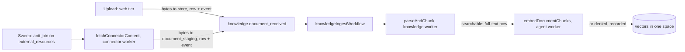

# ADR-029: Company knowledge

**Status:** Proposed. D2, D3, D5 and D11 need outside security review before any real document, credential or provider is used, alongside ADR-024 D4/D5 and ADR-027 D2/D4/D5. No real credential, document or provider has been used: every test uses generated values and local fakes. The tables, triggers, types and ports exist. The behaviour they describe is being built in M5.
**Date:** 2026-11-06
**Deciders:** Project owner; security owner for D2, D3, D5 and D11.
**Backlog:** `KNOW-01` to `KNOW-06`, `MODEL-05`, `AGENT-07`, `AGENT-10`, `AGENT-11`, `AGENT-12`, `CONNECT-03` to `CONNECT-05`, `SEC-03`, `UX-18`, `UX-22`. Exit: Slice 4, Gate D, pgvector recall measured under ACLs.

## Context

M5 puts a company's documents behind a search box and a model. The worst failure is showing someone a passage they may not read, because it is invisible when it happens and it cannot be taken back. The next worst is a model's guess becoming something the company treats as true.

Five facts shape everything below:

- **Web and workers share `ensemus_app`** (ADR-027). A role cannot tell them apart, so the rules live where a query cannot get round them.
- **The web tier has no model path, cannot unseal, and has no route out** (ADR-024). So it cannot embed a question.
- **A connector's permissions change at the provider.** M3 already keeps them, live, in `integrations.external_resource_acl`, and a sync's commit is when they change here.
- **The connector worker reaches PostgreSQL, Temporal and a gateway, and nothing else** (ADR-027 D5). It cannot reach the object store, and it holds credentials, so it must not parse what it fetches.
- **ADR-026 keeps a deletion true across a restore,** and said knowledge sources would need their own type and re-apply step.

## Decisions

| # | Decision |
|---|---|
| **D1** | A source is one thing a person can be granted, with no name on it. A document is one version of it. A sweep finds connector content by anti-join, so nothing has to be told. |
| **D2** | One SQL function defines who may read a source. Row-level security applies it to every table holding a document's words, and every query names it as well. Being an owner or admin grants nothing. |
| **D3** | Closing a source stops serving in that commit, never reverses, and writes an ADR-026 tombstone. A workflow removes what was derived, and a job row reports completion. A trigger refuses anything derived arriving afterwards. |
| **D4** | Parsing runs in its own worker with no credential and no route out, on text formats only, with no new dependency. PDF and Word are refused plainly, for now. No virus scanner is claimed. |
| **D5** | Model calls go through a small port that M4's router implements. Company search is lexical and synchronous in the web tier. Hybrid retrieval and answers run in a worker, as the person who asked. |
| **D6** | Embedding spaces are kept apart by a foreign key and a check. Vector search is exact over authorized rows. An approximate index waits for the recall script. |
| **D7** | A fact needs evidence to exist, and a person to be verified. Reading one takes every source behind it. The graph reads structure live from the tables. |
| **D8** | There is no retrieval cache in M5. |
| **D9** | The egress ledger joins knowledge's own append-only rows to M4's run decisions. The simulator is pure, and can transmit nothing. |
| **D10** | Anything a sibling milestone owns is a small port here, wired at the final merge, failing closed until then. |
| **D11** | Google and Microsoft follow M3's SDK, reaching fixed hosts by named route through one gateway each. An MCP server's words are data, and only a named admin confers anything. |
| **D12** | A person accepts exactly these bytes, once a machine has checked each citation. The flagship is deal won to client onboarding, on the existing kernel. |

### D1. The model

| Table | Holds | Who reads it |
|---|---|---|
| `knowledge.sources` | IDs, kind, class, state, owner. **No name** | The tenant |
| `knowledge.source_grants` | Who may read an upload | The tenant |
| `knowledge.documents` | One version: title, hash, states, freshness, URL | Through the ACL |
| `knowledge.chunks`, `embeddings` | Passages and vectors | Through the ACL |
| `knowledge.document_staging` | A connector's bytes in transit | Service only |
| `knowledge.facts`, `fact_evidence`, `edges` | D7 | Through every source behind it |
| `knowledge.answers`, `answer_sources`, `answer_citations` | D5 | The asker, through every source behind it |
| `knowledge.evidence_packages`, `evidence_items`, `model_calls`, `artifact_verifications` | IDs, hashes, codes. Append-only | The tenant, limited by capability in services |

**A source has no name so that a tenant-wide read reveals nothing.** Titles are on `documents`, under the ACL. A manager sees that a source exists, its class and who owns it, and can revoke it without being able to read it. This goes further than M2, where an admin can read confidential work. `integrations.external_resources.display_name` is M3's, and tenant-readable at the table: M3's services limit it to `connection.manage`. The outside review should look at that column.

**Discovering connector content by sweep, and why not a hook into M3.** A per-tenant Temporal Schedule runs `knowledgeSweepWorkflow` every 15 minutes. It finds resources with no document at their current version, fetches them, and closes sources whose resource or connection has gone.

| Option | Verdict |
|---|---|
| M3's sync workflow calls M5 | **Rejected.** A changed workflow needs a replay patch, on a branch being merged in parallel, and a lost call is a permanent miss |
| A trigger on `external_resources` writes events | **Rejected.** One event per row of a page, and business logic hidden in a trigger with no way to rebuild |
| **An anti-join on a schedule (chosen)** | Costs up to 15 minutes before new content is searchable. It heals itself, and it rebuilds everything derived after a restore, which 04-memory-and-knowledge requires. Security does not wait for it: see D2 |

**A document becomes searchable in full text before any model is involved,** so a deployment with no approved model, and Sovereign, still has search. `embedding_state` says how vectors got on, separately. The current version is the one with `superseded_at` null, and a partial unique index allows one.

**Text search uses `english`,** as `schema.sql` does. Other languages tokenize but do not stem. A per-tenant language means a stored `regconfig` and a re-index, and is left until someone needs it.

### D2. Access

**The one definition is `knowledge.readable_source_ids(membership)`,** in reviewed SQL. A source is readable when it is `active`, the membership is active, and:

- For an upload: a grant names that person, or a team they are directly in (not for `restricted`), or the organization (only for `public` and `internal`).
- For a connector's source: the resource has not gone, its connection is `active`, it is not `unmapped`, and an `external_resource_acl` row names that person, or a team they are in (not for `restricted`).

**It is applied twice, in the query.** Row-level security on `documents`, `chunks` and `embeddings` applies it to every SELECT, so a query that forgets gets nothing it should not have. Retrieval names it again in its own SQL, so the planner can use it and a dropped policy would not fail open. Nothing is ever filtered afterwards, and nothing reaches a reranker or a model first.

**`withTenantTx` now binds `app.membership_id` and `app.actor_type`** in the same statement as the rest, which is one fewer round trip than before. `knowledge.is_service_actor()` needs `actor_type = 'service'` and no membership. A transaction with neither, such as a webhook's context, reads no document at all.

**Who is who.** A person is `user`. A worker doing something for a person is `delegated`, from `createDelegatedContext`, which re-reads the membership and requires it active, and has exactly their reach. M4's `agent` context behaves the same. A bare `service` context skips the ACL, because the ingest and purge workers need it, and lint keeps `@ensemus/database/service` from the web tier. **Search, retrieval, compiling and graph traversal all refuse a service context,** because nothing should ever read everything on someone's behalf.

**This is defence in depth over the same shared role.** A compromised web tier can set these settings: it holds `ensemus_app`, and RLS binds what it is told. That is ADR-027's trade-off, and it is the first thing the outside review should weigh. Narrower policies do stop it writing passages as a person, and stop every bug that forgets a filter.

**Revocation has no lag and no projection,** because a connector's permissions are read from M3's own row. When a sync commits a dropped grant, the next query sees it. Nothing here copies them, so nothing can be stale. Teams are direct membership only: a grant to a team does not reach teams nested inside it. That is the narrow reading, and the owner can widen it (question 3).

**What `partial` and `unmapped` mean,** as ADR-027 D3 left open: a grant that maps to nobody has no target and matches nobody, so `partial` serves those it could place, and `unmapped` serves no one. `domain` and `anyone` map to nothing. So "anyone in the company with the link" reads nothing here until the owner decides otherwise (question 4).

**Rejected: filtering results in the application.** It fails open on a bug, it leaks through counts and timing, and pgvector's approximate indexes lose recall under selective post-filters, which 04-memory-and-knowledge warns about. **Rejected: copying ACLs into `source_grants`.** A copy is a window in which a revoke has not arrived.

### D3. Closing a source, and purge

A source moves `active` → `revoked` or `deleted`, and `revoked` → `deleted`, and never back. A trigger holds this. A re-added document is a new source with a new ID.

In one transaction: the state, a `platform.tombstones` row of type `knowledge_source`, a `purge_jobs` row, `tombstone.recorded` for the ledger, and `knowledge.source_closed`. **Serving has stopped when that commits.** Then `knowledgePurgeWorkflow` removes, in order: answers that used it, its evidence, passages and vectors, staged bytes, document rows, and the stored bytes, checking they have gone. It counts each, marks the job `completed`, and emits `knowledge.purge_completed`. That is Gate D's "eventually purge and report completion".

**A fact with other evidence** becomes `disputed`, with `conflict_ref` naming the closed source, because it was verified on grounds that have changed, and a person has to look again. Nothing returns to `proposed`. One with no evidence left is deleted, because its words came from what was removed.

**A worker that started earlier cannot undo this.** Every insert into `documents`, `chunks` and `embeddings` takes a share lock on the source and is refused unless it is `active`. So a revoke either waits for an ingest transaction, whose rows the purge then removes, or that ingest finds it closed.

**Restore (ADR-026, `QA-025`).** `knowledge_source` joins the ledger's target types, so a tombstone reaches the store through the same dispatcher path, and the gate closes a tenant whose database is behind. `reapplyTombstoneLedger` dispatches by type to `reapplyKnowledgeSourceEntry`, which puts back the tombstone, closes the source and lets the purge run. **An entry is not proof of a deletion** (ADR-026 D3), so a source whose documents and bytes all survive is `unconfirmed`, and waits for an operator, like a whole file. Derived data after a restore is rebuilt by the sweep, and the ACL rows are M3's, restored with them.

**What this does not cover.**

- **A model already has what it was sent.** A provider's retention is the provider's. Egress policy (D5) is what limits this, and a revoke cannot reach it.
- **M4's transcripts.** `ai.step_payloads` can hold passages, and only `ensemus_agent` can reach it. So the purge workflow first runs `purgeRunTranscripts` on M4's queue, which finds runs through `evidence_packages` and asks M4 to remove them through a port. With no agent worker there, it carries on and the job says so. M4 purges at run end by default, so this is a short window.
- **Backups.** A dump still holds deleted passages until it expires. `LIFE-02`.
- **A person's memory, or a copy they made.**
- **Removing one person's access** is not a purge. Reads stop at once, and the source stays. Answers they already had stop being readable by them, by RLS, and are deleted only if the source closes.

### D4. Parsing

**Where.** A new process, `knowledge-worker`, polls `ensemus-knowledge`, and holds only the app database URL, the object-store keys and the codec key. No secrets role, no sealing key, no route out. Each parse runs in a worker thread with a memory limit and a deadline. The connector worker fetches and stages bytes in `knowledge.document_staging`, and never parses them, since it holds the credential.

**Why a staging table.** The connector worker has no path to the object store (ADR-027 D5). Adding one would give the process holding credentials a path to every tenant's files. Staging costs some bloat, bounded at 25 MiB per row, and the row goes as soon as the bytes have moved.

**What is accepted: `text/plain`, `text/markdown`, `text/csv`, `text/html`, `application/json`.** Google Docs export to one of those.

**PDF and Word are refused with `UNSUPPORTED_FORMAT`, plainly, on the page.** This is the biggest gap in M5, since most company documents are one or the other. Adopting a parser is a real decision: `pdfjs-dist` is large, `mammoth` brings a zip parser, both take untrusted bytes, and each needs a license review and a sandbox decision. It is left to the owner (question 1), and the parser sits behind one function so that it can be added without touching anything else.

**A secret scan runs on every document,** through a port M4's `scanForSecrets` implements. A hit raises the class, which normally stops it being embedded. A raised document raises its source, through a trigger. It is an extra signal and never the boundary.

**No virus scanner ships.** `scan_state` says `not_scanned`, and the page says so. Nothing is executed or rendered: output is text, and it is never rendered as HTML. Whether a pilot needs one is the owner's decision (question 2).

### D5. Models

**The port is `KnowledgeModelPort`:** `route`, `embed`, `rerank`, `answer`. M4's router implements it at the final merge, so the same egress policy, key handling, budgets and kill switch apply, and no second path to a model exists. `route` contacts nobody and unseals nothing, so a deny is free. It is asked first, with the strongest class of everything that would go, and a deny writes a `model_calls` row, so `QA-011` is enforced before any text moves.

**The web tier cannot embed a question.** So:

| Surface | Where | How |
|---|---|---|
| Company search, `/knowledge/search` | Web, synchronous | Full text only, under the ACL. No model and no egress |
| Cited answers, agents' context | Worker, asynchronous | Hybrid: the question is embedded and fused |

**Answers.** `askQuestion` writes a row and an event. `knowledgeAnswerWorkflow` runs one Activity on M4's queue, `ensemus-agent`, using two contexts: `service` for the row, and `delegated` as the asker for all retrieval. So someone who lost access while waiting gets `no_evidence`. Only an ID crosses Temporal. No evidence means no model call. An answer whose citations fail `checkCitations` is stored as `refused` and its text is discarded: a model's words do not reach a person unless each cited key was one it was given. A read is limited by RLS to the asker, while every source that went in stays readable by them.

**A model's output is data.** Prompts use structured roles, with fixed system text, and each passage in its own `evidence` message, so a poisoned document stays evidence (05-context-compiler, `FAULT-08`).

**Restricted stays denied by default,** as `data-egress-matrix.csv` says. A restricted document is searchable in full text by those it was granted to, is not embedded, and cannot reach a model that policy has not approved for it.

**Queue name.** `KNOWLEDGE_MODEL_TASK_QUEUE` is `ensemus-agent`, M4 FD-2's queue. With no agent worker, ingest ends `model_worker_absent` through `scheduleToStartTimeout`, the document stays lexically searchable, and an answer fails with `MODEL_UNAVAILABLE`. A missing model is honest, and it never falls back.

### D6. Embeddings

**A space is one model at one dimension and version.** `embeddings` has a composite foreign key to `(space, dimension)` and a check that `vector_dims(embedding) = dimension`, so storing a wrong-sized vector is impossible (`QA-017`). A query names one space, and a partial unique index allows one active space per tenant. Changing model means a new space and a re-embed, while old vectors are retired. Search falls back to lexical for what is not yet in the new one.

**No approximate index yet.** ADR-024 made this a spike for Slice 4, and `schema.sql` deliberately adds no shared HNSW. Search is exact, `ORDER BY embedding <=> $1` inside the authorized set, which has perfect recall by construction and a cost that grows with what a person can read. The script `tests/measure/knowledge-recall.measure.ts` measures exact against HNSW with iterative scan, at several ACL selectivities and tenant sizes, on generated vectors in a scratch database. **It has not run, and M5's exit needs it to.** An index is added only with a measurement behind it, in its own migration, as the owner decides.

**pgvector is `CREATE EXTENSION`-ed by the superuser in `provision.sql`,** where it has been since M0. The migrator cannot create it, and migration 0200 fails with a clear message if it is missing. `public` is closed by provisioning, so 0201 grants `ensemus_app` usage on it, for the type and operators.

### D7. Facts and the graph

**A fact cannot exist without evidence:** a deferred constraint trigger refuses one at commit. Evidence has to be a real passage whose hash matches, that the writer can read (RLS on `chunks` is what checks that), with a quote that fits. That stops invented citations at the door.

**Only a person, as themselves, makes one `verified`.** The trigger requires `actor_type = 'user'`, a reviewer equal to the current membership, a reviewer who is not the proposer, and evidence on sources still active. A model, an agent, a delegated context and a service context all fail, whatever the code does (`SEC-009`, Gate C). The claim, subject and proposer have no update grant, so what was verified stays what was verified.

**A conflict lands as `disputed`,** with `conflict_ref` naming the authoritative record, and stays there until a person reviews it (`QA-016`). The compiler offers only unexpired `verified` facts as trusted, and marks them as such.

**Reading a fact takes every source behind it,** because a claim can say something about each. The policy's subquery reads `fact_evidence` unfiltered on purpose: if that table were filtered by the same ACL, an unreadable source would vanish from the subquery and the fact would look fine. Evidence rows hold IDs, offsets and hashes, and no words.

**The graph reads structure live.** The view `knowledge.graph_links` (`security_invoker`) unions projects, work, assignments and teams from their own tables with `knowledge.edges`, which holds only what the tables do not. So it cannot go stale and needs no rebuild. A traversal is a recursive query with fixed depth and size limits, which **refuses to walk through a node the viewer cannot see**, so a link cannot reveal what lies past it. `knowledge.can_read_work` is `canReadWork` in SQL, and a test holds them together. A polymorphic ID has no foreign key, so a trigger checks each end exists in this tenant.

**Consolidation** (proposing merges and expiry on a schedule) is in the spec and not in M5's tickets. Left out.

### D8. No retrieval cache

05-context-compiler allows a cache keyed by tenant, ACL version, source versions, class and query. **M5 has none.** `acl_revision` exists for one, but a connector's ACL changes in M3's tables without touching it, and the first cache would have to solve that. Exact search under the ACL is what is being measured, and adding a cache before that measurement would hide the number. Next.js's data cache stays off for these routes, and `SEC-03`'s regression test holds that: `NEXT-03` proves no stale read across replicas. Reconsider after `OPS-01`.

### D9. Egress ledger and simulator

**AGENT-10.** `knowledge.model_calls` is append-only, and records each decision to send company text for knowledge work, allowed or denied: purpose, class, profile, host, reason code, policy version, and a hash of what would go, with no text. M4 keeps `governance.egress_decisions` for run-bound calls, and embedding a document has no run. `listEgressLedger` merges the two behind one row shape, with a stable cursor. M4's table does allow a null run, so this table could stop being written at the final merge, without loss. It stays separate for now because this branch cannot see M4's table, and because a builder here must be able to test the ledger.

**AGENT-11.** `simulateEgress` is a pure function over a proposal, a list of workloads and M4's `decideEgress`. Its module imports no network, port or credential, and lint holds that. A policy that throws reads as `wouldTransmit: false`, because a simulator that overstates safety is worse than none. It stores nothing.

### D10. What siblings own

| Port (`packages/application/src/knowledge/ports.ts`, `packages/knowledge/src/ports.ts`) | Implemented by | Until then |
|---|---|---|
| `KnowledgeModelPort` | M4's router and adapters | No model call happens, and full text works |
| `ContentScanPort` | M4's `@ensemus/policy` `scanForSecrets` | Ingest stops: a missing scan must not read as a clean one |
| `EgressPolicyPort` | M4's `decideEgress` | Simulator reads nothing as allowed |
| `RunEgressDecisions` | M4's `governance.egress_decisions` | Ledger shows knowledge's rows only |
| `AgentWorkloads` | M4's published versions | Simulator lists knowledge's workloads only |
| `RunTranscriptPurge` | M4's `ai.step_payloads`, on its queue | Runs nowhere: no agent worker means no transcript to remove |
| `AgentRuns` | M4's run service | Flagship cannot start its brief |
| `ExternalActionGateway` and connector SDK | M3, already typed on this branch | |

Each has a double in `tests/helpers/knowledge.ts` or `@ensemus/knowledge/testing`. Lint keeps the latter out of `apps/` and `workers/`.

**What M4's foundation (`75ca603`) means for the merge.** It landed while this was written, and was read, not merged. Four gaps need a decision by whoever wires `KnowledgeModelPort`:

- **`MODEL_PURPOSES` has no `embed` or `rerank`,** and `EGRESS_DESTINATIONS` has no `embedding_reranker` column, though `data-egress-matrix.csv` does. `MODEL-05` needs both, and without them every embedding is denied, which is safe. Add them to `@ensemus/domain/ai`, and to the matrix `decideEgress` reads.
- **`ModelAdapter` has only `generate`.** Embedding needs an `embed` method, and the fake model an endpoint for it.
- **`InferenceGateway.turn` and `ModelRouter.select` take a run.** An embedding and a person's question have none. Either the gateway gets an entry point for work with no run, keeping FD-8's order, or each answer becomes a run of a built-in agent. The first is simpler, and it is the recommendation.
- **M4 lints `@ensemus/database/service` away from its agent worker's files** (FD-3). `knowledge-embed-activities.ts` runs there and uses a service context, for knowledge's own rows and no Work Unit. It is not in M4's list, and that is deliberate. The outside review should look at it, since it puts a tenant-wide read of passages in the process that can reach a model.

M4's `egress_decisions` allows a null run, and only `ensemus_agent` writes it, so `knowledge.model_calls` could merge into it (question 10). M4's `createAgentContext` has `actorType: 'agent'`, which row-level security here reads through the membership, as intended, and the fact trigger refuses. `withTenantTx` on M4's branch still binds two settings, so the merge keeps this branch's version of that function.

### D11. Connectors

**Same SDK.** Google Workspace and Microsoft 365 are `SyncConnector`s, with `aclMapping: true`, plus `ContentConnector`, in a new file so that M3's contract does not change.

**A gateway has one target, and these providers have several hosts.** ADR-027 D5 stays true by having one gateway per host, each from the same image, each with no secret: `google_api`, `google_oauth`, `ms_graph`, `ms_login`, `mcp_server`. A connector names a **route**, a fixed enum, and the TLS name for each is in code, so a misconfigured gateway cannot get a token sent elsewhere. There is no way to name a host from tenant settings. Certificates are always checked, and no redirect is followed, so a provider's answer cannot send a token elsewhere either. Sovereign runs none of them.

**OAuth credentials** are sealed JSON, leased for one pass, and the access token lives in memory for that pass. There is no consent-screen flow in M5: it needs registered OAuth clients, which the owner has to create, and which do not exist. An admin's refresh token arrives through the existing sealed credential field. No real one has been used.

**Scope mapping.** A stream needs named scopes, a connection records what was granted, and a stream without them is refused with a code, so an admin can see why. **Source revoke** is D2's live read, plus the sweep closing sources for what has gone.

**MCP.** Everything an MCP server says about its tools is untrusted: names, descriptions, annotations, schemas. `integrations.mcp_tools` keeps it as data. A tool starts `pending_review`. A named admin sets its side-effect level and classes themselves, and **no annotation is read to choose them**. A changed definition loses its approval in the same statement, through a trigger. M4's gateway calls `loadCallableMcpTool` first. `read_only` runs through the gateway. `external_write` has to become an M3 external action, so it gets approval and a receipt. Tool descriptions never enter a prompt unreviewed.

**Rejected: the MCP SDK for this.** M5 uses one request type each way, over a path that has to go through the gateway, and the SDK brings its own transports. A small client is less to review. Re-check when `CONNECT-03` is built, against the current protocol revision.

### D12. Acceptance, and the flagship

**AGENT-07.** A produced artifact records its citations. A worker checks each still resolves at its hash and appends a `grounding` record. A person can then accept **these exact bytes** against **this exact objective**, and a trigger refuses an acceptance with no passed check for that hash. Records are append-only, and have no foreign key to the file, so they outlive a deleted one. A model cannot accept anything.

**AGENT-12.** The owner has not chosen, and the plan recommends deal won to client onboarding. This builds that, as a safe default that can be replaced. A person (or a verified webhook, later) names a deal. In one transaction: the client, the project, a parent Work Unit with three children (a cited brief, a person's review of it, one welcome email). An M4 agent drafts the brief from the deal's documents, a person accepts it, an M3 intent proposes the email, the reviewer approves exactly what is shown, and a receipt comes back. `client_onboardings` keeps one per deal. Cost comes from M4's ledger, labelled an estimate. An `unknown` email leaves the onboarding `unknown`, for a person.

**The workflow decides nothing.** It calls `advanceOnboarding` and waits on a durable timer, so a change in the steps needs no patch. It joins the replay corpus anyway.

## Trade-offs

- **A shared role, again.** RLS on a shared role is bug-proofing and not a boundary against a compromised web tier. A separate knowledge-worker role would make `chunks` unwritable from web. It needs the same provisioning work as M4's `ensemus_agent`, and could be the same change. The outside review should decide.
- **Exact search costs more as tenants grow.** Accepted until measured. The cost is latency, and never a wrong result.
- **Two table scans of ACL per query.** A hashed subplan per query, not per row. Not measured. `OPS-01` should.
- **A manager cannot read what they manage.** They can revoke a source they cannot read. That is the point, and it will surprise someone.
- **Text formats only.** A pilot company will have PDFs. See question 1.
- **Up to 15 minutes for new connector content.** Revocation does not wait.
- **A source's class rises by itself** when a scan hits, and that can take a document away from a team that had it. It is the right way round.

## Consequences

**Easier:** a builder cannot forget the ACL, since the row-level policy holds it. M4's compiler gets a real one at the final merge. A restore rebuilds derived data without special steps.

**Harder:** three workers now touch knowledge, on three queues. Every query on these tables needs the membership bound, so a test has to use real contexts. Reviewed SQL holds a lot of logic and needs a careful read: 0201 is on the owner's read-yourself list.

**Mode impact:** the same code in Cloud, BYOM and Sovereign. Sovereign runs no connector, and embeds only if a local model is approved. Without one it still has full-text search, and answers say why not. No external embedding provider is ever required.

**Migration:** `0200` adds the schema and two tables in existing ones, and `0201` is reviewed security SQL. They add three GIN indexes on existing tables' names. `withTenantTx` binds two more settings in the same statement. The journal is stitched at the final merge. No Temporal history changes, since the new workflows are in their own files. Their histories join the corpus once a Temporal can capture them.

## Questions for the owner

Each has a safe default already in place, and can change without a data migration, unless it says otherwise.

1. **Which parser for PDF and Word, and in what sandbox?** Default: refused with `UNSUPPORTED_FORMAT`. This blocks most real documents, so decide before the BYOM pilot.
2. **Is a virus scanner required before a pilot?** Default: none, and the page says `not_scanned`.
3. **Should a team grant reach teams nested inside it?** Default: direct members only.
4. **Does a provider's "anyone with the link" or "everyone in the domain" mean anyone in this tenant?** Default: no, it maps to nothing, as ADR-027 D3 left it. A shared drive open to the whole domain will look empty until this is decided.
5. **May an owner or admin read every document?** Default: no. M2 lets them read confidential work, and this is stricter.
6. **May one person review their own fact, on a one-person pilot?** Default: no, as M2's `SELF_APPROVAL`, so a second member account is needed.
7. **Is deal won to client onboarding the flagship?** Default: yes, as the plan recommends.
8. **OAuth clients with Google and Microsoft.** Only you can register them, and they need the outside review first. Default: nothing registered, and the connectors are tested against fakes.
9. **Which embedding model, and may `internal` documents go to it?** Default: nothing configured, so lexical only. Decided per profile in M4.
10. **Should `knowledge.model_calls` merge into M4's table?** Default: separate, as D9.

## Reversal

Dropping the `knowledge` schema is safe until something real depends on it. Stopping the workers leaves full text working. Removing the sweep schedule stops new connector content, and no access changes. D2's and D3's tables become expensive to change once real tenants have documents, so those should be reviewed first.

## Approvals

| Role | Name | Decision | Date |
|---|---|---|---|
| Project owner | | | |
| Security owner (D2, D3, D5, D11) | | | |
