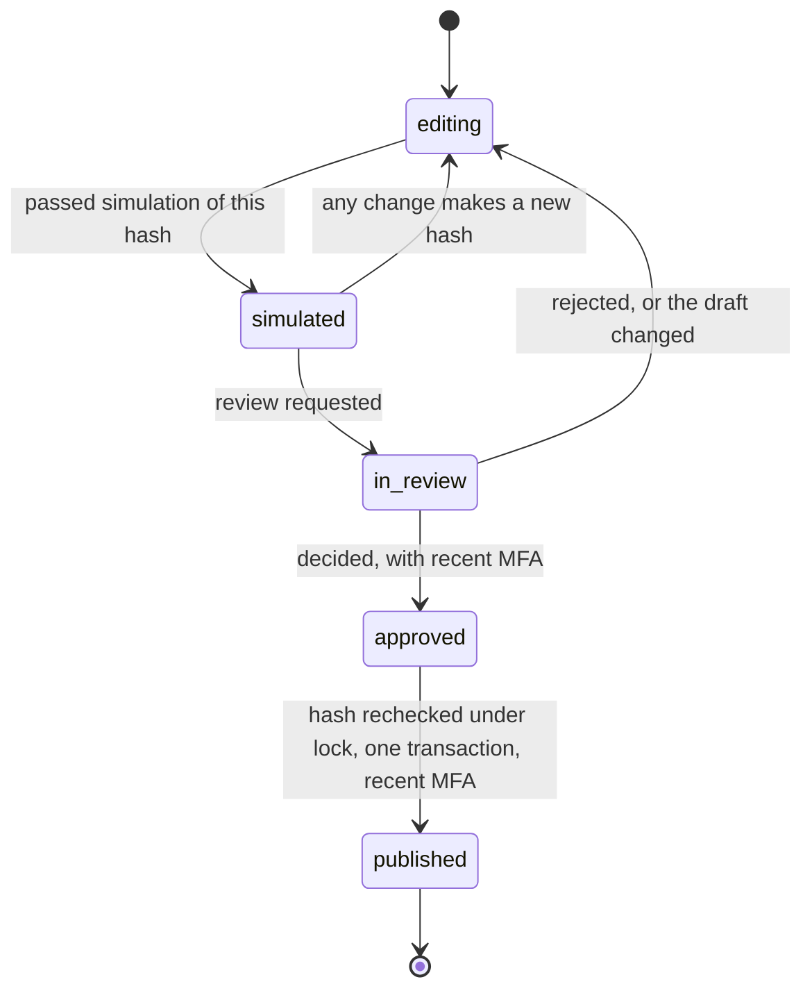

# ADR-031: Full product depth

**Status:** Proposed. D6, D8 and D9, and migration `0401`, need outside security review before any real identity provider or real person's second factor is used, alongside ADR-024 D4 and D5 and ADR-027. No real credential, provider or person has been used: every test uses generated values and local fakes. The tables, triggers, types and ports exist. The behaviour they describe is being built in M7.
**Date:** 2026-11-06
**Deciders:** Project owner; security owner for D6, D8 and D9.
**Backlog:** `WORK-09`, `AGENT-08`, `AGENT-09`, `KNOW-07`, `OPS-05`, `ID-04`, `ID-05`, `UX-19`, `UX-20`, `UX-21`, `AGENT-13`, `AGENT-14`, `UX-24` (owner-led). Exit: Phase 4, with representative cross-department workflows finishing with verified receipts and measured cost.

## Context

M7 is where people who do not think about security get powerful tools. Each feature here is also a way round what M2 to M6 built, if it is left to application code:

- **A guided builder can make an agent nobody looked at.** Publishing needs to rest on something a person actually reviewed, and it has to still be true at the moment of publishing.
- **A pack is a pile of requests for access** that an administrator clicks through.
- **A drawn workflow can reach an external effect** with no approval on the way.
- **Tenant SSO lets a tenant say who someone is.** If a tenant's provider can vouch for any email address, one tenant can sign in as another tenant's people. This is the worst failure in this milestone.
- **MFA that the application can assert is not MFA.** The web tier and the worker share `ensemus_app`, so a proof it can write proves nothing about a compromise.

Three more facts shape what follows:

- **The web tier has no outbound path, and the worker has none either** (ADR-024, `PLAT-16`). Anything that needs the server to contact a tenant-named host is an SSRF and an air-gap failure at once.
- **M4 and M5 are being written at the same time as this.** Their foundations landed while this was being written (`m4-foundation` at `75ca603`, `m5-foundation` at `4dcb3c5`, still marked work in progress). The ports below are shaped to what they hold now, read with `git show` and not merged.
- **Everything has to work in Sovereign,** with no network, no hosted service and possibly no model.

## Decisions

| # | Decision |
|---|---|
| **D1** | M7's tables live in four new schemas plus additions to `org` and `identity`, all in one Drizzle file and two migrations. Every builder uses what is here, and no builder adds a migration. |
| **D2** | What M7 needs from M4 and M5 is a small port in `@ensemus/application/product-ports`. Until the merge each port throws `CAPABILITY_UNAVAILABLE`, and the page says so. There are no foreign keys into `ai.*` or knowledge tables until then. |
| **D3** | M7's capabilities and privileged actions are in their own file, default deny, to fold into `policy.ts` at the merge. |
| **D4** | Company Pulse is a read projection computed per viewer, and a signal cannot exist without evidence. It has no per-person number at all. |
| **D5** | Simulation is a pure function with no way to reach anything. The outcome composer reads a sentence with rules and no model. Both work in every mode. |
| **D6** | Publishing binds one hash through one passed simulation and one review. Elevated risk needs a second person, enforced by a trigger. |
| **D7** | A process spec is an immutable, compiled DAG. The compiler refuses any path to an external effect with no human approval on it. A running step goes through the normal services and gets no shortcut. |
| **D8** | Recent MFA is a row the auth role writes after Better Auth accepts a code, and which the application role can read and never write. It is checked in the same transaction as the effect. |
| **D9** | Tenant SSO is SAML only, so the server never connects to anything a tenant names. Only the operator can verify an email domain, and deprovisioning arrives by a small SCIM subset. |
| **D10** | A pack is data shipped in the release. Installing it grants nothing: it makes drafts and types, and each draft still goes through D6. |
| **D11** | Custom objects have fixed field kinds, hard limits, and a classification floor that a trigger holds. A change that could lose data is refused. |

### D1. Where it lives

`packages/database/src/schema-product.ts` and `migrations/0400_product_depth.sql` (DDL, generated with drizzle-kit from that file against M3's snapshot, so the two agree) and `0401_product_depth_security.sql` (reviewed by hand). Tables come out through `@ensemus/database/product`, so nobody edits `./index.ts`, which other milestones are changing at the same time. `meta/` and the journal are left for the final merge, which stitches every milestone in order. **Until then `runMigrations` does not apply 0400 or 0401, and every integration test that needs these tables cannot pass.** `tests/unit` does not hold the journal against the files, so no unit test fails because of this. Only `infrastructure/scripts/upgrade-gate.mjs` mentions the journal, and that runs in CI.

| Schema | Tables | Why apart |
|---|---|---|
| `studio` | `agent_drafts`, `process_drafts`, `simulation_runs`, `publish_reviews`, `process_specs`, `process_runs`, `process_run_steps` | Authoring and running are the same lifecycle |
| `objects` | `types`, `type_versions`, `records`, `record_values`, `relations`, `migrations` | Grows differently from everything else, and M6's export needs all of it |
| `packs` | `installations`, `capability_reviews`, `installed_items` | What was asked and who said what |
| `experience` | `pulse_signal_states`, `outcome_drafts`, `onboarding_steps` | Small state behind pages |
| `org` (added) | `security_policies`, `sso_connections`, `sso_member_links`, `scim_tokens` | A tenant's identity settings |
| `identity` (added) | `two_factors`, `sso_providers`, `session_assurances`, `users.two_factor_enabled` | Better Auth's shapes, and reached by the auth role |

Everything tenant-keyed has composite foreign keys and FORCE RLS. `tests/integration/tenant-isolation.test.ts` now lists the new schemas, so a table that misses it fails. `ensemus_dispatcher` and `ensemus_secrets` get nothing. Immutable things have no `UPDATE` grant and a trigger as well, so a mistake in one still leaves the other.

**Where M4's `ensemus_agent` fits.** The M4 plan creates that role `IN ROLE ensemus_app`, so it inherits these grants. Nothing here grants to it directly. If M4 lands without membership, the merge has to look at this again.

### D2. Ports, and why no fake ships

Each port in `ports.ts` is a real interface with one honest default: `unavailablePorts()`. The web tier gets its ports from `apps/web/src/server/product-ports.ts`, the worker from `workers/workflow/src/product-ports.ts`, and **those two files are the entire join at the final merge**. Recording doubles are in `tests/helpers/product.ts` and no shipped code can import them, because the only thing `tests/` exports to is itself.

| Port | From | Used by | Unavailable means |
|---|---|---|---|
| `AgentRegistryPort` | M4 S7 | Studio publish, process compile | Publishing is refused, and the draft stays a draft |
| `ToolCatalogPort` | M4 S10 | Studio, graph | The builder says which part is unavailable |
| `AgentRunsPort` | M4 S13 | Assistants, process steps, Pulse | The page says so. An `agent_task` step stops. Pulse marks that part `partial` and does not show false calm |
| `ModelReadinessPort` | M4 S5 | Onboarding | The step reads `unavailable`, not `to_do`. Journey A: AI stays optional |
| `UsageReadPort` | M4 S6 | Process run page | Cost is shown as not measured, never zero |
| `KnowledgeReadPort` | M5's `listSources`, as a count | Onboarding | The step reads `unavailable`. The optional step does not block finishing |

The shapes follow what `m4-foundation` holds: `ToolFacts` is its `ToolManifest`, the guided builder compiles to its `AgentSpecV1`, and a simulation report fills its `evaluationReportSchema` with `scripted_model: true`. **If M4's or M5's shapes move, the merge adapts inside those two files, not in M7's services.** `AgentRunsPort.start` takes the initiator's membership because FD-3 requires an agent to act as a person, never as a service. Two things have no M4 service yet, and the adapter adds them at the merge: `listMine` (a query by initiator) and `pin` (a row in `ai.agent_publications`).

**Rejected: M7 reading `ai.*` tables directly.** They do not exist on this branch, and a page reading another milestone's tables would also bypass its authorization.

**Knowledge UI.** The delivery plan lists it under M7, and the backlog gives it to M5 as `UX-18`. M5's `ui` slice owns `apps/web/src/app/o/[organizationId]/knowledge/**`, `search/**`, `settings/egress/**` and `onboarding/**`, by its own slices file, so this milestone builds no second one, and only links to it from the navigation. **If M5's `ui` slice does not land, that link is a 404 and Knowledge UI is not done: the merge has to check.** M7's own Journey A page is `/get-started`, because M5's `/onboarding` is the client onboarding flagship.

### D3. Capabilities

`@ensemus/domain/product-policy` holds `ProductCapability`, `canProduct`, `PRIVILEGED_ACTIONS` and `mfaDecision`, apart from `policy.ts` because M4 is adding to that file now. M2 still ships three roles, and the spec's named roles stay out. So `studio.author`, `studio.review` and `studio.publish` map to owner and admin, `pack.manage` and `sso.manage` likewise, and `security_policy.manage` to owner only.

`canReadRecord` follows `canReadWork`: restricted is limited to the person holding it, and being an organization admin does not change that.

### D4. Company Pulse

The product doc says Pulse must not invent performance scores or assert causation, and the catalog says "no fabricated employee scoring". So:

- **A signal's type requires evidence.** `PulseSignal.evidence` is a non-empty tuple of links to real rows, so `WORK-09`'s acceptance is a type error to break.
- **Nothing per person exists.** `scope` is a project and a client. The summary has no person in it. `QA-030` holds this.
- **Signals are facts with no "because".** "Overdue, and its prerequisite is not done" is two facts. It never says one caused the other.
- **Computed on each read, for that viewer,** from what they may read, so a signal cannot leak restricted work and a revoked access takes effect at once. Bounded reads, indexed. A materialized projection is a later measured decision, because it would bring back the question of whose access it was computed for.
- **Only dismissals are stored,** per person. A restrictive RLS policy stops one person silencing a signal for another.
- **A part that could not be read is `partial`,** and the page says so.

### D5. Simulation and the composer

**Why simulation is pure.** The requirement is zero side effects. Anything that runs real tools behind a flag is one bug from a real email. `simulateAgent` takes a spec and a scenario, and returns a report. It imports nothing, so it cannot reach anything. The scenario scripts what an agent would propose, and each proposal goes through the same rules: is it granted, does it need approval, does it write outside.

**What this does and does not prove.** It proves the agent's grants, limits and approval paths behave as the reader was told. **It does not prove the model is any good,** and the page says so. M4's Gate C evaluation with a real model stays a separate owner step. FD-19 calls for "a passing evaluation report bound to `spec_sha256` and the policy version": the passed simulation report is that report at this stage, named as such, and M4's real evaluations can be added to the same gate later.

A simulation runs in the worker, not in a Route Handler, through `simulationWorkflow`, so a long scenario set can never block the web process. Its report holds codes and no free text.

**Restricted is not on offer in the guided builder.** Its egress default is deny. `dataClasses` cannot name it, in the type and in the contract. A tenant that needs that decides it later, with an owner decision and a policy that does not exist yet.

**Why the composer uses no model.** The web tier cannot call one, a worker round trip is slow for a form, and in Sovereign there may be none. `parseObjective` reads dates, a title and an owner with rules, and says what it was unsure of in `uncertainties`. **It is not a clever parser, and it is honest about that:** the preview is editable and is what counts. A later model-assisted reader can fill the same preview, as a suggestion, through the worker.

**Nothing runs until authorized.** `authorizeOutcome` takes the hash the person was reading, and makes one Work Unit through `createWorkUnit`, with its checks. Starting an agent or a process is a separate decision on that Work Unit's page.

### D6. Publishing

- **One hash through everything.** `specSha256` is over the canonical spec the answers compile to. A simulation row and a review row each bind it, and no role can update that column on either. An insert trigger refuses a review whose simulation did not pass, or is for another subject or hash.
- **Publishing rechecks.** `publishApproved` locks the draft, compares its current hash to the review's, and refuses with `SIMULATION_STALE`. M4's `publishAgentVersion` commits in its own transaction, and a lock is not held across it. So `list` finds an earlier attempt by hash first, then the version is published, then the review and draft move. A crash between the two leaves an immutable version nothing points at yet, and trying again finds it and adds no second one. A draft edited in that window does not change what was published, which is exactly what was reviewed.
- **Second person for elevated risk, by trigger.** Elevated means external writes, delegation or confidential data. The trigger refuses a decision by the requester, because web and worker share a role, and a service-side check would not survive a compromise of either. **Standard risk (read-only and drafts on public or internal data) may be decided by its author, with recent MFA and an audit row.** One-person companies exist, and a rule they can only pass by making a fake account is worse. This is the safest default that still lets the owner use the product alone with an agent that has no effect, and it is an owner decision below.
- **A running Work Unit keeps its version.** That is M4's rule (`agent_versions` are immutable and a run is pinned), and nothing here touches it.

### D7. Process specs

A graph is what a person draws, and a spec is what can run. `compileProcessGraph` is pure and ignores positions, so moving a box never changes a hash.

**The compiler refuses, and never repairs:** no start, several starts, no end, a cycle, an unreachable node, a dangling edge, too many nodes, an unknown tool or agent, a restricted process with any external effect, and **any path from start to an `external_action` that does not pass a `human_approval`**. That last one is a graph property checked on every path, and is the main safety rule here. It is in addition to M3's own approval on the effect, so this is two independent stops.

**No loops can be expressed.** The spec has `after` sets, and the compiler proved them acyclic. The catalog's guardrail for automation is "no unbounded loops", and this makes one unwritable.

**One generic workflow, deterministic and small.** `processRunWorkflow` is a loop: call `advanceRun`, wait for a signal or five minutes, repeat. All deciding is in the Activity, which reads PostgreSQL, because long-lived workflows are the hardest code to change, and approval waits last days. A lost signal costs at most the timer. Only IDs cross Temporal.

**A step gets no shortcut.** A `work_item` calls `createWorkUnit`. An `external_action` calls M3's `proposeExternalActionInTx`, so it still needs M3's own bound approval and gets M3's own receipt. An `agent_task` has its own Work Unit, pins `latestVersionOf` and calls `AgentRunsPort.start` as the person who started the run (FD-3), never as a service. M4 allows one live run per Work Unit, and `listForWorkUnit` finds it, so a repeated step starts no second one. Before each effect it rechecks that the starter is still active and the root is not stopped.

**Starting runs is a person's act.** A tenant-wide trigger on events is not in M7, because a mistake in one is a mass mailing.

**The visual editor adds no dependency.** It renders server-side SVG from the graph, and edits through ordinary forms: add a node, connect two, remove one. This works with no JavaScript and a keyboard from the first day, as the existing pages do. Client code adds dragging on top. **Rejected: React Flow and the like.** A client graph library is hard to make keyboard-accessible, and needs review and bundle weight for what is mostly a nicer drag.

**The bundled workflows** (`AGENT-13`) are graphs in `@ensemus/packs/bundled` that compile like any other, with no special way past the compiler. The catalog names five. Number 1 is M5's flagship (`AGENT-12`), with its own `clientOnboardingWorkflow`, so the catalog here is numbers 2 to 5, and the page links to M5's for number 1. Number 3 ends in "invoice draft in accounting system" and number 2 starts from a meeting summary: no accounting or meeting connector exists, so those steps are `needs` on the page and stop honestly. **They are not simulated as working.** Each one's acceptance needs a measured cost through M4's ledger, so `AGENT-13` cannot be fully proven until M4 and M3 are merged.

### D8. MFA

Better Auth's `twoFactor` plugin does TOTP and backup codes. It works offline, which rules out SMS and email codes as the only path, and it encrypts the secret with the auth secret. **Rejected: WebAuthn first.** It is a better factor and it has real browser and recovery complexity, so it comes later.

What the plugin does not provide is "this session proved it recently", so:

- **`identity.session_assurances` holds the proof.** The auth role writes it after Better Auth accepted a code. The application role has `SELECT` on some columns and no `INSERT` or `UPDATE`, for its own user only. So SQL injection in application code cannot forge it, and neither can a bug.
- **`assertRecentMfa(tx, context, action, proof)` is one function, called in the same transaction as the effect.** There is no window between check and write.
- **The session ID comes from the verified cookie only** (`requireActor`, `ApiScope`), and is checked against the user, so another person's session finds nothing.
- **A service context never passes,** and an agent has no second factor. An action that asks for MFA is a person's.
- **A code goes through Better Auth's router, not `auth.api`,** which is how its limits and lockout apply, as `submitCredentials` already does for passwords.
- **Fifteen minutes by default,** with a tenant range of 60 to 3600 seconds. This is a starting value, not a measurement.

**Who has to have it.** `always` covers everything new in M7, plus M4's publish and activate routes once merged. On 2026-11-07 the owner also classified `model_workload.approve` as `always`: it authorizes bounded company-data egress and paid model usage. Qualification remains `model_profile.activate`; a conservative workload revocation acquires no new MFA obstacle. `administration` covers M2's member, organization and connection management, and applies only when a tenant sets `mfa_for_administration`. **An upgrade must not lock out an install running today,** and the opt-in administration default stays off. These checks run in the actual privileged DAL effect transaction, with web step-up as its interface. New organizations get a step in onboarding asking for this.

**Actual session and concurrent revocation.** An interactive context originates only from the actual native verified `getSession` result. A JSON body, copied UUID, agent/delegated identity or service context cannot construct it. The effect transaction rechecks current membership/policy, exact own live session, enabled-factor state and the auth-only proof under row locks. A fixed migrator-owned metadata guard supplies lock-only FORCE-RLS visibility; no auth-role membership, broad secret read or application session mutation grant is introduced. The configured maximum age is evaluated using the database clock after any lock wait. A model probe's separately persisted exact-version admission survives later logout/expiry as an already authorized intent; configuration/version/disable invalidates pending admission, and a model's passing qualification proof is still separately required. Unknown legacy pending probes require a fresh request, through the existing “Ask for the test again” action. The new 0404 source and these joined guarantees remain unvalidated until their recorded database/role/runtime gates.

**Lost device and lost codes.** `reset-second-factor`, an operator command with the migrator role, like the setup code. The operator has to know who is asking, and in a one-person install the operator is that person. There is no self-service path, since that would be the bypass.

### D9. SSO

**SAML only for tenants, because of where the bytes go.** In SAML the browser carries the assertion, and the server connects to nothing. Tenant-configured OIDC needs a back-channel call from the server to a host the tenant names, which is SSRF from tenant settings, and impossible on a web tier with no route out anyway. Operator-configured OIDC stays exactly as it is (ID-03). `identity.sso_providers` has a `CHECK` that `oidc_config` is null, so this cannot drift. IdP metadata is pasted, never fetched.

**Why the domain is the operator's.** Whoever controls a verified domain can sign in as anyone at that domain. If a tenant could claim `example.com`, it could become any `example.com` user, including in other tenants, and then into everything they belong to. So:

| Layer | What it does |
|---|---|
| No grant | `ensemus_app` has no `UPDATE` on `domain`, `provider_id`, `domain_state` or `domain_verified_at` |
| Insert trigger | A new row from `ensemus_app` must be `unverified` and `draft` |
| Check constraint | `active` needs `verified` |
| Unique index | One tenant holds a verified domain at a time |
| Operator command | `verify-sso-domain` runs with the migrator role, after the operator checked outside the product |
| Plugin | `domainVerification.enabled`, so an unverified provider is refused and is not trusted for linking |
| Service | The asserted email must be inside the connection's domain, or `refused` |

Self-service DNS verification would need the server to do a lookup that leaves the network, so it is not offered. In Cloud this is Ensemus staff doing it by hand, which is a real cost, and a decision for M8.

**The plugin's routes are closed.** `@better-auth/sso` mounts registration, update and domain routes for any signed-in user. They are in `disabledPaths`, and a test holds that they 404. `sso.storeProvider` is the only way in, after the application service checked the person asking.

**A provider only ever says who someone is, never what they can do.** A verified person with no membership has `no_membership`. `autoJoin` is off by default and only ever adds a `member`. A disabled membership is not revived by signing in. Role never comes from an assertion.

**Assertions:** signed required, `sha256`, `InResponseTo` on (the default), IdP-initiated off. Storing requests uses the database, because web runs as several replicas. **The SAML parser runs in the web tier, on bytes from a stranger, and this needs outside review.** The alternative is a worker hop for each login, and it should be weighed by whoever reviews this.

**Deprovisioning.** `/api/scim/v2/*`, outside `/api/v1` because it is not a client API and takes no session, with a bearer token whose hash only is stored, as webhook URLs are (ADR-027 D4). `withScimTokenTx` is the only way in. It implements the subset a provider needs to tell us someone left: list, read, and `active` false or true. **`resolveTenantContext` already checks membership status on each request, so disabling the membership takes effect on their very next request,** which is what `ID-04`'s acceptance needs, without touching sessions. Their other tenants are untouched, because a provider only speaks for its own tenant. Last-owner protection holds, and is audited, so a provider cannot lock a tenant out. Reactivating restores only what SCIM itself disabled.

**Which plans include SSO** is the owner's decision (see below), and nothing here enforces a plan.

### D10. Packs

- **Data only.** `@ensemus/packs` is manifests in the release. A lint rule stops it importing anything but domain types. Nothing downloads, so Sovereign has the same packs, and there is no marketplace or signing here: the release's own signing covers them.
- **Installing grants nothing, by construction.** A pack can make object types with no records, and drafts that can do nothing until they pass D6. The installation's `capability_reviews` record what an administrator accepted and declined. They are not grants, because nothing reads them to allow anything.
- **Each capability on its own,** with no accept-all, and a trigger refuses activation while any is pending. Declining one leaves out what needs it.
- **Upgrade and rollback.** An upgrade is a new `installations` row, and a new capability comes back for review, whatever was accepted before. `planPackUpgrade` refuses a downgrade or a step that removes something. Rollback reactivates the old row, archives unpublished drafts from the newer one and **keeps custom types and their records, because rollback never loses data.** Something a person already published stays, and the page lists it, since it went through its own review.
- **First pack: Sales operations.** It lines up with the recommended flagship, and the catalog's guardrail ("no unsanctioned bulk outreach") is easy to hold: it has no bulk tool, and each send goes through M3's approval. An owner decision, reversible.

**Integration packs cannot claim compliance** with anything (catalog), and the strings go through this rule.

### D11. Custom objects

Fixed kinds: text, long text, number, boolean, date, enum, email, URL. Limits are in `OBJECT_LIMITS` as code, with `maxIndexedFields` at 8, because the spec says fields are "indexed intentionally". Slugs that mean something to the platform are reserved.

**Filtering goes through `record_values`,** only for indexed fields, and never reaches into JSON, so a filter cannot become a query planner problem or an injection path.

**Classification floor by trigger.** A record can be stricter than its type and never looser, and a type can only rise, raising the records under it. Lowering is refused for everyone: make a new type and move on purpose. This is what "custom types retain policy scope" means when the web and the worker share a role.

**Migration.** A new shape is a new immutable `type_versions` row. `planTypeMigration` allows adding an optional field, widening an enum and changing indexes. It refuses removing a field, changing a kind, adding a required field and narrowing an enum, **because each of those can lose data or make an old record invalid.** There is no "force". Safe moves run in batches in `objectMigrationWorkflow`, with the row moving to the new version, and a record that fails counts, and stays where it was.

**A custom type is never a place to put billing, grants, approvals or Work Unit state,** as the domain model says. It has no path to any of those: it is data with an owner and a class.

M6's export (`COMM-05`) needs these tables added, and `M2`'s tombstones apply once M5 indexes records. Both are noted for the merge.

## What outside review should read

| Item | Why |
|---|---|
| `0401_product_depth_security.sql` | All the rules above that have to hold under a compromised application |
| D9's domain rule and the SSO service | The one mistake that crosses tenants |
| The SAML parser's place in the web tier | Parsing a stranger's XML where the sessions are |
| D8's proof table and the step-up flow | Whether a recent-MFA check can be bypassed |
| The SCIM route | An unauthenticated caller with a token can disable people in one tenant |

## Trade-offs

- **A second reviewer for risky agents** costs a small company time, and means a one-person company cannot publish an agent with an external effect until there is a second account. That account can be theirs, and it is at least a deliberate act. M4's O-7 suggested a named exception until M7, and this is where that ends for elevated risk.
- **Verifying a domain needs a person with a terminal.** In Cloud this is staff time per customer.
- **A pure simulator proves less than a real run.** It cannot find a bad prompt. It is honest about that, and it cannot send an email.
- **A rules-based composer misreads sentences.** The preview exists for this, and nothing happens until someone reads it.
- **Pulse recomputes on each read.** Cheap at the sizes this milestone reaches, unmeasured beyond that. `OPS-01` should test it.
- **The SAML libraries are new code in the web tier's tree:** `samlify`, `xml-crypto` and friends. Their licenses are reviewed by the gate, their security is not. This is the main new supply-chain risk here.
- **SCIM is a subset.** A provider expecting creation by SCIM gets an honest `501`. People arrive by invitation or `autoJoin`.

## Consequences

**Easier:** a builder cannot make a non-technical person's agent skip review, and neither can a compromised web tier. M8's plans can gate these features without changing them, since nothing here reads a plan. Later packs are data. **Harder:** every new effect in a process has to fit the compiler's rule, and each new privileged action has to remember `assertRecentMfa`. A lint rule cannot catch a forgotten call, so the close slice's denied-case sweep is the check.

**Mode impact:** the same in Cloud, BYOM and Sovereign. Nothing here needs outbound access. Simulation, the composer, packs, objects, TOTP and SAML all work with no network. The IdP has to be reachable by the person's browser, not by the server.

**Migration:** `0400` and `0401` add four schemas, four `org` tables, three `identity` tables and one nullable-free column on `identity.users` with a default. No existing data changes. New workflows are in their own files, so no existing history changes, and their histories join the corpus when someone captures them with Temporal running.

## Reversal

Each of these is new tables and new routes. Taking a nav link and its routes away removes a feature, and nothing in M2 to M6 depends on them. **D6, D8 and D9 are expensive to weaken after real use,** since a published version, a provider link or a second factor rests on them. Dropping `sso_providers` and `two_factors` signs nobody out of password or operator OIDC sign-in.

## Open questions for the owner

| # | Question | Default taken here |
|---|---|---|
| O-1 | May an author decide their own standard-risk review? | Yes, with recent MFA and an audit row (D6) |
| O-2 | Should recent MFA apply to M2's administrative actions by default for new organizations? | Off, opt-in per tenant, offered in onboarding (D8) |
| O-3 | Recent means how long? | 15 minutes, 1 to 60 per tenant (D8) |
| O-4 | Which plans include SSO? | Not enforced anywhere. M8 decides (delivery plan: "before M8") |
| O-5 | First pack? | Sales operations (D10) |
| O-6 | Does a domain get verified by a person in Cloud too? | Yes, by the operator command, until M8 decides otherwise (D9) |
| O-7 | Is the SAML parser acceptable in the web tier? | Yes for now, pending outside review (D9) |
| O-8 | Should `sso_enforcement: required` also block a password sign-in? | It does, at tenant entry, with the owner kept able to get in so a broken provider cannot lock a tenant out. Say if you want stricter |

## Approvals

| Role | Name | Decision | Date |
|---|---|---|---|
| Project owner | | | |
| Security owner (D6, D8, D9) | | | |

## Additive effect-time SSO binding (0410, source checkpoint)

0404's recent-MFA guard is supplemented by actual required-company-sign-in checks inside the privileged effect transaction. The fixed metadata guard locks current user/session/provider/link/SSO proof without reading account bodies, external subjects, tokens or provider configuration. The specific refusal is SSO_REQUIRED; optional policy and the documented owner/no-active-provider recovery paths remain unchanged. It adds no new MFA default or blanket service exemption.

Auth-only SSO receipts now bind the actual account PK. Account deletion cascades the matching SSO receipt; account identity changes invalidate only its SSO proofs, preserving MFA and other accounts. Legacy unbound SSO receipts refuse new authority. Application SELECT remains limited to the prior assurance columns. Custom session GUCs select a validated SQL binding and are not unforgeable credentials; native in-process verifier provenance remains independently necessary.

0412 may use the session/required-SSO metadata seam for nonprivileged Studio authors without requiring MFA. Export/import admission and durable metadata effects are described in ADR-030's joined source note. See [the joined source evidence](../../06-delivery/evidence/M6-M7-joined-authority-source.md) for actual static checks and the unrun role/migration/runtime gates.
