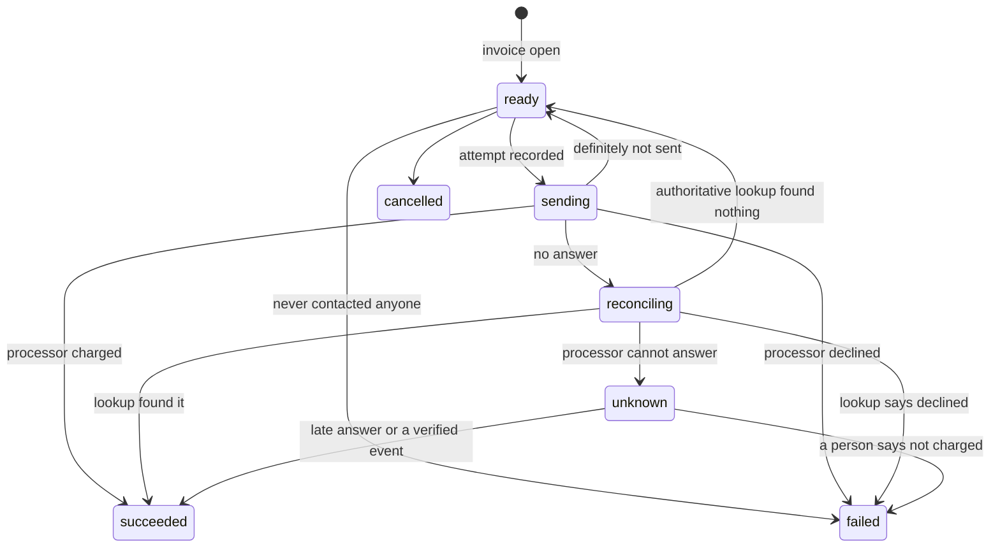
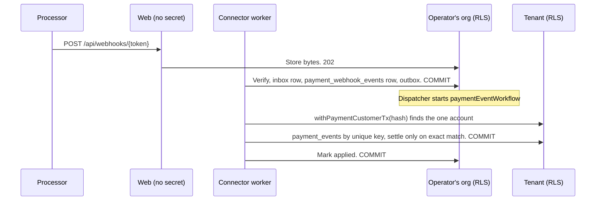

# ADR-032: SaaS operations and billing

**Status:** Proposed. D3, D4, D5, D7 and D8 need outside security review before any real credential, processor or customer is involved, alongside ADR-024 D4 and D5 and ADR-027 D2. No real credential has been stored or used: every test uses generated values and local doubles, and the only payment processor and tax provider in this repository are test doubles that never ship.
**Date:** 2026-11-06
**Deciders:** Project owner; security owner for D3, D4, D5, D7 and D8; a finance adviser and counsel for the owner decisions listed at the end.
**Backlog:** `COMM-01`, `BILL-01` to `BILL-05`, `LIFE-02` to `LIFE-04`, `OPS-01`, `OPS-04`, `OPS-06`, `OPS-21` to `OPS-25`, `PLAT-17`. `LEGAL-03` is owner-led. Exit: Gate E for Cloud and BYOM, Gate F drills, `QA-026`, `QA-027`, `SEC-011`.

## Context

M8 is the first time Ensemus takes money and the first time it decides what happens to a tenant that stops paying or wants to leave. Five facts shape everything below:

- **Most of the numbers are not ours to choose.** Prices, credits, SLAs, retention periods, RTO and RPO are owner decisions, some needing a finance adviser or counsel. So the code holds no values. It holds versioned data that starts empty, and it refuses to act without it.
- **A payment processor has one webhook address per deployment, not one per tenant.** M3's webhook path binds each endpoint to one tenant, so a processor's event arrives in the wrong tenant by design and has to be routed from there without crossing RLS.
- **Charging someone twice is the same failure as emailing them twice.** Temporal retries, workers die, and a processor can time out after taking the money. ADR-027 D2 solved this shape already.
- **No role may have `BYPASSRLS`, and the web tier may not cross tenants.** Yet an operator has to see who owes what, and an offboarding has to delete rows that nothing else may delete.
- **Sovereign has no vendor in its critical path.** Billing must be unreachable there, and no code path may depend on a vendor being reachable.

## Decisions

| # | Decision |
|---|---|
| **D1** | Money is `bigint` micros. Pure rules live in a new package, `@ensemus/saas`, which imports no database, network or framework. Billing is off unless a deployment names it, and Sovereign cannot turn it on. |
| **D2** | Prices are versioned global rows, immutable once approved, and no row ships. Nothing can be billed from a draft or from nothing: the application refuses, and a trigger refuses again when an invoice opens. |
| **D3** | Three new roles, `ensemus_operator`, `ensemus_support` and `ensemus_eraser`, are created unable to log in. The operator plane is commands on the deployment, with no web path at all. |
| **D4** | A payment is an intent with attempts, under the same at-most-one trigger as ADR-027 D2. A processor is an adapter behind a port, and none is chosen. Its webhook comes down M3's path into the operator's own organization, and is routed from there by a hash against our own row. |
| **D5** | A tenant's standing is a lifecycle value. Anything less than `active` makes `withTenantTx` a read-only transaction, so PostgreSQL itself refuses writes. Suspension and downgrade delete nothing, and every step of collecting follows a published policy, or waits for a person. |
| **D6** | Retention has no default number and needs a sign-off reference per rule. A legal hold is enforced by triggers on the tombstone every deletion writes, below any application code. |
| **D7** | Offboarding runs itself as far as `ready_for_erasure` and stops. Erasure is an operator's command, on a role that can delete and count but cannot read, refused by policy while any hold is active. It reports what it left behind, and "verified" means nothing was. |
| **D8** | Support has no access to customer content, by database grants. Break-glass is a design and a record: two people from two sides, a time limit and a log. M8 adds no way to use one. |
| **D9** | What M8 needs from a sibling milestone is one small port, implemented by that sibling's code at the final merge. Each port refuses where nothing implements it. |
| **D10** | Dashboards, alerts, runbooks, incident and disclosure processes are files that can be reviewed and drilled. The public status page reads published incidents through RLS. Load tests and autoscaling are scripts and manifests, run later. |

### D1. Money, and where the rules live

`bigint` micros everywhere, matching M4's `*_micros` (M4 FD-6), so a ledger cost and a price are the same unit. A float cannot add up an invoice. Across an API money is a string of digits, because JSON numbers cannot hold every `bigint`, and across Temporal it does not go at all: only IDs, enums and counters cross (ADR-024 D2).

Exact sums stay on the invoice lines. A processor can only charge whole minor units, so the total rounds, and the difference is its own `rounding` line, so an invoice still adds up to the micro. How many decimals a currency has is `minor_unit_exponent` on the rate card, because that is data and not ours to assume. Rounding half away from zero is a reversible default, and it is listed for the finance adviser.

`@ensemus/saas` holds the state tables, rules and ports, and lint keeps it pure. `packages/commercial`, which M4 created and which owns the `Entitlements` port and the `/entitlements` route, is a different thing: it says what a mode means, and this says what is owed. They stay separate so they cannot collide, and `COMM-01`'s evaluation reaches M4's port through a plain object in that port's shape, as M6's `createSovereignEntitlements` does (D9).

**Sovereign.** `ENSEMUS_BILLING_ENABLED` defaults to off, and `loadSaasConfig` refuses it with `ENSEMUS_MODE=sovereign`. `evaluateEntitlement` answers `ALLOWED` there, with M6's license check governing, so nothing waits for a payment confirmation (`docs/07-commercial/02`, section 4).

### D2. No invented prices

`billing.rate_cards`, `rate_card_lines`, `top_up_offers`, `plans`, `plan_versions`, `collection_policies` and `tax_treatments` are global, entered by the operator, and hold nothing until the owner decides. There is no seed migration and no default column on any commercial number, and a unit test checks both.

Approved rows are immutable (`billing.check_published_change`). A correction is a new version, so an old invoice can always say which prices it used. A retired card still prices the time it was in force, and a draft is invisible to tenants by RLS, because a draft is nobody's price.

**The refusal is in two places on purpose.** `requirePublishedRateCard` stops the application early with a useful error. `billing.check_invoice_change` refuses again when an invoice moves to `open`: no approved card where one is needed, no tax decision, lines that do not add up, or no bill-to all raise `EN802`. An invoice is the one thing that must never be wrong, and the web tier and the worker share a role, so a bug in either should not be able to issue one.

**A Cloud plan bills credits against an approved card, and a BYOM plan bills no inference, ever.** `billing.check_plan_approval` refuses a BYOM plan with a card, an allowance or an overage policy. That is `QA-027`, as a constraint on the data rather than a rule someone has to remember.

**Credits.** `billing.credit_ledger` is append-only, and an `AFTER INSERT` trigger is the only thing that moves `credit_accounts.balance_microcredits`, so a balance cannot differ from what its ledger adds up to. The balance can go negative, since M4 over-counts a lost call on purpose (M4 FD-12) and usage that happened cannot be un-happened. A negative balance stops the next call and bills nobody.

**Top-ups are explicit (`QA-026`).** A request carries the hash of the quote the person saw, and a price that has moved answers `QUOTE_CHANGED` with nothing bought. A top-up row requires `requested_by_membership_id`, so there is no such thing as an automatic one, and a `top_up` ledger entry is refused until the top-up is `paid`.

**Rejected: a config file of prices.** It would ship with the image, so a price change would be a release, and an old invoice could not point at the terms it used.

### D3. The operator plane, and three roles that cannot log in

Everything an operator does is `node dist/ops.js <area> <command>` on the deployment: approving prices, provisioning, suspending, answering tickets, erasing. There is no web route to any of it, and the web tier cannot import the modules behind them (lint). The hosted product's web tier stays exactly as tenant-bound as it was.

| Role | Reaches | Cannot |
|---|---|---|
| `ensemus_operator` | The price list, incidents, drills, vulnerability reports. Across tenants: subscription status, invoice totals and standing, by column grant. M4's usage ledger | Read a name, a contact, a bill-to or anything in `work`. No policy gives it another tenant's work, because no grant does |
| `ensemus_support` | `support.*` | Everything else, which a test proves from the catalog (`SEC-011`) |
| `ensemus_eraser` | `SELECT (organization_id), DELETE` on content tables, only while that tenant's offboarding is `erasing` with no active hold | Read any content, ever. It deletes and counts |

**They are `NOLOGIN` in `provision.sql`.** No credential for them exists in a default install, and an operator gives one deliberately with `ALTER ROLE`. Enabling the eraser is a deliberate act. This also means this milestone adds no compose secret and changes no container until the owner decides to operate a hosted service, so a Sovereign install never gets these credentials at all.

**Upgrade trap.** `ensemus_migrator` has no `CREATEROLE`, and `provision.sql` only runs on an empty data directory. Existing installs run `infrastructure/compose/postgres/upgrade-roles-m8.sql` as a superuser first, and migration 0501 stops with a message naming that file if they did not. M4's plan has the same shape for `ensemus_agent`.

**Rejected: the migrator role for these.** `setup-token` uses it, for one narrow insert. It owns every table, so a price typo in a command would be running as the most powerful role there is.

**Rejected: an operator console in the web tier.** It would put a cross-tenant path into the largest attack surface, against ADR-024 D4. If the owner later wants one, it is a separate process on a separate network.

### D4. Taking payment

**The processor is not chosen, and that is the owner's decision.** `PaymentProcessor` in `@ensemus/saas/payment` is the contract: `createCustomer`, `charge`, `lookup`, `interpretWebhook`, with a manifest that must declare `nativeIdempotency: true`. The only implementation is `createFakePaymentProcessor` in `@ensemus/saas/testing`, which lint keeps out of `apps/` and `workers/`. The connector worker's registry answers `get() => null`, so every charge refuses with `PROCESSOR_NOT_CONFIGURED`.

**The charge is ADR-027 D2, table for table.**

The attempt row is committed before any contact, and `billing.check_new_payment_attempt` locks the payment and refuses another while an earlier one could have charged. Only `not_sent` allows another attempt, and an adapter has to say it on purpose: any other failure and anything thrown is `indeterminate`. The same `idempotency_key` goes to the processor every time, so a duplicate would also be stopped there, but these rules do not rely on it, because one provider's window cannot be checked from here.

**`succeeded` needs evidence.** The trigger refuses it without an attempt that succeeded or a verified event for that exact amount, and an invoice cannot be `paid` without a succeeded payment for its total. So `resolveUnknownPayment` lets a person say only `confirmed_not_charged`. If they believe it was charged, the event or the lookup has to show it. A person's word can stop a charge being retried, and it cannot make money appear on the ledger.

**One live payment per invoice**, by a partial unique index, including `succeeded`. A second request gets the first back.

**Webhooks come down M3's path, unchanged.** Stored by the web tier under a token, verified in the connector worker, deduped in `platform.inbox_events`, and only then read. But a processor has one address for the deployment, and M3 binds an endpoint to one tenant. So:

The endpoint and the processor's credential belong to the deployment's own organization, named by `ENSEMUS_BILLING_ORGANIZATION_ID`. The tenant is found from a hash of the customer reference against our own row, through a policy of the same shape as the invitation link and webhook token, and never from anything the event says. Nothing here needs a cross-tenant role. A fact that matches no account stays `unmatched` for a person and raises an alert, and a fact that matches an account but not a payment's exact reference, amount and currency settles nothing.

A refund or a dispute is recorded and flagged for a person. It takes no credits and no access away by itself, because that is a commercial decision in published terms.

**Merge note.** `WebhookEffect` gains `payment_event`. M3's `applyVerifiedDelivery` ends `else await handlers.requestSync(...)`, so it must gain a branch for this kind. Adding `recordPaymentEvent` to `WebhookEffectHandlers` makes M3's `createWebhookEffectHandlers` fail to compile until that is done, so it cannot be missed.

**Tax.** `TaxPort` has the same status: an owner decision on the provider, an adapter contract here, a double in tests. `billing.tax_treatments` records what an adviser said about a place. No approved row for a place means no invoice there. `provider_computed` with no port leaves the invoice a draft with a code, and asks nobody. There is no rate anywhere in this code.

**What this does not cover.** A database restore to before a charge loses the attempt row, the same gap as ADR-027 D2, and the same runbook rule applies: keep the connector worker stopped until unsettled payments are reviewed. A processor that loses a charge after answering is outside what any of this can see.

### D5. Standing, suspension and downgrade

`org.organizations.lifecycle` is what standing is, and it now has five values:

| Value | Ordinary reads | Ordinary writes | Billing, export, support | Agents and schedules |
|---|---|---|---|---|
| `active` | Yes | Yes | Yes | Run |
| `read_only` | Yes | No | Yes | Halted |
| `suspended` | No | No | Yes | Halted |
| `offboarding` | No | No | Export and cancel | Ending |
| `deleted` | Same as never existing | | | Gone |

**Enforcement is in PostgreSQL.** `resolveTenantContext` reads the lifecycle into `context.serving`, and `withTenantTx` runs `SET TRANSACTION READ ONLY` for anything but `full`. A write anywhere in the product, in code written by any milestone, including code that forgot to check, fails with `25006`. Billing, support, export and leaving use `withAccountTx`, which lint allows only in `packages/application/src/saas/**`. The web gate adds the friendly page. It is not the control.

A worker's service context is always `full`, so upkeep and billing itself keep working, and entitlement checks are what stop new runs.

**Every move leaves a record first.** `billing.check_lifecycle_change` refuses a change without a `billing.standing_changes` row for exactly that move in the same transaction, so nobody can suspend or unsuspend a tenant without saying who and why.

**Published rules, or a person.** `billing.collection_policies` holds the terms reference and steps. With no approved policy, an overdue invoice opens no automatic action: it is counted for an operator's alert and waits. Collection never deletes anything, and paying gives the standing back.

**Downgrades never destroy data (`OPS-21`).** `planChangeEffect` applies upgrades now and downgrades at the period's end, and records how far over the new limits a tenant is. Excess goes read-only for the customer to remedy.

**Rejected: a check in every service.** Hundreds of paths across milestones would each have to remember, and one forgotten path is a suspended tenant writing. **Rejected: revoking grants per tenant.** Roles are per deployment.

### D6. Retention and legal hold

**No number, ever, in code.** `retain_days` has no default, and `basis_ref`, which says whose sign-off a number rests on, is `NOT NULL`. A category with no rule is never swept, and null means keep it. Rules are never edited: setting one supersedes the last, so what applied when is always answerable. Audit logs and transaction records can be stated but not swept, since other mechanisms keep them.

**A hold is enforced below the application.** Every deletion writes a tombstone first (`LIFE-01`), so `lifecycle.refuse_held_tombstone` stands there, with `refuse_held_delete` on the rows that can be deleted directly. Deletion paths written by later milestones meet it without knowing it exists. M5 and others who tombstone new target types get `organization` and exact-ID holds automatically, and add a `target_is_held` branch for anything nested.

**A deletion that came before the hold is a past fact.** The check compares the hold's `placed_at` with the tombstone's `created_at`, so re-applying the ledger after a restore (ADR-026) still works when a hold was placed since. Without this a hold could leave a restored tenant stuck refused. The tombstone ledger's reapply writes the original time, so a new deletion cannot claim it, short of application code forging a past timestamp, which is noted for the reviewer.

A hold is audited with IDs and no matter text, and `matter_ref` is a reference rather than a description. A released hold stays released, and a new matter is a new hold. Only an owner can place or release one, and to anyone else holds look like they do not exist.

**What this does not cover.** A backup still holds what was deleted until it expires, as ADR-026 says. A hold does not stop a backup expiring: that needs the operator to take the backup out of rotation, and the runbook says so.

### D7. Offboarding

The workflow does what is reversible, one idempotent step at a time, and reads what to do next from the row: export offered to the owners, the contract's transition period, connections revoked, schedules ended, agents halted, unsettled external actions waited on (pending M3 actions never just vanish, and `unknown` ones need a person). Then it stops at `ready_for_erasure`.

**The last step is an operator's, on purpose.** `node dist/ops.js erase` needs the eraser role, which an operator has to enable. Moving to `erasing` is refused by trigger while any hold is active, any step is unfinished, or the transition has not ended. Automating it would be simple, and it would mean a bug or a forged request could end a customer. This default is reversible, and the owner may automate it later, once they have run a few.

**A hold anywhere stops all of it.** That is stricter than needed, since a hold on one project could let the rest go. It is the safe default, because erasing around a hold correctly needs a list of everything the hold protects, and getting that wrong is unrecoverable. The state is shown to the customer as blocked, not silently waiting.

**How the role works.** Migration 0999, last by number so it comes after every milestone's tables, calls `lifecycle.extend_eraser_reach`, which grants `SELECT (organization_id), DELETE` on every tenant table in every schema, except a retained set: `billing`, `governance`, `lifecycle`, `operations`, `identity`, and most of `platform`. Policies add `lifecycle.erasure_open`. `app.reject_change` lets exactly this role delete past append-only triggers, and that is the one change to an existing rule. Audit keeps its own function and is untouched.

Blobs go first by the existing tombstone path (ADR-026), so a restore cannot bring bytes back. Rows go table by table, passing over the list until nothing moves, since foreign keys order them. Anything it cannot empty is `left_over`, and is never forced.

**"Verified" means verified.** The offboarding moves to `verified` only with no rows left in any table the role reaches. Anything else stays at `erasing`, with the list. The report goes to the customer with counts and codes and no content, and states plainly what stays: invoices and payments, audit, tombstones and event metadata, the usage ledger, the erasure log, global account identities, and backups until they expire. Whether each of those retentions is right is for counsel (`docs/07-commercial/03`, section 5).

A test compares the role's reach with every tenant table in the database, so a table added later fails CI instead of quietly surviving an erasure.

### D8. Support and break-glass

**Default: no access**, and that is a grant, not a promise. `ensemus_support` can reach `support.*` and nothing else, which a test reads from the catalog, and the role cannot log in until enabled. Tickets hold what a customer chose to write.

**Break-glass is the design the ticket asks for, and M8 builds no way to use it.** `support.break_glass_requests` records a request from a named support person, a signature from an operator who is a different person, a signature from one of the customer's owners, and a time limit no longer than was asked for and no longer than `ENSEMUS_BREAK_GLASS_MAX_MINUTES`, which has no default. Without that setting `ENSEMUS_BREAK_GLASS_ENABLED` refuses to start. The trigger holds the two people and the time limit, and the log is append-only.

**Nothing reads content because of one.** No role gets a grant from it, and no code path checks it. Adding a read path is its own reviewed change, with its own ADR, after outside review. The launch default, per the delivery plan, is that this stays off.

Coverage hours are `support.coverage_schedules`, data with who is actually rostered, so published hours can match real staffing. None published means the page says so.

### D9. Ports to siblings

Each is small, lives in `@ensemus/application/saas/ports`, and refuses where nothing implements it, so a deployment stops and says what is missing rather than billing nothing or skipping a step. `workers/workflow/src/saas-ports.ts` is the one place they meet sibling code.

| Port | From | Refuses as |
|---|---|---|
| `UsageLedgerPort`, `ProviderCostPort` | M4's `platform.usage_ledger`, through readers here in raw SQL | `UsageUnavailable`: no invoice with usage |
| `AgentHaltPort` | M4's `governance.kill_switches`, `organization` scope (`SEC-06`) | `PORT_NOT_WIRED_IN_AGENTS` |
| `TenantExportPort` | M6's `listOrganizationExports` (`COMM-05`) | `PORT_NOT_WIRED_IN_EXPORT`: offboarding waits at its first step |
| `RetentionSource` | Each store with its own purge, M4 and M5 | A category with no source is not swept |
| `createEntitlementChecker` | Goes the other way: M4's `Entitlements` port calls this | Not applicable: this one is M8's to provide |

**These were checked against the real code.** `m4-foundation` and `m6-foundation` landed while this was being written, and were read with `git show`, without merging. The ledger's columns, its `model_input_tokens`-style meters, the `Entitlements` shape, the kill switch and M6's export calls are as they stand there. M6's export takes the customer's own public key, so nothing here can start one: "export offered" means the owners were told and given the link, which is what the spec means by offered.

### Merge notes

The final merge has to do these, and none is optional. The first fails to compile if missed.

1. **M3 `applyVerifiedDelivery`:** add a `payment_event` branch before its `else`, calling `handlers.recordPaymentEvent`. As it stands that `else` would treat a payment as a sync request, and lose it. M3's `createWebhookEffectHandlers` gains `recordPaymentEvent`, calling `recordPaymentEventInTx`.
2. **M4 `@ensemus/commercial`:** `createEntitlements` calls `createEntitlementChecker` for Cloud and BYOM, and `getEntitlementsView` calls `getEntitlements`. It stays denying until that happens.
3. **M6 export:** its page and route use `requireTenant`, and its service writes through `withTenantTx`, so a suspended or leaving tenant could not export. Give that one path `requireAccountTenant` and `forExportInAnyStanding`. D5 promises this, and it is the customer's way out.
4. **`workers/workflow/src/saas-ports.ts`:** wire in `createUsageLedgerReader`, M4's kill switch, M6's exports, and each milestone's `RetentionSource`.
5. **Journal:** 0500, 0501 and 0999, in that order among everything else. `tests/integration/tenant-isolation.test.ts` is left alone, and `saas-schema.test.ts` covers the new schemas.
6. **Upgrade gate:** `upgrade-roles-m8.sql` before the migrations.

### D10. Observability, incidents and disclosure

**Dashboards and alerts are files**, under `infrastructure/observability/`, and read metrics with no tenant content. The monitoring product is an owner decision, so the rules are written to be portable. P0 alerts per `docs/05-operations/01`, section 3: cross-tenant policy signals, forbidden egress, duplicate side effects, plus M8's own: `unmatched` payment events, `unknown` payments, overdue invoices with no policy, and erasures left over. No threshold in them is presented as an SLO the owner has not agreed.

**A provider's outage is never reported as ours, or the other way (`OPS-23`).** `operations.incidents.origin` is required, and the status page derives from it. The page reads through RLS with no session and no tenant, sees only published incidents and their allowed columns, and states no uptime percentage, since none is measured. Drills cannot be published, by constraint.

**Vulnerability disclosure (`OPS-25`).** The process, a `security.txt` template and a tracking table holding references and no details. Contact details and any bounty are owner decisions, and "exercised once, end to end" needs a person to do it.

**Load and autoscaling.** A dependency-free Node harness and manifests, run later, with a Docker stack. `docs/05-operations/06` says its profiles are test personas and not proven capacity, and nothing here claims otherwise.

## Consequences

**Good.** No price, percentage or period can be invented by code, because code has nowhere to put one. A suspended tenant cannot write through any path, in any milestone. Two people cannot be charged for one invoice's bug. The eraser cannot read what it deletes.

**Costs.** Nothing is billable until the owner fills in the tables and chooses a processor, which is the point. A false `unknown` costs a person's time, as in ADR-027. Column grants and triggers make schema changes slower. A hold anywhere pauses a whole offboarding. Three more roles to run, though they are off by default.

**Read-only by transaction has an edge:** a read path that writes as a side effect, such as marking something read, fails on a read-only tenant. Those paths fail loudly and get fixed, which is the right way round.

## What needs outside review

- D3: the three roles and every grant in migration 0501.
- D4: `withPaymentCustomerTx` and its policy, and the payment triggers. Any processor adapter, before it holds a credential.
- D5: `SET TRANSACTION READ ONLY` as the enforcement, and the `withAccountTx` exemption.
- D7: `app.reject_change`, the eraser's reach, and `lifecycle.retained_table`.
- D8: the design, before any read path is proposed.

## Owner decisions

The safest reversible default holds until each is made, and none blocks the code.

| Decision | Default until then | Needs |
|---|---|---|
| Payment processor | None registered, so every charge refuses | Outside security review of the adapter |
| Tax provider, jurisdictions and treatment | None, so no invoice issues anywhere | Tax adviser (`BILL-03`) |
| Prices, credits, plans, payment terms, top-up offers | Empty tables, so nothing bills | Finance adviser |
| Rounding rule | Half away from zero on the total, on its own line | Finance adviser |
| Published terms: suspension, read-only, and what happens to a failed payment | No policy, so nothing automatic happens | Counsel, finance |
| Retention numbers per data class | No rules, so nothing is swept | Counsel, customer contract |
| What is retained after offboarding, and for how long | Retained and listed in the report | Counsel |
| Transition period after an offboarding request | None set, so erasure is refused | Contract |
| Automating the erase step | Off: an operator runs it | Owner, after running some |
| Whether a hold pauses all of an offboarding | Yes | Counsel |
| Support hours and staffing, and who is on call | None published, and the page says so | Owner |
| Break-glass: ever enabling it | Off, and no read path exists | Owner, counsel, outside review |
| SLA, RTO, RPO, status commitments | None stated anywhere | Owner, counsel |
| Monitoring and paging product | Portable rule files, wired to nothing | Owner |
| Where the status page is hosted, given it must survive an outage | On the app, marked as a limitation | Owner |
| Security contact and disclosure terms | Placeholder in the template, marked to replace | Owner, counsel |
| Support desk tool beyond the built-in queue | Built-in queue only | Owner |
