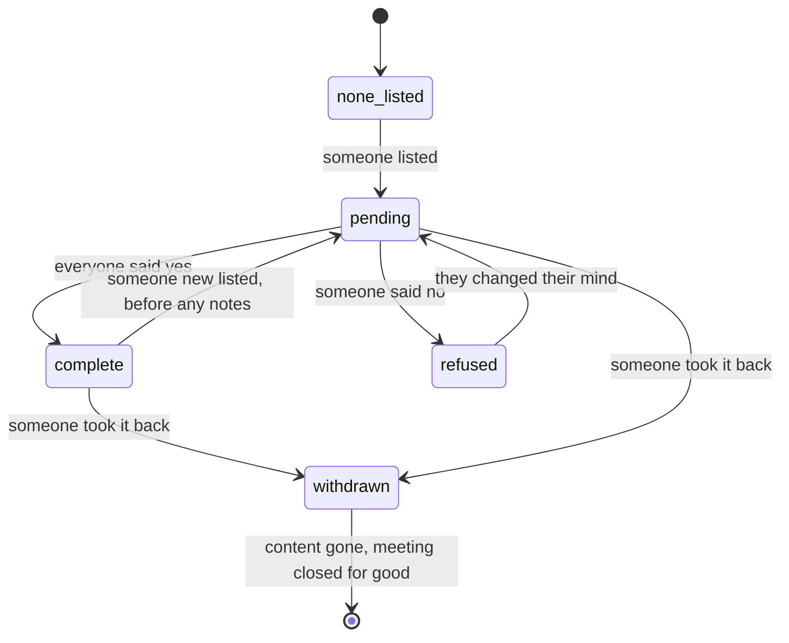

# ADR-033: Expansion: department packs, business connectors and meetings

**Status:** Proposed. D2, D3, D5 and D6 need outside security review before any real credential or real meeting content is used, alongside ADR-024 D4 and D5 and ADR-027 D2, D4 and D5. D5's consent model also needs counsel, because whether all-party consent is the right rule, and what a notice has to say, are legal questions. No real credential has been stored or used, no real provider has been contacted, and every test uses generated values against local fakes. The tables, triggers, types and ports exist, and the behaviour they describe is being built in M11A.
**Date:** 2026-11-06
**Deciders:** Project owner; security owner for D2, D3, D5 and D6; counsel for D5.
**Backlog:** `EXP-01`, `EXP-02`, `EXP-03`. Acceptance: each pack passes the pack format's review and rollback rules; each connector meets the connector lifecycle and reconciliation rules; consent and provider approval enforced, and derived work is proposed, not assumed.

## Context

M11 is expansion: useful, optional, and built on rules that already hold. This milestone adds no new way to do anything dangerous. Each of the three parts is a new use of something earlier milestones already got right, and most decisions here are about not weakening those.

Four facts shape what follows:

- **The spec names kinds of system, not vendors.** The catalog says "CRM / ticketing / accounting: read/update selected records", with the guardrail "reconciliation + provider scopes". No vendor has been chosen, and choosing one is a commercial decision that also needs contracts.
- **The egress gateway has one target, on purpose** (ADR-027 D5). That rule is why "what can this reach?" has a one-line answer. Three more systems could easily erode it.
- **Meetings are the first feature whose content is about people who may not use Ensemus.** Someone outside the company can be in the room, has no account here, and did not agree to anything. Names and terms can be trade secrets, too.
- **The milestones this depends on are being written now.** M4's model gateway and egress decision, M5's knowledge pipeline and M7's pack format do not exist on this branch.

## Decisions

| # | Decision |
|---|---|
| **D1** | A department pack is plain, reviewable data in its own package. It has no code path, and installing one grants nothing. M7 owns installing. This milestone owns the content and the rules any pack must pass. |
| **D2** | Connectors are one vendor-neutral adapter protocol, one kind per system type, each through its own single-target gateway instance. No vendor appears in the code. |
| **D3** | A connector keeps an allowlist of fields. Who may read one is what the source said, mapped to people here, and being an organization admin adds nothing. Every change is a verified external action, with its approval and receipt. No tool moves money. |
| **D4** | Meetings are off for a tenant until an administrator turns them on and names the organization's own notice. |
| **D5** | Consent is all-or-nothing, per meeting, in append-only records, enforced by triggers. A withdrawal takes every word out of the product in the same transaction, and the transaction cannot commit otherwise. |
| **D6** | Notes reach a provider only under an explicit approval for that provider, purpose and class, rechecked right before the call. Restricted content never goes. Only someone who was in the room reads the content. |
| **D7** | Derived work is proposed, never applied. The database refuses any other starting state, and only a named person who was there can turn a proposal into a Work Unit. |
| **D8** | Where a sibling milestone owns something, this depends on a small port whose shipped default refuses. |

### D1. Department packs

The catalog lists what a pack holds (object and view schemas, agent definitions, skills, workflow blueprints, policy requirements, localization strings and evaluation scenarios) and the rule that matters: installing cannot grant permissions automatically, and upgrades need migration and rollback paths.

`@ensemus/domain/department-pack` is that list as a type, and `checkDepartmentPack` and `checkPackUpgrade` are the rules as pure functions. `@ensemus/department-packs` holds the content, one folder per pack. Lint keeps that package from the database, connectors, Temporal, secrets, sockets and the filesystem, so a pack is something you can read, diff and review.

The type does some of the work. A request has `grantedOnInstall: false` as a literal, so "this pack grants that on install" cannot be written. The rule functions catch what a type cannot:

| Rule | What it stops |
|---|---|
| `AGENT_TOOL_NOT_REQUESTED`, `WORKFLOW_TOOL_NOT_REQUESTED` | Using a tool the reviewer was never asked about |
| `AGENT_TOOL_HAS_EFFECT` | An agent holding a side effect. An agent proposes, and an effect is a workflow step behind a person's approval |
| `WORKFLOW_EFFECT_WITHOUT_APPROVAL` | A side effect with no approval right before it. An approval is used up by the effect after it |
| `WORKFLOW_UNBOUNDED` | Loops with no limit, which the catalog forbids |
| `TOOL_MOVES_MONEY`, `TOOL_BULK_OUTREACH`, `TOOL_NEVER_ALLOWED` | Finance's and sales' guardrails, held for every pack |
| `RESTRICTED_WITHOUT_ISOLATION` | HR's "strict employment data isolation", held for any pack asking for restricted data |
| `STRINGS_COMPLIANCE_CLAIM` | A pack claiming compliance with legislation, which the catalog forbids |
| `EVALUATION_NO_DENIED_SCENARIO` | A guardrail with nothing proving it |
| `MIGRATION_*`, `UPGRADE_*` | An upgrade that cannot be undone, or that asks for more without going back to a person |

**Which packs.** The catalog names five, and M7 builds "the first department pack". Nothing on M7's branches says which yet. The flagship workflow is deal won to client onboarding, so this assumes **sales operations is M7's**, and M11A builds **marketing, HR, finance and learning**. If M7 chooses another, the missing one is a copy of this work and the duplicate is dropped at the merge (see Open questions).

**Passing these rules means fit for a person to review, and no more.** Numbers in a pack, such as `max_cost_usd`, are limits a person sets at install, and not prices.

**Rejected: packs as code.** A function can do anything, so a review would have to read all of it. Data also lets the rule functions see everything.

**Rejected: writing packs against a guess at M7's format.** They are written against the catalog's list, and `DepartmentPackFormat` adapts them to M7's real installer at the merge. If M7's rules go further, a pack has to pass both.

### D2. One adapter protocol, one gateway per kind

**The protocol.** `@ensemus/contracts/business-adapter` defines a small HTTP and JSON protocol: read a stream's records with a cursor, post an operation with our idempotency key, look an operation up by that key, and read a note. A customer or integrator maps it to whichever system they run, and a vendor's own connector can replace it later without changing anything above it. This is how "no vendor commitments" and "typed operations" are both true.

| | |
|---|---|
| Connector types | `crm_http`, `ticketing_http`, `accounting_http`, `meeting_notes_http` |
| Credentials | Through `CredentialLease`, in the connector worker, as ADR-027 D3 |
| Settings | Which streams are selected, which scopes were granted, and a TLS name. Never a host, a port or a credential |
| Reconcile | `best_effort`. A lookup that finds an operation is believed. One that does not find it proves nothing, because a real system may be slow to show it, so it stays with a person |
| Idempotency | Native, with the intent's key |
| Webhooks | `ensemus_hmac_sha256_v1`, and a verified notice can only ask for a sync (ADR-027 D4) |

**Why a small HTTP client and no library.** The same reason as SMTP: ADR-027 D2 turns on knowing exactly when the first byte was written, and `node:http` is not allowed in this package because it opens its own sockets. `packages/connectors/src/business/http.ts` sends one request on one connection, and never retries or follows a redirect. TLS is Node's, with no custom cryptography, and it wants an outside review.

**What an answer means, in one table, in one place** (`business/kit.ts`):

| What happened | Result | Why |
|---|---|---|
| Nothing written yet: refused, timed out, TLS failed, credential would not open | `not_sent` | Certain |
| 429 or 503 | `not_sent`, retryable | The protocol defines these as "not done, try later" |
| 2xx saying `applied` | `accepted` | The provider's word |
| 2xx saying `rejected`, other 4xx | `rejected` | The provider's word |
| 401 or 403 | `rejected`, `AUTH_FAILED` | The provider's word |
| Written, then silence, a dropped connection, a 5xx or a body we cannot read | `indeterminate` | It may have happened. It goes to reconcile, and then to a person |

**Gateways.** ADR-027 D5's rule stays exactly as it is: one service has credentials and no route out, and one service has a route out and no credentials. Each kind of system gets **its own instance of the same gateway**, on its own port, with its own single target and no new code. `routeConnector` binds a connector to its instance, and `ConnectorContext.network` still takes no host. So "what can the CRM connector reach?" still has a one-line answer, and a compromised connector worker gets those targets and nothing else.

A connector with no route is not on the worker's list at all, so it is clearly unavailable, as the integrations doc requires. **Air-gapped installs set no routes and make no attempts**, and the shipped stack is unchanged.

**The real cost: one target per kind per deployment.** That suits BYOM and Sovereign, where one customer runs one system. In a multi-tenant Cloud deployment, every tenant shares the CRM target, so tenants with different CRMs would need an adapter service that routes between them, and that service would hold or see all of their traffic. This is deliberately not solved here, and it is the main thing to reconsider before offering these connectors in Cloud (see Open questions).

**Rejected: one gateway with an allowlist.** It breaks the one-target rule to save a container. **Rejected: tenant-supplied URLs.** ADR-027 D3 closes SSRF at the source, and this keeps it closed.

### D3. Records: selected, permissioned, and changed only through an intent

**What is stored.** `BUSINESS_STREAMS` lists every field of every stream. `selectRecordFields` keeps those and drops the rest, so a source adding a field cannot put anything new in the database. A stream nobody selected makes no contact and stores nothing. This is what "selected records" means.

**The order of a page.** The connector hands its fields to a sink before the cursor moves, and M3's `commitSyncPage` writes the resource and its grants. Those are two transactions, because M3's commit is its own. The order is safe, and it is why:

- Crash between them: the page repeats, and writing the same fields again changes nothing.
- Fields with no resource row yet: **nobody can read them**, because access comes from the resource's grants. So the window fails closed.
- Lost the compare-and-swap: the other pass wrote the same page.

**Who reads.** `canReadBusinessRecord`: a source grant that maps to this person or a team they are on, from an active connection, on a resource that has not gone. An organization owner or admin has no way in by that alone, because the external system never said so. They can manage the connection, and see how many records it holds. `unmapped` means nobody, and `partial` means only those it could place (ADR-027 D3).

**Classification.** `recordClassification` lets a source raise a record's class and never lower it past a floor per connector, and accounting's floor is `confidential`.

**Changes.** Each is an intent with an approval, using `integrations.external_actions` and its triggers unchanged, so everything in ADR-027 D1 and D2 holds: an immutable payload, the same hash on approval and intent, at most one effect, and `unknown` going to a person. Four more things:

- `expected_version` is in the payload, and the adapter refuses if the source has moved on. Someone cannot overwrite what they never saw.
- `checkRecordChange` allows only `writable` fields of that stream, and checks it when proposing and again before sending.
- The connection's `write` scope is checked when proposing and again before sending. A connection granted read has no way to write.
- **Restricted work cannot propose one**, as the table's `classification` check already says.

**Why a twin of `proposeExternalActionInTx`.** M3's service takes email only, with a check at its top, and it is not this milestone's file. `proposeBusinessActionInTx` is its twin, and the triggers hold them to the same rules. The cost is two short functions that must not drift. At the final merge they should be folded together behind a tool registry. That is a follow-up, and it is noted in the slices file.

**No tool moves money.** The accounting connector reads, annotates memo and reference fields, and creates draft invoices (the catalog's third bundled workflow). A draft's payload has no status and no bank or payment field, so a draft is all it can be. Every money field is read-only in every stream, and a test holds that. `max_cost_usd` aside, Ensemus states no amounts of its own.

**Revocation.** A revoked connection's records are denied at once, by the join, and their fields are cleared by the tenant's upkeep.

### D4. Off until someone turns them on

`meetings.settings` starts with no row, which means off, and the trigger on new meetings reads it. Turning it on takes an owner or admin, and a `notice_ref`.

**Ensemus states no legal terms.** `notice_ref` and `terms_ref` are references to documents the organization owns: which version of its notice, and where its record of a provider's basis is. The page shows the reference and says who holds the text. Writing that text is theirs and their counsel's, and is listed as owner-led.

### D5. Consent

**All or nothing, per meeting.** Everyone listed has to say yes, and the newest word from each is what counts. This is the strictest common rule, and so the safest default. Counsel may say a jurisdiction allows less, which would be a setting, and is listed as an owner decision. Nothing here claims that this satisfies any law.

**Who can say what.** A member records their own answer, and nobody can do it for them, including the organizer and an administrator. Someone outside has no account, so the organizer attests, and `basis = attested` says it is the organizer's word and not theirs. A trigger holds both, and the notice reference must be the current one.

**What people are agreeing to.** Notes being stored, and being sent to the providers an administrator approved. They are not agreeing to their boss reading them (D6).

**What consent guards.** Nothing comes in before it. Notes are refused until consent is complete, and so is reading a note's text from a connector: a sync brings titles and permissions, with no text, since nobody has agreed to anything yet. Who was in the room is fixed once notes exist, because someone added later has agreed to nothing.

**Withdrawal, and why it cannot be forgotten.** A `withdrawn` record has to commit with the meeting already `purged`, and a deferred constraint trigger refuses the commit otherwise, so a service that forgets the purge commits nothing. The purge, under the meeting's lock:

1. Notes and summaries lose their text, for good. A trigger allows the text to go and never to change or come back.
2. Open proposals become `withdrawn`. Decided ones lose their text and keep who decided what.
3. Open runs become `refused`, so a model's late answer is dropped, not stored.
4. The meeting's title becomes `Removed`, because a title can say what it was about.
5. A tombstone and its ledger event are written (ADR-026), with `meeting` as a new target type, so a restore cannot bring the content back.
6. `MEETING_CONTENT_PURGED` tells M5 to remove it from every index and cache.

**What it does not take.** A Work Unit a person made from a proposal stays. They chose what it says, it is their record, and removing it would make work disappear from under its owner. The ledger cannot prove a deletion happened (ADR-026), and a dump still holds the text until it expires (`LIFE-02`). The provider that saw the notes keeps whatever its terms say it keeps, and that is why the approval names the terms. **This is the honest limit of a withdrawal, and the page has to say so.**

**Records of consent are kept** after a purge, append-only, because they prove who said what. They hold a participant ID, a decision, a basis and a reference, and no content. An outside participant's label stays on their row, and whether that needs clearing is a question for counsel.

### D6. Provider approval, and who reads

**An approval is narrow.** `meetings.provider_approvals` says that one model profile or connection may do named things, up to one class, until a date, with `terms_ref` pointing at the basis. It is written by a named, active owner or admin, a trigger checks that, and it has no renewal: widening one means writing a new one. Purposes are `summarize` and `extract_items` for a model, and `import_notes` for a source.

**Restricted content never goes.** `max_classification` cannot be `restricted`, and `provider_approved` leaves it off its list, so a restricted meeting has no path to a provider. This matches `data-egress-matrix.csv`. A specially authorized local profile could be added later, and it would need its own decision.

**The check, three times, with different jobs:**

| When | What | Why |
|---|---|---|
| A person asks | The service, then the insert trigger | So they hear the reason |
| Just before the call | `beginMeetingDerivation` under the meeting's lock, then the move to `running` in a trigger, then M4's egress decision | Consent or approval may have changed since |
| When storing the answer | `running` is required, and consent is read again | Someone may have said no while the model was thinking |

**Only a person starts a run.** `requested_by_membership_id` is required, and the service refuses a service context, so nothing summarizes anything by itself on a schedule.

**The model's answer is a stranger's text.** It read notes a stranger may have written, so it can try to say anything. `meetingSummaryOutputSchema` and `meetingItemsOutputSchema` are strict and bounded, with no ID, URL or instruction field to fill in. It refers to participants by position in a list it was given, and maps back on our side, so it never handles an ID. A summary is `model_generated`, by a check on the table, and the page says so.

**Derived content keeps the source's class** (secrets and egress §6): a trigger requires it to match the meeting's.

**Who reads.** The organizer and the people listed. An organization owner or admin who was not there can see that a meeting exists, when, who ran it and where consent stands, and nothing it said, including its title. They can hand it on if its organizer leaves. This is stricter than `canReadWork`, on purpose, because consent was to processing and not to reading. It is reversible, and it is listed as an owner decision.

**Temporal sees IDs only.** `meetingDerivationWorkflow` takes `{organizationId, derivationRunId}`. Notes stay in PostgreSQL and in the Activity's memory. One Activity does the recheck, the call and the storing, because splitting them would mean putting notes in a workflow's history. Retrying it can repeat the call, which costs money and shows the same notes to the same approved provider again. It has no other effect, since storing is keyed on the run.

### D7. Proposed, never applied

The rule is in the database, because the worker and the web share a role (ADR-027's trade-off):

- A proposed item must start `proposed`, with no decider, no decision time and no Work Unit. There is no column a workflow can fill in to skip a person.
- `proposed` moves only to `accepted` or `rejected` with a named person who was in the room, or to `withdrawn` with nobody named, by a purge.
- `accepted` work must point at a Work Unit, unique per item.

**Accepting is the only path to a Work Unit.** `acceptProposedWork` creates it in the same transaction as the status, from what the person sent, in their name. The model's suggested owner and date only fill in the form. The Work Unit takes the meeting's class, so derived work is never less protected than its source, and no event starts anything on its own.

**Why it writes the Work Unit itself.** `createWorkUnit` opens its own transaction, so calling it means two transactions, and a crash between them leaves work nobody decided on, which is the thing this rule forbids. Refactoring it would collide with M3's change to the same function. So the slice writes the same rows, event and audit entry, and a test holds them equal. At the final merge `createWorkUnit` should get an `InTx` form and this should call it.

### D8. Ports with a default that refuses

| Port | Owner | Default until merged |
|---|---|---|
| `MeetingModelGateway` | M4 | `noMeetingModel`: a run ends `MODEL_UNAVAILABLE`, and the page says so |
| `MeetingEgressGate` | M4 | `denyAllMeetingEgress`: nothing leaves |
| `MeetingKnowledgeIndex` | M5 | `noMeetingKnowledgeIndex`: notes are not indexed, which is true |
| `DepartmentPackFormat` | M7 | None. Only tests implement it, and the packs are data until M7 installs them |

No fake ships as a default. A deployment that has not wired M4 cannot leak meeting content, and it says why it cannot summarize.

## Trade-offs

- **Web and worker share `ensemus_app`,** as in ADR-027. The rules are in triggers rather than role grants, so a compromised web tier could write a decision or a consent record under a forged membership, and the record is only as good as that role's exposure. **The outside review should decide** whether workers get their own role, and this makes the question weigh more.
- **Records are a second copy of someone else's data.** The source stays authoritative, and copies go stale between syncs. The copy is what makes the source's permissions and classification enforceable here, and the alternative, reading through on every page view, would put the connector worker in the web tier's request path.
- **Attested consent is one person's word.** It is recorded as exactly that. Nothing can be better without contacting outsiders, and a contact path to people with no account is its own decision.
- **Notes live in PostgreSQL,** bounded at 512 KiB, not in object storage. They are text, and the purge has to be atomic with consent, which an object store cannot be. Backups therefore hold them until they expire (`LIFE-02`).
- **No retention period is set for anything here.** Numeric defaults need legal and customer sign-off (data lifecycle §4), so content stays until someone removes it. Removing a meeting without a withdrawal is not in this milestone.

## Consequences

**Easier:** adding a kind of system is a spec and its fields. Adding a pack is a folder. The rules are in one place each, and a test can break everything above them.

**Harder:** a security reviewer has a second hand-written protocol client to read. Operators who want these connectors run one more gateway per kind. People may be asked for consent often enough to tire of it, and that should be measured when real use exists.

**Mode impact:** the same images and code in Cloud, BYOM and Sovereign. With no routes set, no business connector exists and no attempt is made. Sovereign can use manual notes with a local model through M4, once M4's approved profiles include one. Cloud's shared-target limit is above.

**Migration:** `0600` and `0601` add one schema and two tables to `integrations`. No existing table changes. `0600` and `0601` are outside the journal on this branch, because the final merge stitches them in order, so integration tests cannot run until then.

## Open questions for the owner

1. Which pack is M7's first? This assumes sales.
2. Which systems first? The adapter protocol commits to none. A real one needs an adapter or a vendor connector, and very likely a contract.
3. Do these connectors go in Cloud before multi-tenant routing is designed? This says not until then. BYOM and Sovereign first.
4. Is all-party consent the rule you want everywhere? Ask counsel. It is the strictest, and easy to relax.
5. May an organization owner or admin read meeting content they were not in? This says no. It is one function to change.
6. How long is meeting content kept? This sets nothing, and a number needs counsel.
7. Who supplies the notice text and the provider terms? Those are referenced here and written by you and your counsel.

## Reversal

Remove the gateway routes and no business connector exists. Leave `meetings.settings` off and no meeting can start. Packs do nothing until M7 installs one. Dropping the two tables and the schema is safe until something real depends on them. D5 and D7 become expensive to change once real consent records exist, and those should be reviewed first.

## Approvals

| Role | Name | Decision | Date |
|---|---|---|---|
| Project owner | | | |
| Security owner (D2, D3, D5, D6) | | | |
| Counsel (D5) | | | |
