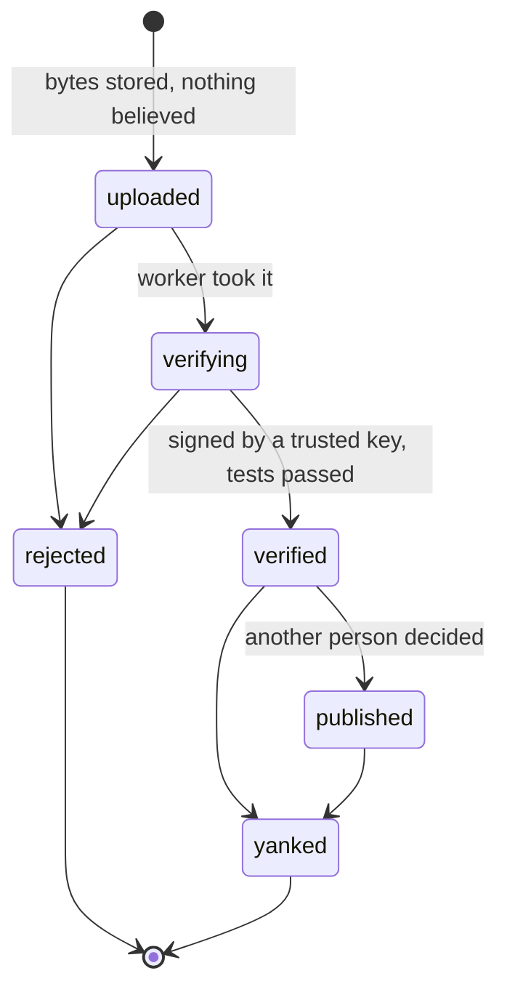
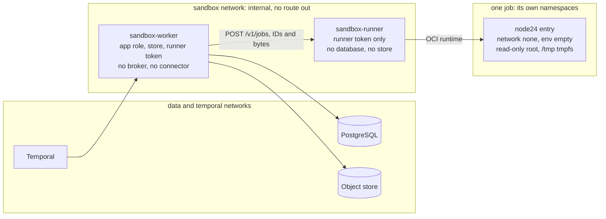
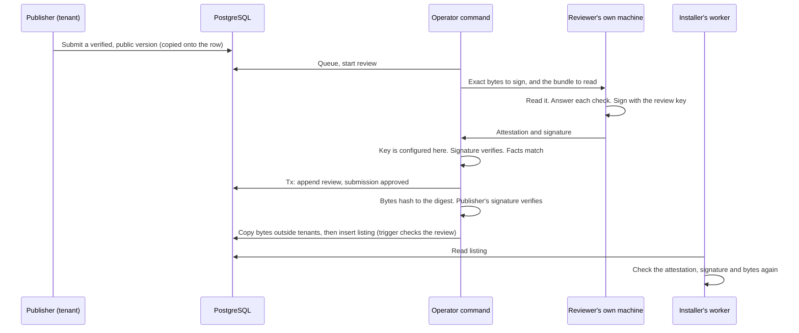

# ADR-034: Skills catalog, user-code sandbox and marketplace

**Status:** Proposed; implementation and qualification in progress. The release-candidate update below records what has run. D2, D3, D5 and D6 still need outside security review, and no product surface may describe the sandbox as isolated, secure or safe until that review and the runtime proofs below are complete.

**Integration update, 2026-11-21:** The recovered migrations are now applied in the isolated release-candidate database; schema and role tests have run. Signed bundle parsing, signature/review verification, publisher tooling and policy admission are implemented and unit tested. Catalog, durable verification and runner journeys remain incomplete. No real sandbox enforcement or outside security review is claimed. The original code-only implementation notes below describe the November 6 checkpoint.

**Date:** 2026-11-06
**Deciders:** Project owner; security owner for D2, D3, D5 and D6.
**Backlog:** `EXP-04`, `EXP-05`, `EXP-06`. Depends on `AGENT-01`, `AGENT-03` (M4). Scenarios: `SKL-TS-01` to `SKL-TS-05`, `SBX-TS-01` to `SBX-TS-08`, `MKT-TS-01` to `MKT-TS-07`.

## Context

Until M11, every piece of code Ensemus runs is code Ensemus wrote. These three tickets change that:

- **`EXP-04` Skills catalog:** "signed, tested and versioned packages". The spec's supply-chain section adds an approved owner, digest and signature, licence, allowed dependencies, tool boundaries and an execution environment.
- **`EXP-05` User-code sandbox:** "no ambient credentials; network, filesystem, time and memory limits enforced".
- **`EXP-06` Marketplace:** "signature and security review required before listing".

Five facts shape everything below:

- **The threat model names this one directly.** "Hostile agent/skill package" is a threat actor and "package marketplace" an entry point. The principles forbid "arbitrary native code installed from an unreviewed skills marketplace into privileged containers". Non-code skills need review too, because instructions can induce harmful permitted behaviour.
- **The web tier and workers share `ensemus_app`.** A rule only in application code is a rule a bug can break, so anything that must always hold goes in a trigger, as in ADR-027.
- **Isolation cannot be written, only proved.** A file that says "read-only" enforces nothing. What runs a job has to be a real boundary, and this build runs no containers, so this ADR separates what the code does from what still has to be shown.
- **A database row cannot prove who reviewed something.** If approval is only a flag, anyone who can write the row has approved it, so the review has to be a signature made with a key the database does not hold.
- **Sovereign has no phone-home.** There can be no central marketplace it talks to, and nothing here may need a route out.

## Decisions

| # | Decision |
|---|---|
| **D1** | A version is immutable once checked, and a trigger holds it to `signed` and `tested` before it can be verified or published. Every use rereads whether it may still be used. |
| **D2** | A package is one signed JSON document, with Ed25519 over a domain-separated hash of a manifest that lists every file. The web tier stores bytes and believes nothing, and a worker parses them later. Ensemus never holds a signing key. |
| **D3** | User code runs in a separate runner process, behind an OCI runtime, with no network mode but `none`, a fixed empty environment, no credentials of any kind, and every limit fixed on the run's row. With no runner configured, nothing runs. There is no fallback to a plain process. |
| **D4** | Someone other than the uploader publishes a version, and the table enforces it. Installing grants nothing. |
| **D5** | A listing needs a review signed by a key from the deployment's configuration. The trigger refuses a listing without an approved review row, and every install checks the signature again, so neither the row alone nor the signature alone is enough. |
| **D6** | One opt-in database role writes reviews and listings, used only by an operator command run by a person. No web route can reach it. The marketplace is per deployment and takes no payments. |
| **D7** | A tenant's copy goes through the same verification as an upload, and stays subject to the listing's revocation. |
| **D8** | Anything a parallel milestone owns is a small port that refuses when nothing implements it. |

### D1. A version, and "signed, tested and versioned"

`skills.package_versions` starts knowing only the size and hash of its bytes. What a worker learns from them (`semver`, `digest`, `manifest`, signer, execution kind, licence, data class) is written once, on the move to `verified`, and `check_version_change` refuses any change to it after that, for every role. So a version number means one thing for good.

**The move to `verified` and to `published` is a rule of the table, not of the code.** The trigger requires a signer this tenant trusts (or a listing it can still see, for a marketplace copy) and a passed row in `skills.test_runs` for exactly this digest, in the mode this kind of package needs. A rejected upload frees its version number, because it never meant anything.

**What "tested" means here, plainly.** A `contract` test checks each fixture's input and expected output against the declared schemas. It says the package's tests make sense, not that its instructions are good. A package with code also has to pass `sandbox` mode, which runs each fixture and compares the result. Whether instructions lead a model to a good result is an evaluation question, which belongs to M4 and M7's evaluation sets. This does not claim to answer it.

**Every use rereads.** `resolveSkillVersionForUse` puts the version, package, signer and listing through `skillUseDenial` in one transaction, immediately before use. Disabling a package, revoking a signer, yanking a version or revoking a listing takes effect for anything not already past that point.

**Revoking a signer** yanks every tenant-origin version it signed, in one transaction, and a revoked key can never be trusted again: the unique key and a trigger both refuse it. Trusting it again would mean trusting everything it ever signed.

### D2. The package, and why the web tier parses nothing

| | A: Tar or zip | **B: One JSON document (chosen)** | C: OCI artifact |
|---|---|---|---|
| Handling a stranger's upload | Archive library, path traversal, zip bombs, symlinks | `JSON.parse` under a hard size limit | Registry client and a registry |
| New dependency | One, with a history of exactly these bugs | None | Several |
| Fit for 8 MiB of text | Fine | Fine, with base64 overhead | Overkill |
| Sovereign | Fine | Fine | Needs a registry to be running |

**Why B:** there is nothing to unpack, so nothing can unpack badly. A path is a string that has to match one strict pattern, and the rule is written so it never has to clean one up: every part starts with a letter or digit, which rules out `..`, hidden files and drives before anything else looks at it.

**The format:** `{format, manifest, files[{path, content_base64}], signature{algorithm, key_id, value_base64}}`. The manifest lists every file with its SHA-256 and size. `digest = SHA-256("ensemus.skill.digest.v1\0" + canonicalJson(manifest))`, using the same `canonicalJson` approvals use. The signature is Ed25519 over `"ensemus.skill.signature.v1\0" + digest`, using `node:crypto`, so no dependency is added. The prefixes mean no signature can be replayed as any other kind.

**No signing key on any server.** A publisher signs on their own machine (`packages/skills/scripts/skill-tool.ts`) and uploads the result. A tenant trusts a public key by adding it, with its fingerprint shown. Studio cannot sign on someone's behalf in M11B. If that is ever wanted, it needs its own review, because a server holding a signing key is what this design avoids.

**The web tier stores bytes and believes nothing,** for the same reason as webhooks in ADR-027 D4. Parsing 8 MiB of untrusted JSON is CPU work a web process should not do, and nothing it could learn is usable until a worker has checked it anyway. It counts the bytes as it reads them, hashes them, stores them, and writes the row and `skill_version.uploaded` in one transaction.

**A restricted JSON Schema.** Manifests declare input and output schemas, and a worker evaluates what a stranger wrote. So the dialect is a fixed list of keywords with no `pattern`, `format` or `$ref`, bounded in depth and size, and read by a small interpreter in `@ensemus/skills/bundle`. It cannot compile a regular expression, so it cannot be used for a denial of service that way, and it cannot fetch anything. Adopting `ajv` here would have meant generating code from hostile input.

**Licences and dependencies.** Third-party code is carried inside the bundle and declared by name, version and licence, and nothing is fetched. The allowed licences are the same short list `check-licenses.mjs` accepts without a named exception. `LicenseRef-Proprietary-Tenant` lets a tenant keep its own skill private. Marketplace review checks it is not used there.

### D3. The sandbox

**What a job is given:** the package's files, read-only at `/skill`. Its input, on standard input and nowhere else. A size-limited `tmpfs` at `/tmp`. An environment of exactly `PATH` and `HOME=/tmp`, written in the OCI spec, so nothing of the runner's reaches it. A job is told nothing about which tenant, person or skill it serves.

**What a job is never given, in M11B:**

| | Decision | Why |
|---|---|---|
| Network | `none` is the only value, in the manifest contract, the compiled policy and the protocol. A package asking for anything else is rejected, not narrowed | Opening it needs a route out of the sandbox network, an allowlist and SSRF defence, on the runner's side. That is its own ADR and review. A skill that needs the world asks through a tool, and M4's gateway authorizes that outside the model |
| Credentials | None of any kind, ambient or issued | The spec allows ephemeral per-action credentials. Nothing here needs one yet, because with no network there is nothing to use one on. Adding them is reversible, and adds a whole class of risk that nothing has asked for |
| Restricted data | Refused by a table check, whatever a package says | `data-egress-matrix.csv` denies restricted by default, and third-party code reading it needs a per-tenant policy that does not exist. Reversible |
| Logs | Standard error is counted and thrown away. Standard output is parsed as JSON and checked against the output schema, or dropped | A job's text is untrusted and may hold what it was given. There is no debug path that stores it |

**Where the boundary is.** A job runs under an OCI runtime the operator names (`ENSEMUS_SANDBOX_RUNTIME_BINARY`), such as gVisor's `runsc` or `crun`. Node's own permission model is not used as a boundary: its documentation says it does not protect against malicious code, and that is the threat. `node:vm` is not used at all.

| | A: Plain child process with rlimits | B: Docker socket from the worker | **C: Dedicated runner + OCI runtime (chosen)** |
|---|---|---|---|
| Boundary | None worth the name | A kernel boundary, but the socket is root on the host | Namespaces and seccomp at least, and a user-space kernel with `runsc` |
| If the job escapes | Reaches the worker and its database role | Reaches the host | Reaches a process with a request token and no route out |
| Runs on a low-disk dev machine | Yes | Yes | Not without setup, which is why this is unproved today |
| Deployment cost | None | Low, and unacceptable | A runtime in the image, and elevated capabilities on that one container (see "What must be proved") |

**There is no fallback.** With no binary set, the runner refuses every job. With no sandbox worker running, a run waits a bounded time and ends `runner_unavailable`. The only code that runs a job without a runtime is in `@ensemus/sandbox/testing`, and lint keeps it out of anything that ships. A deployment that never asked for this has none of it running (`ENSEMUS_SANDBOX_ENABLED` is off, and both processes sit under a `sandbox` profile).

**Three processes, each with less than the last.** The sandbox worker has the application role, the store and a request token, and lint keeps the broker and connectors out of it. The runner has a request token, and lint keeps the database, the store and every credential out of it. A job has nothing. So an escape from a job reaches a process with nothing worth taking, and that process cannot start anything but more jobs.

**The policy is fixed on the row, and rechecked.** `compileSandboxPolicy` turns a manifest's request and this deployment's ceilings into a `SandboxPolicy` when a run is requested, and it refuses rather than narrows, so a package's tests mean the same on every deployment that accepts it. The policy and its hash cannot be updated. Before a job starts, the worker rehashes the stored policy, and rehashes the bytes against the row and the signature, so a changed object in the store ends `SKILL_BYTES_CHANGED` and never runs.

**Runs are safe to retry, within limits.** Unlike an external action (ADR-027), a job with no network and no credentials cannot have changed anything outside itself, so a lost attempt goes back to `queued`, up to three attempts. That argument depends on `network: none`. Opening the network removes it, and any change there must revisit this.

**Temporal sees IDs only.** `sandboxRunWorkflow` receives `{organizationId, sandboxRunId}`, and Activities exchange enums and counters. Input and output stay in PostgreSQL under RLS. The execute Activity runs on `SANDBOX_TASK_QUEUE`, polled only by the sandbox worker, and has a schedule-to-start limit, so nothing waits for ever for a worker that does not exist. Cancelling goes through the outbox, and `cancel_requested_at` is rechecked before start, so a run asked in time never starts.

**Budgets.** A concurrency ceiling per tenant holds across workers under an advisory lock. Every limit is enforced per job. Metering belongs to M8, which can read the counters on the row: nothing here prices anything.

#### What is not claimed

A **probe** runs real jobs that try to do what the limits forbid: open a socket, resolve a name, read the environment and `/proc/1/environ`, look for mounted secrets, write outside `/tmp`, overfill `/tmp`, allocate past the memory limit, spin past the CPU limit, sleep past the wall limit, fork past the process limit, see the host's processes. Each check passes only on seeing the forbidden thing fail, so a job that crashes before trying fails it. The worker needs a passing report no older than `ENSEMUS_SANDBOX_PROBE_MAX_AGE_MS`, and the trigger refuses `running` without a probe time on the row.

A passing probe says **the limits held for these jobs on this server**. It says nothing about whether a determined attacker can escape. So `isolation_evidence` has two values, `none` and `probe_passed`, and no value means isolated. A test fails if a word like that appears. The page says "limits checked on this server at this time", and says outside review has not happened.

### D4. Who decides

Uploading needs `skill.manage`, publishing needs `skill.publish`, and the version's `published_by` cannot equal its `uploaded_by`, which a table check enforces. The table also requires an uploader on a tenant's own upload, so that check cannot be avoided by leaving it blank. A marketplace copy has no uploader here, and someone here still has to publish it.

**This locks out a one-person tenant.** An organization with a single owner can upload and never publish. It is the safe default, it is reversible by dropping a check, and it is listed for the owner to decide.

**Declaring a tool grants nothing.** `tool_boundaries` narrows what a skill's instructions may ask for and is shown to the person publishing. Each tool call still goes through M4's gateway with the agent's own grants. A version's page shows what it declares, as the product requirements ask of extension review.

### D5. Signature and security review, before listing

**Two locks that fail differently:**

| Lock | Stops | If it were missing |
|---|---|---|
| `check_new_listing` trigger | A listing with no approved review of exactly this digest, signer and attestation, by anyone with a connection | A bug in the operator command could list something unreviewed |
| Column grants and no policy | The web tier and workers writing a review or a listing at all | A compromised web tier could write rows, and the signature check would still refuse them at install |
| Review signature checked at install | Anything that got a row written by any means, including a stolen operator role | A stolen operator role could list anything |
| Keys in configuration, not the database | Writing a row adding a trusted reviewer | The signature check would prove nothing |

**What a review is.** Seven fixed checks, each `pass`, `fail` or `not_applicable`, and fixed finding codes, so "reviewed" means the same every time. Only `code_read_for_abuse` can be `not_applicable`, and only for a package with no code. An approval needs every check answered and no findings, which the trigger holds except for that last rule, which the command holds. The signer's key cannot be the reviewer's. The attestation covers the publisher, name, version, digest, signer, verdict, checks and time, so changing any of them breaks the signature.

**Reviewing is a person looking, not a certification.** The API and the page say who signed and when. Nothing in the product may turn it into a badge, a grade or a promise, and what a review obliges anyone to do is for counsel (see the owner-led items).

**What may leave a tenant.** A package has `content_classification`, and only `public` can be submitted, by a person with `marketplace.publish` (owners only), confirming in the request that other organizations will see it. A marketplace copy cannot be re-submitted as your own. A publisher cannot withdraw what is listed: it asks, and the operator delists.

### D6. The operator role, and the marketplace's shape

| | A: Operator as a tenant, through the web | B: `ensemus_app` with a wider policy | **C: Separate role, used only by a command (chosen)** |
|---|---|---|---|
| Blast radius if the web tier is taken | Can review and list | Can review and list | None here: no grant, no policy |
| Review UI | A page | A page | A command-line tool run by a person |
| Spec fit | Hides a platform role inside tenancy | Against ADR-024 D4 | Matches ADR-024 D4's narrow roles |
| Sovereign | Needs a privileged tenant | Same | Same tool, offline |

**Why C:** a review is rare, slow and worth protecting. A command costs little and removes the web tier from the path entirely. A page can come later, on its own ADR.

**The role is opt-in, and a migration does not need it.** `ensemus_marketplace` reaches only the `marketplace` schema: not `skills`, `work`, `secrets`, `identity`, `org`, nor installations. Migrations run with no `CREATEROLE`, and a server is provisioned once, so first-boot provisioning and every existing server have no such role. `grant_operator_role()` is a function migration 0651 defines, and calls only if the role exists. `provision-marketplace.sql`, run by hand by a superuser, creates the role and calls it. Until then nobody can write a review or a listing, every other feature is unaffected, and the upgrade path stays as it is.

**Per deployment, and no payments.** The tables have no price, plan or currency, a test fails if one appears, and no code path charges anything. Listing is global to one deployment, and a deployment talks to no other. A Sovereign operator with a vendor's package has a tenant trust the vendor's key, upload it, and put it through the same review. There is no second import path to attack. A hosted catalog across deployments, and paid listings, are future decisions.

**Takedown.** `delist` has two modes: `stop_new` stops new installs and leaves existing copies running, and `revoke` also stops every copy at its next use. A listing never comes back, and `stop_new` can harden into `revoke` but not the reverse. A tenant that installed one can still read its listing after a delisting, so it can see why it stopped.

### D7. Installing

An installation copies bytes, and grants nothing, which is `AGENT-14`'s rule for packs. `marketplaceInstallWorkflow` checks the attestation against this deployment's review keys, the publisher's signature, and the bytes against the digest, and copies them to the tenant's own prefix. It then creates an `origin = marketplace` package and an `uploaded` version with no uploader, and runs the ordinary `skillVerificationWorkflow` over the copy as a child. So a copy's own tests run on this deployment, under its ceilings. Someone here still has to publish it. A tenant cannot edit its copy's classification, because the content is not its own.

### D8. What other milestones owe this one

Sibling branches were checked with `git branch`, and none had committed anything but the base when this was written. So nothing here uses their real types. Each need is a port defined here, implemented at the final merge, and a missing implementation refuses.

| Port | Owner | Refuses how |
|---|---|---|
| `AgentRunGuard` (`@ensemus/application`): may this agent run still act | M4 (`AGENT-02`, `AGENT-03`) | A request naming an agent run with no guard ends `AGENT_LINK_UNAVAILABLE`, so nothing runs for an agent nobody can stop |
| `SkillFeatureGate`: is this tenant entitled | M8 | `deploymentFeatureGate` answers from operator switches, all off. M8 adds its check alongside, and both must say yes |
| `requestSandboxRunInTx`, `resolveSkillVersionForUse` | Called **by** M4's tool gateway and agent runtime | An agent version pins a skill version by ID, never by "latest", and its gateway decides whether the agent may use the tool. This never does |
| `sandbox.runs.agent_run_id`, `execution_step_id` | M4 | Plain IDs until the final merge adds keys, once M4's table names are known |
| Tenant offboarding | M8 (`LIFE`) | The `*_keep` triggers refuse deletes, as ADR-027's do, so offboarding must handle these tables as it does those |
| Pack skills (`AGENT-14`) | M7 | A pack that carries skills calls the catalog's services and gets no shortcut |

M4's `AGENT-01` is "versioned agent/skill schema and registry". If M4 also creates skill tables, the final merge has to pick one owner. These live in schema `skills` to keep them from colliding by name, and this ADR's position is that signed packages live here and M4's registry refers to them by ID.

## What needs outside review

Nothing here has had any. Before any real tenant's code or data reaches this:

| Item | Why it needs someone else's eyes |
|---|---|
| D3's boundary: the OCI spec, seccomp allowlist, chosen runtime and its capabilities | It is the only thing between hostile code and the runner |
| The runner's handling of paths, files and output | Parsing and writing what a stranger sent, on the boundary's outer side |
| D2's bundle parser and restricted schema interpreter | Runs on hostile input in a worker with a database role |
| D5's attestation format, domain separation and key handling | The whole of "reviewed" rests on it |
| Migration 0651 | Reviewed security SQL, like every other, and the rules live here |
| D6's role and the operator command | The one thing that crosses tenants |

## What must be proved

None of this has been shown. Each is a test written and not run, or a proof that needs containers. All of it is listed in `docs/06-delivery/m11b-slices.md` and in the handoff.

1. A real runtime applies the spec: each row of `ISOLATION_CHECKS`, by the probe, on the images that ship.
2. The runner can run that runtime inside its own container, with what capabilities. Nested `runsc` commonly needs elevated privileges on the outer container. **If it needs `--privileged`, the runner must not share a host with anything else, and that is an owner decision with a cost.**
3. The `sandbox` network has no route out, by the air-gap gate's method: packet capture while a job tries.
4. An escape from a job, simulated by running a hostile process in the runner's own namespace, reaches no database, store or secret.
5. The stock stack without the profile has none of these services, and makes no new outbound attempt.
6. Migrations 0650 and 0651 apply on the merged journal, and `skills-schema.test.ts` passes against real roles.

## Trade-offs

- **`network: none` only** rules out skills that fetch something directly. They have to ask through a tool, which is slower to build and is exactly the boundary this wants.
- **A command, not a page, for review** costs marketplace operators convenience, and keeps the web tier out of it.
- **No archive format** costs about a third in size to base64, within an 8 MiB limit that fits text skills. A skill carrying large assets does not fit, and that is a later decision.
- **Refusing limits over the ceiling, rather than narrowing,** means a package can fail to install on a stricter deployment. Narrowing would mean its tests prove something other than what runs.
- **Two-person publishing** locks out one-person tenants until the owner decides otherwise.
- **Node only** means Python skills cannot run. A second runtime is a second image to review.

## Consequences

- Two new packages, `@ensemus/skills` and `@ensemus/sandbox`, with import rules that fail the build. Three new worker entry points. No new outside dependency.
- Three new database schemas with forced RLS, and one optional role.
- The stock stack changes in one way: the main worker registers three more Activity sets, and they do nothing until an event starts them, which needs a feature an operator turned on.
- Temporal gets three new workflows, each joining the replay corpus once it can be captured.

## Open questions for the owner

Each has a default in place that is safe and reversible, and none blocks the build.

1. **Runtime and host for the runner.** `runsc`, `crun`, or a dedicated VM, and whether a privileged container on a shared host is acceptable. Default: none configured, so nothing runs.
2. **Who holds marketplace review keys, and what a reviewer must look at beyond the fixed checks.** Default: no keys configured, so nothing can be installed.
3. **Two-person publishing for one-person tenants.** Default: enforced.
4. **Opening a sandbox network, or issuing ephemeral credentials.** Default: neither, and either needs its own ADR.
5. **Restricted data in a sandbox.** Default: refused.
6. **Whether these three features ship on by default in any commercial mode.** Default: all off.
7. **A hosted catalog across deployments, and paid listings.** Default: neither exists, and no terms or prices are invented here.

## Reversal

Each feature has its own switch, and off means every surface refuses. The tables can stay empty indefinitely. Dropping the sandbox entirely means removing the profile and leaving `sandbox.runs` as a record. Nothing else depends on it.

## Approvals

| Role | Name | Decision | Date |
|---|---|---|---|
| Project owner | | Pending | |
| Security owner | | Pending | |
| Outside security reviewer | | Not yet engaged | |
