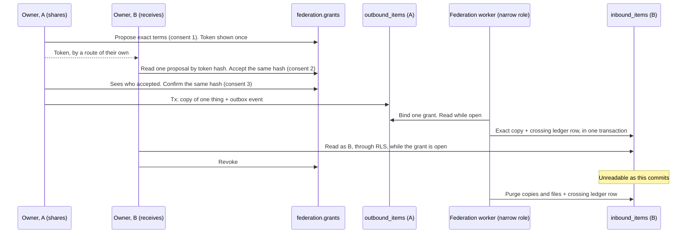

# ADR-035: Cross-organization work, dedicated tenants and regions

**Status:** Proposed. Nothing here has run against a real database or a real deployment: it is written and typechecked only, and the migrations are not yet in the journal. D1 to D4, and the use of an optional role in D2, **need outside security review before any tenant's data crosses**, alongside ADR-024 D4 and ADR-027. D5 and D6 need review before anyone is told a deployment is isolated or in a region. No real credential has been stored or used, and every test uses generated values.
**Date:** 2026-11-06
**Deciders:** Project owner; security owner for D1 to D4; product and commercial owners for what is listed under [owner decisions](#owner-decisions).
**Backlog:** `EXP-07`, `EXP-08`, `EXP-09`. Scenarios: `XORG-TS-01` to `XORG-TS-08`, `TIER-TS-01` to `TIER-TS-03`, `RES-TS-01` to `RES-TS-03`. Threats: `TR-M11C-01` to `TR-M11C-08`.

## Context

Every other milestone defends one rule: a tenant's data stays in that tenant. Cross-organization work deliberately crosses it, so it is the riskiest thing in the product to get slightly wrong, and it has to be built so that the rest of the product does not change at all.

Five facts shape everything below:

- **The whole isolation model is one session variable.** `ensemus_app` sees a tenant because `app.organization_id` says so ([ADR-024](ADR-024-build-start-runtime-contracts.md) D4). Any policy on an existing table that adds "or a grant says so" weakens every test that holds that table today. [Multitenancy](../../02-architecture/07-multitenancy.md) section 7 asks for explicit invitation, authorization at both ends, limited objects, signed consent, purpose restriction, export controls and revocation, disabled by default.
- **The migrator cannot create a role.** Only a superuser can, and provisioning runs once, on first boot, so a role added to provisioning would not exist on an install that upgrades. A migration that grants to a missing role fails, and would stop every upgrade whether or not anyone wants this feature.
- **Nobody can look up another tenant,** and they must not be able to. The two sides have to find each other some other way, and neither can read the other's rows to check.
- **Dedicated tiers and data residency are open owner decisions** ([decisions](../03-decisions-and-adrs.md)). The code cannot name a price, a level of service, a region or a promise, but it must be able to refuse what cannot be shown, and to say nothing it has no evidence for.
- **Residency reaches further than the database:** storage, backups, support access, embeddings, inference and telemetry ([data lifecycle](../../04-security/05-data-lifecycle.md) section 7), and "do not claim an all-in-region product if a connected AI model sends content elsewhere."

## Decisions

| # | Decision |
|---|---|
| **D1** | `federation.grants` is the single explicit grant table. Two owners consent to the exact hashed terms, with a third step where the sharing owner sees who accepted before anything crosses. Every grant has a date, and either side can end it for good. |
| **D2** | One optional role, `ensemus_federation`, is the only way to write from one tenant to another. It sees one grant per transaction, and no table of business data. It exists only where an operator created it, so a deployment that never turned this on has no way across at all. |
| **D3** | What crosses is a copy, made on purpose by a person in their own tenant, holding only the fields a strict contract allows. A worker carries it, with only IDs through Temporal. No policy on any existing table changes, and the web tier gets no new reach. |
| **D4** | Reading stops when a revocation commits, because the read policy asks whether the grant is open. A worker then removes the copies, and a ledger both parties can read records what crossed and what was removed. |
| **D5** | A tier is one whole deployment. A dedicated deployment holds one organization, enforced by a trigger, and the word "isolated" is only ever worked out from probes that ran and statements that were recorded. |
| **D6** | A region is one whole deployment too. Where each surface happens is an operator's declaration, a requirement is a tenant's own, and a gate refuses what cannot be shown to meet it. With nothing configured, nothing is claimed. |

### D1. The grant

| | A: A row per tenant | **B: One shared row (chosen)** | C: A broker service |
|---|---|---|---|
| Consistency | Two rows to keep in step, which neither side can write | One row and one state machine | One service, but a new one |
| Reach | Each side sees only its own | Both parties read one row, which holds no content | Depends on the service's credentials |
| Revocation | Must reach the other side's row first | One commit, seen by both | A network call that can fail |
| Fit with the suite | Fits, with more moving parts | Fits: reviewed SQL, like everything else | ADR-015 forbids a second backend by default |

**Why B:** a revocation has to be true everywhere the moment it commits. With one row there is nothing to get out of step, and this is the only table in the product that two tenants can both read, so it is easy to audit that it holds only the agreement.

**The three steps.** A token alone would be a bearer credential to a company's data: if it is forwarded, the wrong organization could accept. So consent takes three steps, each by an active **owner**, each naming the terms hash they read:

1. The sharing owner proposes. Only the token's hash is stored, the token is shown once, and this product sends it nowhere, because it cannot look anybody up.
2. An owner of the receiving tenant previews by token, which reveals that one proposal under their own binding, and accepts the same hash. Accepting reveals their organization's name.
3. The sharing owner now sees who accepted, compares a fingerprint by another route if they wish, and confirms. **Nothing crosses before this.**

**"Signed" here means bound and attributable, not cryptographically signed.** Multitenancy section 7 says signed consent. Each consent records who, when, and the SHA-256 of the canonical terms, using the same `canonicalJson` as approvals (ADR-027 D1). There is no key held by a person, so this would not by itself prove anything to a third party. It is marked for outside review, and a stronger form is a later change that does not alter this table's meaning.

**What the triggers hold, whatever a service does:** the terms, hash, purpose, dates and token are fixed by column grants; the name on each side is read from that organization's own row, so a request cannot choose one to impersonate; a consent with a different hash is refused; only an owner of the right side can consent; only an owner or admin can end one; `ended` has no way out; a tenant's switch cannot go off while anything is open, and consenting takes a row lock on that switch so the two are put in order; `expired` is only true once the date has passed, and names nobody.

**Names are not verified.** Two organizations can be called the same thing. The token's route and the fingerprint are what tell them apart, and the page has to say so.

**Off by default, three times.** An operator switch in configuration, written to `tenancy.deployment_profile.cross_org_enabled`, which no tenant can write. A tenant's own switch, `federation.org_settings`, where no row means off. And `CrossOrgEntitlement`, a port that the plan system implements if there is one, since which plans include this is an owner decision. The operator's switch is also part of `federation.grant_is_open`, so turning it off closes every grant at once.

### D2. The role

| | A: Add grants to `ensemus_app` policies | B: `SECURITY DEFINER` functions | C: Required narrow role | **D: Optional narrow role (chosen)** |
|---|---|---|---|---|
| Existing tests | Weakens every policy it touches | Unchanged | Unchanged | Unchanged |
| Blast radius | Every table named | Whatever the function owner can do | Shared copies only | Shared copies only, and none at all where it is off |
| Upgrades | Fine | Fine | **A grant to a missing role fails the migration** | Fine |
| Sovereign | Present whether wanted or not | Present | Present, with a password to manage | Absent unless turned on |
| Cost | Lowest | Low, but `SECURITY DEFINER` and FORCE RLS interact badly | Low | One function holding the grants, and one extra operator step |

**Why D:** the role reaches only `federation.outbound_items`, `federation.inbound_items`, `federation.crossings`, a few columns of `federation.grants` and one column of the profile. It has nothing in `work`, `org`, `identity`, `platform`, `governance`, `secrets` or `integrations`. It can write a title and a body into an inbound row but cannot read one back. And since only a superuser can create it, a deployment that never enabled this has no role, no password and no worker, which is the strongest form of "disabled by default" there is.

**How the grants arrive.** They sit inside `federation.apply_bridge_grants()`, in the reviewed migration, so a reviewer reads every line. It does nothing without the role, it refuses a role with `BYPASSRLS`, `SUPERUSER`, `CREATEROLE` or `CREATEDB`, and it can be repeated. `runMigrations` calls it each time, inside the same lock. Turning the feature on later is: create the role as a superuser, run the migrate job, set the switch, start the worker.

**Binding.** `BridgeDatabase.withGrant` is the only method on the handle, and it sets `app.federation_grant_id`, which only this role's policies read. A query with no grant bound finds nothing. A compromised federation worker could set any ID, so its reach is every copy under every open grant, in both directions, and that is exactly what an outside reviewer should weigh. It is still far less than `ensemus_app`, whose process can bind any tenant.

**Lint.** `@ensemus/database/federation` is blocked everywhere but three named files, and a test fails if that list grows.

### D3. What crosses

**Why copies.** The alternative is a policy on `work.work_units` saying "or a grant allows it", and then every column of that table, and every table added later, is one mistake from crossing. A copy has only the fields in its strict contract, and the bridge never touches a source record.

**Limited objects, by purpose.** `FEDERATION_PURPOSE_KINDS` says what may go which way, in the domain and in `federation.kinds_for`, and a test holds them equal. Widening it takes a reviewed migration. Terms state the kinds explicitly, so an old agreement says what it said.

| Purpose | From sharing to receiving | Back |
|---|---|---|
| `delegated_work` | `work_summary`, `artifact` | `status_update`, `artifact` |
| `document_review` | `artifact` | `status_update` |

**Restricted never crosses.** The `classification` checks leave it out, as with external actions in ADR-027. Each grant also caps classification, defaulting to `internal`, and classification comes from the source row and not the request.

**Only people send.** `created_by_membership_id` is required and must be an active owner or admin, so no agent or service can publish, which matches "no model-issued grants" in the prohibitions. Agents cannot propose, accept or confirm.

**What arrived is another company's words.** Inbound items sit in their own table, which nothing indexes, embeds or retrieves, and they are not offered to an agent as instructions. Accepting one starts nothing: it can only point at a Work Unit a person made. Taking them into knowledge or a context is a later, separate decision (`KNOW-*`, M5).

**Files cannot be aimed.** A file's object key is a check constraint on the row, `federation/outbound/{organization}/{item}` and `federation/inbound/{organization}/{item}`, so no row can point the worker at another tenant's bytes. The worker verifies the hash after copying and refuses with a code if it differs.

**Temporal and the web tier.** Only IDs and enums cross Temporal: `{organizationId, itemId}` and `{organizationId, grantId}`. The dispatcher starts `federationDeliveryWorkflow` and `federationPurgeWorkflow` on the platform queue, and their Activities run on `FEDERATION_TASK_QUEUE`, polled only by the federation worker. With no worker, things wait and nothing crosses. The web tier writes its own tenant's rows and its outbox, as ever, with no new role and no path to Temporal.

**No cross-deployment federation.** Both parties must be on the same deployment, because this is one database. A dedicated tenant has nobody to work with in this version, and the profile refuses that combination. Federation between deployments is a much larger design, and a safe thing to leave out for now.

### D4. Revocation

Either party ends a grant, and that cannot be undone.

1. **On commit:** `inbound_receiver_read` requires `federation.grant_is_open`, so nothing arrived can be read on any page, including an open one on its next request. The bridge's outbound read fails the same test, so nothing further crosses. This does not wait for any worker.
2. **No race:** a crossing takes a shared advisory lock on the grant, and ending takes it exclusively. So a crossing either finishes before the end commits, and is purged, or sees the grant closed.
3. **Afterwards:** `federation.grant_ended` starts `federationPurgeWorkflow`, which removes the copies and their files in bounded passes until none are left, and each side gets its notification and audit row. The row goes first and the bytes after, so a crash leaves a file nobody can reach, not a row pointing at nothing.
4. **The record:** `federation.crossings` holds what crossed and what was removed, with a hash and a kind and no content. Both parties can read it, and it is append-only for everyone.

**What revocation cannot do, and the page must say so.** It cannot make someone forget. Anyone who read a copy, or downloaded a file, still has what they saw. Backups keep what they hold until they age out, under the [data lifecycle](../../04-security/05-data-lifecycle.md) rules and ADR-026.

**Export controls.** A received item cannot be sent on, because `publishItem` only takes a sender's own Work Unit or artifact. Inbound items are left out of a tenant's export, since they belong to the sender. This is a safe default, and is listed for the owner to confirm.

### D5. Dedicated tiers

| | A: Route per tenant inside one web tier | **B: One whole deployment per dedicated tenant (chosen)** |
|---|---|---|
| Web tier | Holds many database URLs, against ADR-024's reach rule | Unchanged: one database, one Temporal namespace |
| Failure | Shared process, shared fate | Separate |
| Code | A router, a connection registry, per-tenant pools | Almost none |
| Operations | Fewer deployments | More deployments to patch, which is the real cost |
| Reversible | Hard, once routes exist | Easy: same images and same database shape as Sovereign |

**Why B:** it is the same signed images, with no second code path, and everything already proven for one deployment holds for each. "Isolated database, networking and worker pools" then means there is nothing shared to get wrong. The cost is operational, and sizing it is part of the owner's tier decision.

**One organization, by trigger.** `tenancy.deployment_profile` has at most one row, which only the deploy job writes as the migrator. On a dedicated deployment `tenancy.check_new_organization` refuses any organization but the pinned one. It reads the profile, because RLS would hide others from a count. With no profile row, every existing path behaves exactly as before, and this was the requirement.

**"Isolated" is worked out, not written.** `tenancy.isolation_evidence` is append-only, and `isolation-report` writes it from real probes:

| Aspect | How it is found | Result |
|---|---|---|
| `database` | The dispatcher's event metadata lists every organization ever created, and it must be only the pinned one | `passed` or `failed` |
| `network` | From inside, the operator's list of another deployment's endpoints must be unreachable | `passed` or `failed` |
| `worker_pool`, `temporal_namespace` | Namespace and queue compared with the same list, and the other deployment's Temporal unreachable | `passed` or `failed` |
| `object_store` | Bucket compared with the list, and the other store unreachable | `passed` or `failed` |
| `backups`, `embeddings`, `telemetry`, `key_encryption_key` | A probe inside cannot prove these, so an operator states them, with a reference | `declared` |

`isolationPosture` says `isolated` only when every probed aspect passed **on this release**, and the rest are declared. A probed aspect cannot be merely declared. A shared deployment is never `isolated`. An older check shows `stale`. With no list of foreign endpoints the network probe reports `NO_FOREIGN_ENDPOINTS_GIVEN` and fails, because it proved nothing.

**Customer-held keys** stay a `SecretBroker` adapter (ADR-024 D5), and are not built here. Offering them is an owner decision.

### D6. Regions and residency

**A region is one deployment**, for the same reasons as D5: `home_region` on the profile is singular. This means a tenant is in a region because it signed up on that deployment. Moving is a process, not an update: the export and verified import in [data portability](../../07-commercial/03-data-portability-and-exit.md). It is not built here, and nothing offers it.

**Three things, kept apart:**

- **The statement** is an operator's, in `ENSEMUS_RESIDENCY_POLICY_FILE`: for each of the six surfaces, the regions it happens in, and a reference to what backs that up. This is configuration, and no region is named anywhere in the code. The product repeats it as "declared", and has no way to verify it.
- **The requirement** is a tenant's: `tenancy.residency_requirements`, for everything or one data class, set by an owner. A trigger refuses a region this deployment is not in, and refuses any requirement if the deployment claims no region, so there is never a saved promise nothing enforces.
- **The gate** is `ResidencyGate.check`, which other milestones call before data goes anywhere: the model router before inference (M4), the embedder before embedding (M5), support access (M8), and any telemetry exporter. With no requirement it allows and claims nothing. With one, the surface must be declared wholly inside the region, and if the caller knows a real target, such as a model profile's region, that must be inside it too. A target that cannot say where it is denies. Reading the requirements failing denies. A denial writes one audit row with a code and no data.

**In-region statements are worked out too.** `residencyPosture` says `allInRegion` only when all six surfaces are declared wholly in the home region and no `ProcessingLocationSource` sees a connected thing going elsewhere. This is how "do not claim an all-in-region product if a connected AI model sends content elsewhere" becomes code. M4 and M5 supply those sources at the final merge.

**Mode impact.** Cloud and BYOM can use all of this. Sovereign gets D1 to D4 only if its operator turns them on, with the same rules, and D6 lets it state its own posture. It makes no outbound call, and adds no phone-home in any mode.

## Owner decisions

Each of these has a safe, reversible default in the code. None is decided here.

| Decision | Default until decided | How to change it |
|---|---|---|
| Which tiers are sold, and at what price and service level | Only the mechanism exists. No price, SLA, RTO or RPO appears anywhere | Commercial documents and plan entitlements |
| Data residency stance, and which regions are offered | No region is named. With nothing configured, nothing is claimed and a requirement cannot be set | Configuration, per deployment |
| Which plans include cross-organization work | `CrossOrgEntitlement` with no plan system allows it, and operator and owner switches still have to be on | The M8 entitlement adapter |
| Whether cross-organization work is offered at launch at all | Off everywhere | `ENSEMUS_CROSS_ORG_ENABLED` and the role |
| Contract between two collaborating organizations, and data roles | **None drafted.** The terms are a technical scope, and the page must not present them as an agreement in law | Counsel. A required acknowledgement can be added to the terms |
| Whether consent needs two people on a side | One owner at each step | A trigger change, which is a reviewed migration |
| How long a grant may last | At most 365 days, with invitations at most 14 | Domain constants, and an operator could lower them |
| Whether received items are in a tenant's export | Left out | The export slice in M8 |
| Whether received items may ever reach knowledge or agents | Never | A later ADR |
| Whether customer-held keys are offered on dedicated | Not offered | A `SecretBroker` adapter |
| Moving a tenant between regions | Not offered | Export and verified import |

## What needs outside review

| Item | Why |
|---|---|
| All of migration `0703`, and `0701`'s organization trigger | They are the boundary. Nothing here has run against PostgreSQL yet |
| `ensemus_federation` and `BridgeDatabase` | A compromised federation worker reaches every copy under every open grant |
| Consent without cryptographic signatures | Multitenancy section 7 says signed. This is bound and attributable, and no more |
| Two-party RLS on `grants` and `crossings` | Two policies in the product deliberately see another tenant's ID, opaque membership IDs and a token's hash |
| Token handling | A bearer token, stopped from reaching the wrong side only by the third step |
| What a revocation can honestly promise | Copies already read, and backups |
| Isolation probes | Whether these prove what the page says they prove |

## Trade-off analysis

- **Copies cost storage and a delay.** A received item is seconds old at best, not live. In exchange the bridge can only ever move what a person chose to send.
- **The third step costs a round of waiting** when both sides are ready. It is what stops a forwarded token sending a company's data to a stranger, so it stays.
- **One deployment per tenant or region costs operations.** Each one needs patching, backups and monitoring. It removes a whole class of code that could get routing wrong, and it can be revisited behind the same profile if the numbers ever demand it.
- **An optional role costs an operator step, and integration tests create it themselves.** It saves every deployment that never uses this from having a way across, and it keeps upgrades working.

## Consequences

**Easier:** auditing the boundary, since one migration holds all of it. Every existing test stays as it was, and no existing policy or role changes. Saying only what is true about isolation and residency.

**Harder:** a person has to send things one at a time, on purpose, so large shared workspaces are not this feature. Reviewing one more role. The deploy job gains a step. Other milestones must call the gate at the final merge, and until they do a requirement is only enforced where it is called. `TIER-TS-*` and `RES-TS-*` say so plainly.

**Revisit when:** a customer needs live shared records rather than copies; a review rejects hash-bound consent; dedicated tenants need to collaborate across deployments; operating many deployments becomes the main cost.

**Rollback:** nothing depends on this until someone turns it on. Turning it off closes every grant at once. D3 and D4's tables can be emptied and left. D5 and D6 fall back to their defaults when the profile row is removed.

## Acceptance tests

| Test | Backlog |
|---|---|
| Off by default: no profile, no switch, and every path answers as if it does not exist | `EXP-07`, `XORG-TS-01` |
| Two-sided consent: each of the three steps refused for the wrong person, wrong side, wrong hash and past the date | `EXP-07`, `XORG-TS-02` |
| Limited objects: a kind or a class the terms do not cover is refused, and restricted always is | `EXP-07`, `XORG-TS-03` |
| Revocation: unreadable on commit, and purged afterwards, with a crash in between | `EXP-07`, `XORG-TS-04` |
| The role reaches what ADR-035 lists and nothing else, and no existing role gained anything | `EXP-07`, `XORG-TS-05` |
| A third tenant sees nothing, through any table, by any ID or token | `EXP-07`, `XORG-TS-06` |
| Canary in a title and a file, then dump Temporal and logs: absent | `EXP-07`, `XORG-TS-07` |
| A crossing racing a revocation leaves nothing readable | `EXP-07`, `XORG-TS-08` |
| A second organization on a dedicated deployment is refused by the database | `EXP-08`, `TIER-TS-01` |
| Two dedicated stacks: database, network and worker pool cannot reach each other | `EXP-08`, `TIER-TS-02` |
| Isolated is false until each probe has passed on this release | `EXP-08`, `TIER-TS-03` |
| Every surface, unmet, denies and audits, and an undeclared one is not assumed | `EXP-09`, `RES-TS-01` |
| A model profile in another region removes the all-in-region statement | `EXP-09`, `RES-TS-02` |
| A requirement for a region this deployment is not in is refused | `EXP-09`, `RES-TS-03` |
