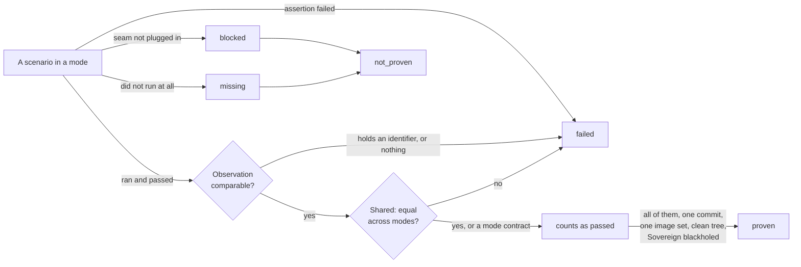

# ADR-036: Release readiness: parity suite, guides and license inventory

**Status:** Proposed. Nothing here has run on a deployed stack, and no human has reviewed it. The parity gate has never started a container, so it has shown nothing about any mode. Counsel has not seen the license inventory. D5's public Help route, and the claim check in D6, should go to the outside security reviewer alongside ADR-024 D4 and D5.
**Date:** 2026-11-06
**Deciders:** Project owner; counsel for what D7 produces.
**Backlog:** `COMM-06`, `DOC-01`, `DOC-02`, `LEGAL-05`. This is the part of M9 that agents can build. `SEC-07`, `UX-23` and `LEGAL-04`, and the human half of `DOC-02` and `LEGAL-05`, stay with people.

## Context

M9 asks for outside evidence on a frozen release candidate. Three of its inputs can be built before anyone outside is hired: a suite that holds the three modes to one behaviour, documentation, and a list of what the release redistributes. Four facts shape them:

- **All three are about claims, so all three can lie.** A parity suite that skips what is not built reads as passing. A guide can describe the plan instead of the product. An inventory with a short list reads as a complete one. Each design below has to make the dishonest result hard to produce by accident.
- **Most of what these describe does not exist yet.** M3 to M8 are being written on their own branches at this moment. Their tables, routes and types are not final, and their foundations are still at the base commit as this is written.
- **Sovereign has to read its documentation with no network**, and `docs/` does not reach the image (`.dockerignore`). A link to a hosted site would be a phone-home at the moment someone needs help.
- **This work must not add runtime risk to a product about to be assessed.** It runs beside the product, and adds one read-only page.

## Decisions

| # | Decision |
|---|---|
| **D1** | No tables, migrations, API, events or new package. Parity results, guides and inventories are release artifacts, not tenant data. |
| **D2** | One release runs in each mode, as configuration. Scenarios report what they saw, and the gate compares it. There are three verdicts: `proven`, `not_proven` and `failed`. |
| **D3** | Modes may differ only along a named dimension of a contract taken from the commercial documents, and a test ties each dimension to its row there. |
| **D4** | What other milestones own is reached through small seams. An unplugged seam makes a scenario `blocked`. It can never make one pass. |
| **D5** | User guides are compiled into the product and served at `/help`, from a small block format, with no raw HTML. |
| **D6** | Every guide states its status, and a checker refuses claims without evidence, outside hosts and real addresses. A pass says the guides are well formed, not that they are true. |
| **D7** | The license tool lists facts and flags what to look at. It holds no legal conclusion, and it cannot say that anything was reviewed. |

### D1. No new state

The task template for a foundation asks for migrations, Drizzle tables, RLS, ports, Zod contracts, OpenAPI and outbox events. **This milestone adds none, and the `0900` migration range stays unused.** Nothing here has a tenant, a user or a row:

- A parity report is evidence about a commit. It belongs with the build artifacts, next to the SBOMs, in `.local/parity` and as a CI artifact.
- A guide is a file, and the same for every customer of a release.
- An inventory describes a release.

Adding tables to hold these would widen RLS, roles and the assessed surface for no consumer. `REL-03` signs gates with named evidence, and it can name files. If an operator ever needs to see parity results in the product, that is a new decision with its own review.

The one piece of shared code is pure and test-only. `tests/parity` never ships (`.dockerignore`), and nothing under `apps`, `workers` or `packages` imports it.

### D2. How parity is decided

`docs/07-commercial/04-deployment-and-support-matrix.md` requires "same Work Unit semantics, agent manifest formats, policy checks, data import/export and core UX", and `COMM-06` requires the same tests to pass in all three modes. Passing the same tests is weaker than behaving alike: two modes can each pass an assertion while answering differently. So:

- **Same images.** `parity-gate.mjs` builds once, then starts the stack three times with a different `ENSEMUS_MODE`. It records the image IDs that really ran, and different IDs fail the gate. That also holds ADR-010: modes are runtime configuration, not forks.
- **Observations, not only assertions.** A scenario returns what it saw: statuses, codes, counts and sequences. A shared scenario's observations must be equal across its modes. A UUID, an address, a timestamp, a long hexadecimal value or a URL in one is refused, because it would make modes differ for no reason, and it would put identifiers into release evidence.
- **The deployment has to say which mode it is.** The harness reads the responsibility statement on the setup page before believing anything else, so a stack started in the wrong mode stops the run. It uses the statement a person sees, and adds no test-only endpoint to the product.
- **Sovereign's round has outside names unreachable**, using the air-gap overlay. It does not count packets. `air-gap-gate.mjs` still does that, and this does not replace it.

**There are two bars, on purpose.** Run plainly, the gate fails on anything that contradicts parity, and otherwise prints `NOT PROVEN` and exits zero. With `--release` it also fails on `not_proven`. A gate that stayed red until M8 merged would teach everyone to ignore it. A gate that went green while most scenarios were blocked would be worse. CI runs the first bar, and launch sign-off (`REL-03`) runs the second.

**Rejected: `skip` for what is not built.** Reporters count a skipped test as nothing, and a suite with 40 skips and no failures looks like a pass. A skipped scenario is reported as `blocked` with its reason, and that is what stands between the run and `proven`.

### D3. The differences that are allowed

The same matrix allows differences "only in hosting, local provider availability, external integrations, licensing/billing and support". `tests/parity/contract.ts` is that matrix in machine form. Each dimension names which allowance it falls under, and the exact row it came from, and a unit test finds that row in the document. A scenario of kind `mode_contract` must name a dimension.

So adding a difference between modes means adding a dimension that names its allowance, which a reviewer will see. A difference that fits none of the five is a parity failure, not a new row. The contract holds who does what, and no number: no price, allowance or service level. Those are the owner's.

### D4. Seams

The suite has to be written while what it tests is being written. `tests/parity/seams.ts` defines what scenarios need in their own terms, such as "arrange a model supply that refuses" or "lapse maintenance". `tests/parity/wiring.ts` is empty until slice `parity-wiring` plugs in the real code after M3 to M8 merge.

- A seam reaches the product through the product's own paths. What sits on the far side, a provider or a mail server, is a local fake that lives with the tests, on generated values.
- An unplugged seam throws `SeamNotWired`, which the harness records as `blocked`, with the tickets that own it. **No default implementation exists, so no scenario can pass on a stand-in.**
- A seam is not a port of the product. Nothing shipped depends on it. If a sibling's real types differ from a seam's shape, `parity-wiring` adapts on the test side, and the sibling changes nothing for this.

### D5. Guides ship inside the product

**Decision: user guides are served at `/help`, and operator guides ship with a release as files.** The safest reversible default for where documentation lives, and the owner can add a hosted site later, because the source stays Markdown.

- **It works everywhere the product works.** No host, no network, and the same in all three modes, which is its own small parity.
- **No new dependency, and no way to inject markup.** Guides use a small format (`docs/specifications/tools/guide-rules.mjs`): headings, paragraphs, flat lists, tables, quotes, code, bold and relative links. `check-guides.mjs` refuses anything else, raw HTML and images included. `build-help.mjs` compiles the blocks to `apps/web/src/generated/guides.ts`, checked in like the generated API types, because `docs/` does not reach the image. React renders them as text nodes, so `dangerouslySetInnerHTML` is not needed and the route must not use it.
- **`/help` needs no sign-in.** "I cannot sign in" has to be answerable, and the content is the same for everyone. It reads no tenant data, and takes no input but a slug checked against the compiled list. A page for another mode answers not found, so a Sovereign deployment does not offer billing help.
- **Only written pages are shown.** A stub or a `not_in_product` page is not compiled in, and a link to one becomes plain text.

**Rejected:** a Markdown library in the web tier (a dependency and a sanitizer to review, for a format we control), and a static site in the image (a second web server, against "one web framework").

### D6. What a guide may say

Guides are written from code on branches that are still moving, and mostly by agents. So each one states its status in front matter, the checker holds it to that, and the page says it to the reader.

| Status | Means | Set by |
|---|---|---|
| `not_written` | A stub | The foundation |
| `not_in_product` | The feature is on no branch, and the page says only that | A writer |
| `written_untested` | Written from the code, with an exact banner saying nobody has followed it | A writer |
| `tested` | Each behaviour has a named test that ran in CI | Whoever saw them pass |
| `walked_through` | Someone who did not write it followed it, and it names them | **Only a person** |

The checker refuses, in prose, anything that reads as a certification, compliance claim, service level, price, recovery number, air-gap claim, absolute, confidentiality claim or legal term. It refuses, anywhere, real-looking addresses, credentials and outside hosts. To say what is *not* claimed, a writer ends a negative sentence with `<!-- not-a-claim -->`, and the checker refuses that marker on a line with no negative in it. These are patterns, so they will have gaps and false alarms, and **a pass only says the guides are well formed**.

Every ticket up to M8 is either named by a page or listed in `docs/guides/coverage-exempt.csv` with its reason, which stops a feature being forgotten without showing anything about any page. `--release` also refuses stubs and untested pages, and refuses install, upgrade, backup and offline-install guides that nobody else has followed, which is `DOC-02`'s acceptance test. So an agent can never finish `DOC-02`, by design.

### D7. The license inventory

`check:licenses` already answers "has someone looked at this license type?" (`FOUND-07`). `LEGAL-05` needs something else: a list counsel can read, of what is really distributed. `infrastructure/licenses/inventory.schema.json` fixes its shape.

- **Facts only.** Each component states what it declares, word for word, and where that came from. `attention` holds facts for a reviewer to look at first, such as `copyleft_family` or `license_text_not_found`. None is a verdict.
- **It cannot say "reviewed".** The `review` field is a constant, `draft_not_reviewed_by_counsel`. Counsel's review is recorded outside the tool, so the tool can never be read as having approved anything. The notices file it writes says the same on its first line.
- **A short list cannot pass as complete.** Each source (npm, container images, OS packages, model weights, other) has a section saying `collected`, `declared_by_hand`, `not_collected` or `none_distributed`, with the reason. OS packages come from the SBOMs `build-release.mjs` makes, which need Docker, so until those exist that section says `not_collected`.
- **What was typed by hand says so.** The third-party images' licenses are read from their upstream projects, not from inside the images, and are marked `declared_by_hand_not_read_from_artifact` until an image's own files have been read.
- **Scope is what ships.** The web and worker images' production dependencies, the third-party images in `compose.yaml`, the base image, and, when the owner decides them, model weights. Images only in `compose.test.yaml` are test tools and do not ship, and the tool has to show it left them out.

## Consequences

**Good:**

- The gate cannot report parity it did not see, and a missing scenario holds it back.
- Everything here is outside the product except one read-only page, so the runtime surface being assessed barely grows.
- Documentation can be written now, marked honestly, and tightened as evidence arrives, without another format later.

**Costs:**

- `apps/web/src/generated/guides.ts` has to be rebuilt whenever a user guide changes, which `check:guides` enforces. The final merge rebuilds it, along with `docs/MANIFEST.json`.
- Guides written now from moving branches will need a second pass (slice `guides-sweep`).
- Parity costs one more CI job: one build, then three full stacks. It adds up to an hour of runner time per push.
- The claim check will sometimes need the `not-a-claim` marker on an innocent line. That is cheaper than a claim getting through.

## Needs outside review

- **Security reviewer:** the public `/help` route and its compiled content, and whether the claim and value checks are enough for a customer-facing document set.
- **Counsel:** the inventory's content and the notices, under `LEGAL-05`. The tool drafts nothing that counsel has seen.
- **Someone who did not write them:** the install, upgrade, backup and offline-install guides, under `DOC-02`.

The penetration test (`SEC-07`), the accessibility audit (`UX-23`) and the agreements (`LEGAL-04`) stay outside this work.

## Owner decisions, each with its safe default

| Decision | Default until you decide | To change it |
|---|---|---|
| Where documentation is published | In the product at `/help`, and as files in a release. No hosted site | Add a site from the same Markdown |
| Whether Help is public before sign-in | Public, since it holds no tenant data | Add `requireActor()` to the route |
| Languages | English only | Translate the source Markdown |
| Who follows the operator guides for `DOC-02` | Nobody yet, so those pages cannot reach `walked_through` | Name someone. The delivery plan already calls for a second person from M6 |
| How people reach support and report a vulnerability | The guides name no address or hours, and say the contract or the operator does. `OPS-22` and `OPS-25` publish these | Give the addresses and coverage hours |
| When parity must be `proven` | Only at launch sign-off (`--release`). CI fails on contradictions alone | Add `--release` to the CI job |
| Whether a mode may launch with some scenarios blocked | No. A mode that has not shown parity waits, as `REL-03` says | A named exception in the launch record |
| Which notices ship in a release | None until counsel has reviewed them | Counsel approves the draft |
