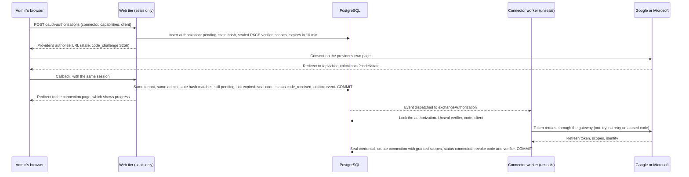

# ADR-038: Workspace suites: connect by consent, directory, and agents inside Google and Microsoft

**Status:** Proposed. D1, D2, D4 and D6 need outside security review before any real Google or Microsoft account, client or token is used, alongside ADR-024 D4/D5, ADR-027 D2/D4/D5 and ADR-029 D11. FLAGGED FOR HUMAN SECURITY REVIEW: the migrations this ADR adds (`0560_*`, `0561_*`, `0562_*`, `0563_*`, `0564_*`). No real credential has been used: every test uses generated values and local fakes.
**Date:** 2026-11-11
**Deciders:** Project owner; security owner for D1, D2, D4 and D6.
**Backlog:** `CONNECT-04`, `CONNECT-05` (widened), new `CONNECT-07` (connect by consent), `CONNECT-08` (directory sync), `CONNECT-09` (suite tools for agents). Builds on ADR-027 (external actions) and ADR-029 D11 (Drive and SharePoint read).

## Context

M5 gave Ensemus read access to Google Drive and to OneDrive and SharePoint. Three things stop a company from using that, and a fourth is what the owner actually wants:

- **There is no way to connect except pasting a client ID, a client secret and a refresh token.** Nobody outside engineering can do that, and a person who can should not have a refresh token on their clipboard.
- **Nothing writes `connections.granted_scopes`.** Both connectors refuse a stream whose scopes are missing, so a pasted credential syncs nothing.
- **The Google, Microsoft and MCP connectors run nowhere.** `workers/workflow/src/connector-worker.ts` registers only SMTP and the inbound webhook, `createProviderHttpClient` is used only by tests, and Compose has one egress gateway with one target. M5's connectors pass their tests against fakes and have never been wired.
- **A share with a group grants nobody.** `resolveSourcePrincipal` maps users by email and returns null for every group. Google and Microsoft are mostly shared by group, so most files end up readable by no one here. That is safe and useless.
- **Agents should work inside the suites,** not only read them: read a person's mail and calendar, draft and send, book meetings, create and edit documents and sheets, post to Teams. At the best quality the providers allow, and never by a path that skips approval, receipts or the source's own permissions.

Facts that shape the decisions:

- **The web tier can seal and cannot unseal, and has no route out** (ADR-024 D5). Turning an authorization code into a token needs the client secret, so the web tier cannot do it.
- **The connector worker holds credentials, reaches the outside only through one gateway per named route, and checks TLS names fixed in code** (ADR-027 D5, ADR-029 D11).
- **Source permissions are resolved at sync time** into `external_resource_acl.membership_id` or `team_id`, and every read checks those columns. Team membership is read live, so a team is already a principal whose membership can change without rewriting a grant.
- **Google's and Microsoft's own AI features** (Gemini in Workspace, Microsoft 365 Copilot) are products for their users. Where either offers a documented API to third parties, it is a model provider like any other and goes through M4's router and egress policy. Ensemus does not depend on them: our agents do the work through each suite's data APIs.

## Decisions

| # | Decision |
|---|---|
| **D1** | An admin connects by consent on Google's or Microsoft's own page: authorization code with PKCE. The web tier starts it and stores what comes back, sealed. The connector worker exchanges the code. State is single use, bound to the tenant, the authorization row and the signed-in admin who started it, and expires in ten minutes. |
| **D2** | Two kinds of OAuth client. The operator's own app, whose secret lives only in the connector worker's configuration and never in a tenant's row. Or the customer's own app, whose client ID and secret the admin enters and the web tier seals. A tenant credential names which one it uses. |
| **D3** | An admin chooses capabilities, not scopes: Files, Directory, and later Mail, Calendar, Documents, Chat. Each maps to the narrowest scopes in code. `granted_scopes` is what the provider says it granted, intersected with what was asked for, and written only by the worker that saw the token response. |
| **D4** | Directory sync mirrors each provider group as a team that only the sync may change. Members match people here by email. Nested groups are flattened, at most five deep. A group grant then resolves to that team, so leaving a group at the provider ends access here at the next directory pass, with no file re-synced. |
| **D5** | Two owners of a connection: the organization (files, directory) and one member (their own mail and calendar). An agent acting for a person may use the organization's connection, within that person's source permissions, and that person's own connection. Never another member's. |
| **D6** | Every suite operation is a typed tool in the existing gateway. Reads run as the initiator and return classified data. Every change is an ADR-027 external action, with an exact payload, an approval when policy asks, and a receipt. Each tool declares how it reconciles, and uses the provider's own idempotency where one exists. |
| **D7** | Push notifications come after polling works, through ADR-027 D4's webhook path, and only ever trigger a sync. A notification is never believed as data. |
| **D8** | An air-gapped install has none of this, and says so. A connected Sovereign install uses the customer's own app (D2) and an operator-configured gateway, as ADR-027 D5 already requires. |

### D1. Connect by consent

**State.** The state parameter is `<organization id>.<authorization id>.<32 random bytes>`, base64url. The callback reads the tenant from it only to open the tenant transaction. It then requires the row to exist in that tenant, the stored SHA-256 to match in constant time, the status to be `pending`, the row not to be expired, and the signed-in membership to be the one that started it. Any failure is the same `OAUTH_STATE_INVALID`, so the response tells an attacker nothing. A second use finds the row no longer `pending`. Binding to the starting admin's session stops a forged callback from attaching an attacker's Google account to a victim's tenant.

**The callback is bound to the browser as well as to the member.** The start sets `__Host-ensemus_oauth` (HttpOnly, Secure, SameSite=Lax, Path=/, ten minutes), holding a labelled SHA-256 of the state that is never the value the row keeps. The callback requires it, compares it in constant time, and clears it whatever happens; a missing or different one is `OAUTH_STATE_INVALID` like every other failure. So a consent URL started by the same admin in another browser, or sent to them by someone else, cannot complete. A client that starts through the JSON API must open `authorize_url` in the browser that received that response. One binding per browser: starting a second attempt replaces the first one's cookie, and the first then fails and is started again.

**Nothing sealed outlives an attempt.** The exchange revokes the code, verifier and customer client when it ends. An attempt that ends earlier (denied, expired, abandoned while `pending` or `code_received`), or a start refused after it sealed its verifier and client, is caught by the suite upkeep: a per-tenant schedule every fifteen minutes, on the connector worker, that moves attempts past their ten minutes to `expired` and revokes every live sealed value of the three attempt purposes that a settled attempt names, or that no attempt names and is older than fifteen minutes. When the web tier marks an attempt `denied` or `expired` it emits `oauth_authorization.ended`, and the dispatcher runs the upkeep for that tenant at once.

**A failed exchange takes back the grant it received.** Once the token endpoint has answered with a refresh token, any later failure (`OAUTH_IDENTITY_INVALID`, `OAUTH_SCOPES_INSUFFICIENT`, the completing transaction failing) posts that token once to Google's `oauth2.googleapis.com/revoke` through the `google_oauth` route, never retried, bounded to ten seconds and with its outcome ignored, then drops it. Microsoft offers no per-token revoke for a delegated grant: the consent stays in the customer's directory until one of its administrators removes the app under Enterprise applications in Microsoft Entra, and the failure message says so.

**The callback is one fixed route, `/api/v1/oauth/callback`,** because providers require an exact registered redirect URI. It reads only `code`, `state`, `error` and Microsoft's `admin_consent` and `tenant`. A provider `error` marks the row `denied` with a code from a fixed list. Provider text is never stored or shown.

**The code is sealed at once** with purpose `oauth_authorization_code`, and the verifier with `oauth_pkce_verifier`. Both are revoked in the commit that ends the exchange, whichever way it ends.

**The exchange runs once.** A code is single use at the provider, so the Activity has `maximumAttempts: 1`. A failure ends the row `failed` with a code, and the admin starts again. Nothing retries a code.

**What it asks for.** Google: `access_type=offline`, `prompt=consent` so a refresh token always comes back, `include_granted_scopes` left off so the grant is exactly this request. Microsoft: `offline_access` plus the chosen scopes, the `organizations` authority for the operator's app and the customer's tenant ID for their own app. Both ask for `openid email` so the connection records who connected and, for Microsoft, the directory (`tid`) the credential belongs to. The ID token comes straight from the token endpoint over TLS checked against a name fixed in code, so its claims are read without a signature check, as OpenID Connect allows for that channel, and used only to label the connection and fill `tenant`.

**Who may start one.** `connection.manage`, with the interactive privilege check `createConnection` already makes. The starting membership is recorded and audited.

### D2. Whose app

| | Operator's app | Customer's app |
|---|---|---|
| Who registers it | Ensemus, once | The customer's admin, in their own Google Cloud project or Entra tenant |
| Where the secret is | Connector worker configuration only | Sealed per connection |
| Credential row | `{client: "platform", refresh_token, tenant?}` | `{client_id, client_secret, refresh_token, tenant?}` (today's shape) |
| Provider review | Google verification, and the yearly security assessment for restricted scopes. Microsoft publisher verification | The customer's own, and an internal app needs none |
| Fits | Cloud | BYOM, Sovereign, and any customer before ours is approved |

`oauthCredentialSchema` becomes a union of the two. `createProviderAuth` takes a `PlatformOAuthClients` port that answers `{client_id, client_secret}` per provider from worker configuration, and refuses `CREDENTIAL_INVALID` when the operator configured none. The web tier never reads the operator's secret. It knows only the client ID, which is public, to build the authorize URL.

**Rejected: copying the operator's secret into every tenant's sealed credential.** Rotating it would mean resealing every tenant, and a leak of one tenant's credential would leak the platform's secret.

### D3. Capabilities, not scopes

A capability is a bundle an admin can understand. The code maps each to scopes, and an admin sees both before they consent.

| Capability | Google | Microsoft | Owner |
|---|---|---|---|
| Files (read) | `drive.readonly`, `drive.metadata.readonly` | `Files.Read.All`, `Sites.Read.All` | Organization |
| Directory (read) | `admin.directory.group.readonly` | `GroupMember.Read.All`, `User.Read.All` (a member's email, and whether the account is enabled and a guest has accepted, need it) | Organization |
| Mail (read, draft, send) | `gmail.readonly`, `gmail.compose`, `gmail.send` | `Mail.ReadWrite`, `Mail.Send` | Member |
| Calendar | `calendar.events` | `Calendars.ReadWrite` | Member |
| Documents and sheets (edit) | `drive.file`, `documents`, `spreadsheets` | `Files.ReadWrite` | Either |
| Chat | Later | `ChannelMessage.Send`, `Chat.ReadWrite` | Later |

Exact scope strings are checked against each provider's current documentation when a capability is built, and corrected here. `granted_scopes` is written by the exchange and by every token refresh that reports scopes, so an admin narrowing access at the provider narrows it here. A stream or tool whose scopes are missing refuses with `SCOPE_NOT_GRANTED` before any request. That is the rule both connectors already follow.

**Narrow first.** Where a provider offers a narrower scope that does the job, it is the default: Google's `drive.file` lets a person pick files and needs no restricted-scope review. Broad read of all files is an admin's explicit choice.

### D4. Directory as teams only the sync can change

New table `integrations.directory_groups` (organization, connection, external ID, team ID, display name, seen generation) links each provider group to a team. The sync creates the team the first time it sees a group, names it from the provider, and sets its members to the people here whose email matches a member's. A nested group's members are added, at most five levels down, with cycles cut.

**Why a team and not a new kind of principal.** Every read path already enforces team grants, in reviewed SQL, and reads team membership live. A new principal kind would mean new enforcement in every policy function that reads `external_resource_acl` and `knowledge_source_grants`. Reusing teams changes no enforcement.

**What keeps it honest.**

- A trigger on `org.team_memberships` refuses inserts and deletes on a directory team unless the transaction set `ensemus.directory_sync` to that team's connection. Only the directory commit does. A person cannot add themselves to "Finance" here to read Finance's files.
- A directory team carries no role and appears in the Teams list marked "From Google" or "From Microsoft", read only. Assigning work to it is allowed, and the page says its members change with the provider.
- `resolveSourcePrincipal` resolves a group by the connection's `directory_groups` row. Google groups are keyed by email, which is what a Drive permission carries. Microsoft groups are keyed by object ID, which is what Graph permissions carry. A group not yet synced still resolves to nothing.
- A pass that does not finish changes nothing: membership is replaced per group in one transaction, and a group missing from a completed full pass loses its members and then its team.
- A Microsoft member counts only while `accountEnabled` is true. A guest counts only once `externalUserState` is `Accepted`, and is matched by mail alone, never by a sign-in name carrying `#EXT#`. Anything Graph does not say counts as nobody.
- A directory is believed for `DIRECTORY_STALE_AFTER_MS`, a day, after its last completed full pass, and not at all once its last pass failed. Past either, its teams lose the members it gave them and keep their rows, so every grant naming them reaches nobody at read time without a file being synced again; members a pass read since stay. A failed pass also sends the stream back to a full pass, which restores every group when it completes. The full pass's completion is the directory cursor's `watermark`, and each group's `updated_at` is when its members were last read. Microsoft starts a full pass every twelve hours so this never bites a healthy directory. The check runs after every directory pass and on the suite upkeep schedule, because a sync runs only when something asks for one.
- A connection that no longer holds the directory scopes (an admin narrowed the grant at the provider, and a refresh narrowed `granted_scopes`) loses its teams, as a revoked one does, through the same cleanup in the sync's service context. 0561's guards ask only for that context and the connection's own setting, so this needs no new migration.
- Revoking the connection stops its resources being served at once, as today. The worker's revoke cleanup then removes every team it made, in the sync's service context. The guard refuses everyone else, because web and workers share `ensemus_app` and a setting alone proves nothing.

### D5. Organization and member connections

`connections.owner_membership_id` is null for an organization's connection and set for a member's own. A member may connect their own account for capabilities the admin has allowed for members. Only that member, or an agent run that member started, may use it. An admin can disable or revoke it, and cannot read through it.

### D6. Suite tools for agents

Each operation is one tool in the existing tool gateway, declared in a manifest beside its connector, with input and output schemas, scopes, side-effect level and reconcile kind. Tool metadata confers nothing (as for MCP, ADR-029 D11).

**What changes in the gateway.** Today the tool list is five entries in `packages/domain/src/ai-tools.ts`, the gateway dispatches by a `switch` on the tool ID, only `email.send` may take the approval path, and `proposeExternalActionInTx` and `ACTION_CONNECTOR_TYPES` accept only `email_smtp`. Suite tools replace those special cases with one rule: a tool names its connector types and scopes, the gateway checks the run's connection is of one of those types, owned by the organization or by the initiator (D5), active, and granted those scopes, and an `external_write` tool goes through the same approval binder and intent path `email.send` uses. `email.send` becomes the first entry of that rule rather than an exception to it. The MCP call path (`loadCallableMcpTool`), which has no caller today, joins through the same rule with its reviewed side-effect level.

- **Reads** (search mail, read a thread, list events, read a document or sheet range, search files) run with the initiator's context. Organization-owned content comes back only if the initiator's source ACL allows it. Results are classified at the source's class, never logged, and count against the run's budget.
- **Changes** are ADR-027 intents. The approval binds the exact payload: recipients, subject and body, event attendees and times, the exact document edit and the revision it applies to. Policy decides which changes need a person; sending outside the organization always does.
- **Reconciling, per tool:**

| Tool | Provider idempotency | After a timeout |
|---|---|---|
| Calendar event, Google | Client-chosen event ID, derived from the intent | `authoritative`: a 404 for that ID means it was not created |
| Calendar event, Microsoft | `transactionId` from the intent | `best_effort` |
| Send mail, Gmail | None | `best_effort`: search Sent for our Message-ID |
| Send mail, Outlook | None | `best_effort`: search Sent Items for our Message-ID header |
| Document edit, Google Docs | `requiredRevisionId` refuses an edit to a changed document | `best_effort`: read the revision |
| Sheet values, Sheets or Excel | None | `best_effort` |
| Create file | Client-chosen name and app property carrying the intent ID | `best_effort` |
| Channel message, Teams | None, and reading a channel back needs a scope the tool does not ask for | `none`: nothing can be looked up, so a timeout is `unknown`, for a person |

A draft is not a change: creating a Gmail or Outlook draft is a reversible write in the person's own mailbox and needs no approval, but it is still an intent with a receipt.

### D6 in detail

FLAGGED FOR HUMAN SECURITY REVIEW: migrations `0563_suite_tools.sql` and `0564_suite_upkeep_and_own_revoke.sql`. Stage 2's foundation builds this, and the google-tools, microsoft-tools and personal-connections builders fill it in.

**A tool is data.** `ToolManifest` in `packages/domain/src/ai-tools.ts` keeps `id`, `version`, `class` and `requiresApproval`, and a tool that works through a connection adds a `connection` rule (`packages/domain/src/suite-tools.ts`): `connectorTypes`; `bindings`, one per type, each with its `scopes`, its `reconcile` kind and `nativeIdempotency`; the D3 `capability` the scopes come from; the `owner` rule (`organization`, `member` or `either`); `resourceAccess` (`read`, `write` or none) and `resourceArg`, the argument naming the one resource it touches, for the organization's content; and `maxOutputBytes`. Reconcile and idempotency are per type because a calendar create is the same tool on both providers but `authoritative` with a client-chosen ID on Google and `best_effort` with `transactionId` on Microsoft. `email.send` is the first entry: `email_smtp`, no scopes, the organization's, reconcile `none`. The registry stays code, and `FORBIDDEN_TOOL_PREFIXES` stays. Argument schemas are strict zod in `packages/contracts/src/suite-tools.ts`, each with `connection_id`; for a change, everything else is the payload an approval binds.

**One rule, one function.** `decideConnectionUse` in `@ensemus/policy` is pure. In order: the connection exists and is `active`; it is not another member's (`CONNECTION_NOT_YOURS`, whatever else holds); its type is one the tool lists (`CONNECTION_TYPE_MISMATCH`); its owner kind is one the rule allows (`CONNECTION_NOT_YOURS`); `granted_scopes` holds every scope the binding names (`SCOPE_NOT_GRANTED`); restricted data does not leave by an external write or a draft (`CLASS_DENIED`); and through the organization's connection the named resource is synced with a mapped ACL that grants the initiator what the tool needs, directly or through a team (`RESOURCE_NOT_PERMITTED`, audited as `RESOURCE_NOT_SYNCED` or `SOURCE_ACL_DENIED`). A search names no one resource, so it is told to check each result instead. The gateway applies it in the gate transaction, with the connection share-locked; the connector worker applies it again before and after a read; M3's intent path applies it to every intent, however made. Each refusal is recorded on the step and audited as any other.

**The switch is gone for connection tools.** The gateway dispatches by class: `external_write` to `proposeChange` (the approval binder, as `email.send` always did), `draft_only` to `recordDraft`, `read_only` to `requestSuiteRead`. Only an external write through a connection may take the path to a person; anything else that must ask stops with `APPROVAL_REQUIRED`, as before.

**Changes are ADR-027 intents.** `proposeExternalActionInTx` accepts any tool whose manifest declares it a change through a connection, on a connection the rule allows, and freezes and hashes its payload exactly as email's: email freezes its sender from the connection; a suite payload is parsed by the tool's own schema and frozen as parsed. `proposeDraftActionInTx` makes a draft's intent: no approval, `ready` at once, `external_action.ready` emitted, a receipt when M3's workflow has made it. Each refuses the other's tools. `ACTION_CONNECTOR_TYPES` is every type a tool can bind to; M3's email form and receipts keep `EMAIL_SENDER_CONNECTOR_TYPES`. The connector gateway hands a connector only a tool its manifest lists in `capabilities.actions` (a test holds that list equal to the manifests), and reconciles with the tool's own kind. A send handler not yet written throws `NotImplementedSend`, a `NotSent`, so its intent ends `failed` and never `unknown`. A draft's step waits for M3 as a send's does (`needs_approval` with no code, label `WRITING_DRAFT`), so the run reads `waiting_for_approval` while it is made.

**Reads cross two roles by ID.** Credentials live only in the connector worker (ADR-027 D5), and prompts and answers only in `ai.step_payloads`, which only the agent role reaches (ADR-028 FD-4, FD-5). Giving the connector worker the agent role would let it read every prompt, so a read is in two halves joined by a row, `integrations.suite_reads`:

1. The agent gateway checks the rule, moves the proposal to `running` and writes the request (arguments, connection, the named resource) in the gate transaction, and answers the workflow with the proposal's ID only.
2. The agent workflow runs `runSuiteRead({organizationId, runId, proposalId})` on the connector queue. It reloads the request, rechecks the run, the initiator, the kill switches and the whole rule under the request's lock, reads through the connector and the per-route gateway, rechecks everything again, refuses output over the tool's limit or that is not UTF-8 JSON or text, refuses output naming any of the organization's resources the initiator's ACL does not grant, and writes the output at the strongest of the source's class, each resource's class and the run's. It returns `read`, `refused` or `gone`. Provider text reaches no log, error or Temporal payload.
3. The workflow runs the same tool step again with `collect`. The gateway moves the output into the step's transcript in its gate transaction, raising the run's class in the same commit as `commitOutput` does, counts the call, and clears the output from the row. A request nobody answered is refused, so a late answer has nowhere to go.

Migration 0563 lets only the agent role write a request, only the worker's service context answer it, once, and only the agent role read or clear the output; a person's context sees no row. The workflow change is under `patched('agent-suite-read-v1')`, and a history written before it never reaches the branch.

**Personal connections.** A member may start a consent for their own connection (`owner: 'member'`) for capabilities a member can own (`mail`, `calendar`, `documents`, `chat`) and the organization allows (`integrations.suite_settings`, default mail and calendar, changed only with `connection.manage`). A member cannot start the organization's. 0563's version of 0561's start trigger checks the same. A run's model is told, in the task message, the usable connections (ID, type, `organization` or `yours`, the admin's name fenced as data, and the tools each could serve), never scopes or secrets, and a suite tool is offered only when one exists.

**Routes.** Gmail on `google_gmail` (`gmail.googleapis.com`), Docs on `google_docs` (`docs.googleapis.com`), Sheets on `google_sheets` (`sheets.googleapis.com`), Calendar and Drive on `google_api` (`www.googleapis.com`), and all of Microsoft 365 on `ms_graph`. Each new route has its own gateway in Compose with no target by default. The HTTP client gains `PATCH` and `PUT`. Checked against Google's and Microsoft's references on 2026-11-11; unqualified until the owner runs them.

**The resource a tool names is the one the sync keyed.** `resourceArg` names the argument, or the arguments, whose value is exactly the external ID the connector's sync stores: a Google Drive file ID as given (a document or a sheet is a Drive file), and for Microsoft the JSON array `["drive", "item"]`, so Word and Excel tools take `drive_id` with `item_id`, and the connector reaches `/drives/{drive}/items/{item}` and nothing else. A read's handler is told whose connection it is (`ownerKind`), and a member's own documents start `confidential`, as their mail and calendar do; the organization's start `internal` and rise to each file's synced class.

**What a reviewer sees.** A calendar create or change carries `send_updates` (`all`, `external_only`, `none`), which Google takes as `sendUpdates`. Microsoft Graph tells the attendees of any event it creates or changes and offers no switch, so on Microsoft only `all` is accepted (or any value for a create with nobody invited), refused when proposed rather than sent with a different effect. The approval page gives every suite change and draft its own view: the connection and whose it is; recipients and attendees, each marked when no active member here has that address; subject and text; times in the event's zone and who is told; a file's name and size; a document edit's exact text and revision; a range and its values as a bounded table; a Teams team, channel and message. Only the payload and this organization's rows are shown, never anything a provider said. A mail's Message-ID carries the deployment's own domain (`ENSEMUS_MAIL_ID_DOMAIN`, else the host of `ENSEMUS_PUBLIC_URL`); with neither, suite mail is refused unsent.

**Uncollected reads.** The suite upkeep deletes a suite read whose run has ended, or that is older than an hour. 0564 lets the worker's service context alone delete, and only such rows.

**Owner's revoke.** 0564 lets the member who owns a connection revoke it: state to `revoked`, the version moved on by one, `revoked_at` and `updated_at` stamped by the database, and nothing else about the row.

**Not yet.** The MCP call path does not yet go through this rule. An organization's `documents` connection is not yet offered to an admin.

### D7. Push

Google Drive `changes.watch` and Microsoft Graph subscriptions arrive through ADR-027 D4's stored-then-verified path. A verified notification only schedules a sync of that connection. Polling stays on as the backstop, because both providers expire subscriptions.

## Consequences

- Connecting becomes a button, and the Drive and SharePoint sync M5 built starts working, because scopes get recorded.
- Group shares grant the right people, without touching the read-path SQL.
- Cloud depends on our own apps passing Google's and Microsoft's review. The customer-app path lets pilots start before then.
- New migrations, `0560_workspace_suites.sql`, `0561_workspace_suites_security.sql`, `0562_credential_rotation.sql`, `0563_suite_tools.sql` and `0564_suite_upkeep_and_own_revoke.sql`, need the same outside review as ADR-027's. 0563 is the one place provider content and a model's arguments cross from the agent role to the connector worker and back. 0562 lets the secret broker reseal a live connector credential in place, under the same ID, tenant and purpose, so a refresh token the provider rotates is kept. The broker writes only if the value sealed now is the one the refresh read.
- Live behaviour is unqualified until the owner runs it against test tenants holding no real data. That run needs the owner's decision, because it means real credentials before the outside review.
