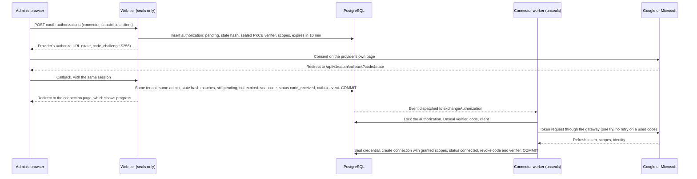

# ADR-038: Workspace suites: connect by consent, directory, and agents inside Google and Microsoft

**Status:** Proposed. D1, D2, D4 and D6 need outside security review before any real Google or Microsoft account, client or token is used, alongside ADR-024 D4/D5, ADR-027 D2/D4/D5 and ADR-029 D11. FLAGGED FOR HUMAN SECURITY REVIEW: the migrations this ADR adds (`0560_*`, `0561_*`). No real credential has been used: every test uses generated values and local fakes.
**Date:** 2026-11-11
**Deciders:** Project owner; security owner for D1, D2, D4 and D6.
**Backlog:** `CONNECT-04`, `CONNECT-05` (widened), new `CONNECT-07` (connect by consent), `CONNECT-08` (directory sync), `CONNECT-09` (suite tools for agents). Builds on ADR-027 (external actions) and ADR-029 D11 (Drive and SharePoint read).

## Context

M5 gave Ensemus read access to Google Drive and to OneDrive and SharePoint. Three things stop a company from using that, and a fourth is what the owner actually wants:

- **There is no way to connect except pasting a client ID, a client secret and a refresh token.** Nobody outside engineering can do that, and a person who can should not have a refresh token on their clipboard.
- **Nothing writes `connections.granted_scopes`.** Both connectors refuse a stream whose scopes are missing, so a pasted credential syncs nothing.
- **The Google, Microsoft and MCP connectors run nowhere.** `workers/workflow/src/connector-worker.ts` registers only SMTP and the inbound webhook, `createProviderHttpClient` is used only by tests, and Compose has one egress gateway with one target. M5's connectors pass their tests against fakes and have never been wired.
- **A share with a group grants nobody.** `resolveSourcePrincipal` maps users by email and returns null for every group. Google and Microsoft are mostly shared by group, so most files end up readable by no one here. That is safe and useless.
- **Agents should work inside the suites,** not only read them: read a person's mail and calendar, draft and send, book meetings, create and edit documents and sheets, post to Teams. At the best quality the providers allow, and never by a path that skips approval, receipts or the source's own permissions.

Facts that shape the decisions:

- **The web tier can seal and cannot unseal, and has no route out** (ADR-024 D5). Turning an authorization code into a token needs the client secret, so the web tier cannot do it.
- **The connector worker holds credentials, reaches the outside only through one gateway per named route, and checks TLS names fixed in code** (ADR-027 D5, ADR-029 D11).
- **Source permissions are resolved at sync time** into `external_resource_acl.membership_id` or `team_id`, and every read checks those columns. Team membership is read live, so a team is already a principal whose membership can change without rewriting a grant.
- **Google's and Microsoft's own AI features** (Gemini in Workspace, Microsoft 365 Copilot) are products for their users. Where either offers a documented API to third parties, it is a model provider like any other and goes through M4's router and egress policy. Ensemus does not depend on them: our agents do the work through each suite's data APIs.

## Decisions

| # | Decision |
|---|---|
| **D1** | An admin connects by consent on Google's or Microsoft's own page: authorization code with PKCE. The web tier starts it and stores what comes back, sealed. The connector worker exchanges the code. State is single use, bound to the tenant, the authorization row and the signed-in admin who started it, and expires in ten minutes. |
| **D2** | Two kinds of OAuth client. The operator's own app, whose secret lives only in the connector worker's configuration and never in a tenant's row. Or the customer's own app, whose client ID and secret the admin enters and the web tier seals. A tenant credential names which one it uses. |
| **D3** | An admin chooses capabilities, not scopes: Files, Directory, and later Mail, Calendar, Documents, Chat. Each maps to the narrowest scopes in code. `granted_scopes` is what the provider says it granted, intersected with what was asked for, and written only by the worker that saw the token response. |
| **D4** | Directory sync mirrors each provider group as a team that only the sync may change. Members match people here by email. Nested groups are flattened, at most five deep. A group grant then resolves to that team, so leaving a group at the provider ends access here at the next directory pass, with no file re-synced. |
| **D5** | Two owners of a connection: the organization (files, directory) and one member (their own mail and calendar). An agent acting for a person may use the organization's connection, within that person's source permissions, and that person's own connection. Never another member's. |
| **D6** | Every suite operation is a typed tool in the existing gateway. Reads run as the initiator and return classified data. Every change is an ADR-027 external action, with an exact payload, an approval when policy asks, and a receipt. Each tool declares how it reconciles, and uses the provider's own idempotency where one exists. |
| **D7** | Push notifications come after polling works, through ADR-027 D4's webhook path, and only ever trigger a sync. A notification is never believed as data. |
| **D8** | An air-gapped install has none of this, and says so. A connected Sovereign install uses the customer's own app (D2) and an operator-configured gateway, as ADR-027 D5 already requires. |

### D1. Connect by consent

**State.** The state parameter is `<organization id>.<authorization id>.<32 random bytes>`, base64url. The callback reads the tenant from it only to open the tenant transaction. It then requires the row to exist in that tenant, the stored SHA-256 to match in constant time, the status to be `pending`, the row not to be expired, and the signed-in membership to be the one that started it. Any failure is the same `OAUTH_STATE_INVALID`, so the response tells an attacker nothing. A second use finds the row no longer `pending`. Binding to the starting admin's session stops a forged callback from attaching an attacker's Google account to a victim's tenant.

**The callback is one fixed route, `/api/v1/oauth/callback`,** because providers require an exact registered redirect URI. It reads only `code`, `state`, `error` and Microsoft's `admin_consent` and `tenant`. A provider `error` marks the row `denied` with a code from a fixed list. Provider text is never stored or shown.

**The code is sealed at once** with purpose `oauth_authorization_code`, and the verifier with `oauth_pkce_verifier`. Both are revoked in the commit that ends the exchange, whichever way it ends.

**The exchange runs once.** A code is single use at the provider, so the Activity has `maximumAttempts: 1`. A failure ends the row `failed` with a code, and the admin starts again. Nothing retries a code.

**What it asks for.** Google: `access_type=offline`, `prompt=consent` so a refresh token always comes back, `include_granted_scopes` left off so the grant is exactly this request. Microsoft: `offline_access` plus the chosen scopes, the `organizations` authority for the operator's app and the customer's tenant ID for their own app. Both ask for `openid email` so the connection records who connected and, for Microsoft, the directory (`tid`) the credential belongs to. The ID token comes straight from the token endpoint over TLS checked against a name fixed in code, so its claims are read without a signature check, as OpenID Connect allows for that channel, and used only to label the connection and fill `tenant`.

**Who may start one.** `connection.manage`, with the interactive privilege check `createConnection` already makes. The starting membership is recorded and audited.

### D2. Whose app

| | Operator's app | Customer's app |
|---|---|---|
| Who registers it | Ensemus, once | The customer's admin, in their own Google Cloud project or Entra tenant |
| Where the secret is | Connector worker configuration only | Sealed per connection |
| Credential row | `{client: "platform", refresh_token, tenant?}` | `{client_id, client_secret, refresh_token, tenant?}` (today's shape) |
| Provider review | Google verification, and the yearly security assessment for restricted scopes. Microsoft publisher verification | The customer's own, and an internal app needs none |
| Fits | Cloud | BYOM, Sovereign, and any customer before ours is approved |

`oauthCredentialSchema` becomes a union of the two. `createProviderAuth` takes a `PlatformOAuthClients` port that answers `{client_id, client_secret}` per provider from worker configuration, and refuses `CREDENTIAL_INVALID` when the operator configured none. The web tier never reads the operator's secret. It knows only the client ID, which is public, to build the authorize URL.

**Rejected: copying the operator's secret into every tenant's sealed credential.** Rotating it would mean resealing every tenant, and a leak of one tenant's credential would leak the platform's secret.

### D3. Capabilities, not scopes

A capability is a bundle an admin can understand. The code maps each to scopes, and an admin sees both before they consent.

| Capability | Google | Microsoft | Owner |
|---|---|---|---|
| Files (read) | `drive.readonly`, `drive.metadata.readonly` | `Files.Read.All`, `Sites.Read.All` | Organization |
| Directory (read) | `admin.directory.group.readonly` | `GroupMember.Read.All` | Organization |
| Mail (read, draft, send) | `gmail.readonly`, `gmail.compose`, `gmail.send` | `Mail.ReadWrite`, `Mail.Send` | Member |
| Calendar | `calendar.events` | `Calendars.ReadWrite` | Member |
| Documents and sheets (edit) | `drive.file`, `documents`, `spreadsheets` | `Files.ReadWrite` | Either |
| Chat | Later | `ChannelMessage.Send`, `Chat.ReadWrite` | Later |

Exact scope strings are checked against each provider's current documentation when a capability is built, and corrected here. `granted_scopes` is written by the exchange and by every token refresh that reports scopes, so an admin narrowing access at the provider narrows it here. A stream or tool whose scopes are missing refuses with `SCOPE_NOT_GRANTED` before any request. That is the rule both connectors already follow.

**Narrow first.** Where a provider offers a narrower scope that does the job, it is the default: Google's `drive.file` lets a person pick files and needs no restricted-scope review. Broad read of all files is an admin's explicit choice.

### D4. Directory as teams only the sync can change

New table `integrations.directory_groups` (organization, connection, external ID, team ID, display name, seen generation) links each provider group to a team. The sync creates the team the first time it sees a group, names it from the provider, and sets its members to the people here whose email matches a member's. A nested group's members are added, at most five levels down, with cycles cut.

**Why a team and not a new kind of principal.** Every read path already enforces team grants, in reviewed SQL, and reads team membership live. A new principal kind would mean new enforcement in every policy function that reads `external_resource_acl` and `knowledge_source_grants`. Reusing teams changes no enforcement.

**What keeps it honest.**

- A trigger on `org.team_memberships` refuses inserts and deletes on a directory team unless the transaction set `ensemus.directory_sync` to that team's connection. Only the directory commit does. A person cannot add themselves to "Finance" here to read Finance's files.
- A directory team carries no role and appears in the Teams list marked "From Google" or "From Microsoft", read only. Assigning work to it is allowed, and the page says its members change with the provider.
- `resolveSourcePrincipal` resolves a group by the connection's `directory_groups` row. Google groups are keyed by email, which is what a Drive permission carries. Microsoft groups are keyed by object ID, which is what Graph permissions carry. A group not yet synced still resolves to nothing.
- A pass that does not finish changes nothing: membership is replaced per group in one transaction, and a group missing from a completed full pass loses its members and then its team.
- Revoking the connection removes every team it made, in the same transaction that marks it revoked.

### D5. Organization and member connections

`connections.owner_membership_id` is null for an organization's connection and set for a member's own. A member may connect their own account for capabilities the admin has allowed for members. Only that member, or an agent run that member started, may use it. An admin can disable or revoke it, and cannot read through it.

### D6. Suite tools for agents

Each operation is one tool in the existing tool gateway, declared in a manifest beside its connector, with input and output schemas, scopes, side-effect level and reconcile kind. Tool metadata confers nothing (as for MCP, ADR-029 D11).

**What changes in the gateway.** Today the tool list is five entries in `packages/domain/src/ai-tools.ts`, the gateway dispatches by a `switch` on the tool ID, only `email.send` may take the approval path, and `proposeExternalActionInTx` and `ACTION_CONNECTOR_TYPES` accept only `email_smtp`. Suite tools replace those special cases with one rule: a tool names its connector types and scopes, the gateway checks the run's connection is of one of those types, owned by the organization or by the initiator (D5), active, and granted those scopes, and an `external_write` tool goes through the same approval binder and intent path `email.send` uses. `email.send` becomes the first entry of that rule rather than an exception to it. The MCP call path (`loadCallableMcpTool`), which has no caller today, joins through the same rule with its reviewed side-effect level.

- **Reads** (search mail, read a thread, list events, read a document or sheet range, search files) run with the initiator's context. Organization-owned content comes back only if the initiator's source ACL allows it. Results are classified at the source's class, never logged, and count against the run's budget.
- **Changes** are ADR-027 intents. The approval binds the exact payload: recipients, subject and body, event attendees and times, the exact document edit and the revision it applies to. Policy decides which changes need a person; sending outside the organization always does.
- **Reconciling, per tool:**

| Tool | Provider idempotency | After a timeout |
|---|---|---|
| Calendar event, Google | Client-chosen event ID, derived from the intent | `authoritative`: a 404 for that ID means it was not created |
| Calendar event, Microsoft | `transactionId` from the intent | `best_effort` |
| Send mail, Gmail | None | `best_effort`: search Sent for our Message-ID |
| Send mail, Outlook | None | `best_effort`: search Sent Items for our Message-ID header |
| Document edit, Google Docs | `requiredRevisionId` refuses an edit to a changed document | `best_effort`: read the revision |
| Sheet values, Sheets or Excel | None | `best_effort` |
| Create file | Client-chosen name and app property carrying the intent ID | `best_effort` |

A draft is not a change: creating a Gmail or Outlook draft is a reversible write in the person's own mailbox and needs no approval, but it is still an intent with a receipt.

### D7. Push

Google Drive `changes.watch` and Microsoft Graph subscriptions arrive through ADR-027 D4's stored-then-verified path. A verified notification only schedules a sync of that connection. Polling stays on as the backstop, because both providers expire subscriptions.

## Consequences

- Connecting becomes a button, and the Drive and SharePoint sync M5 built starts working, because scopes get recorded.
- Group shares grant the right people, without touching the read-path SQL.
- Cloud depends on our own apps passing Google's and Microsoft's review. The customer-app path lets pilots start before then.
- New migrations, `0560_workspace_suites.sql` and `0561_workspace_suites_security.sql`, need the same outside review as ADR-027's.
- Live behaviour is unqualified until the owner runs it against test tenants holding no real data. That run needs the owner's decision, because it means real credentials before the outside review.
