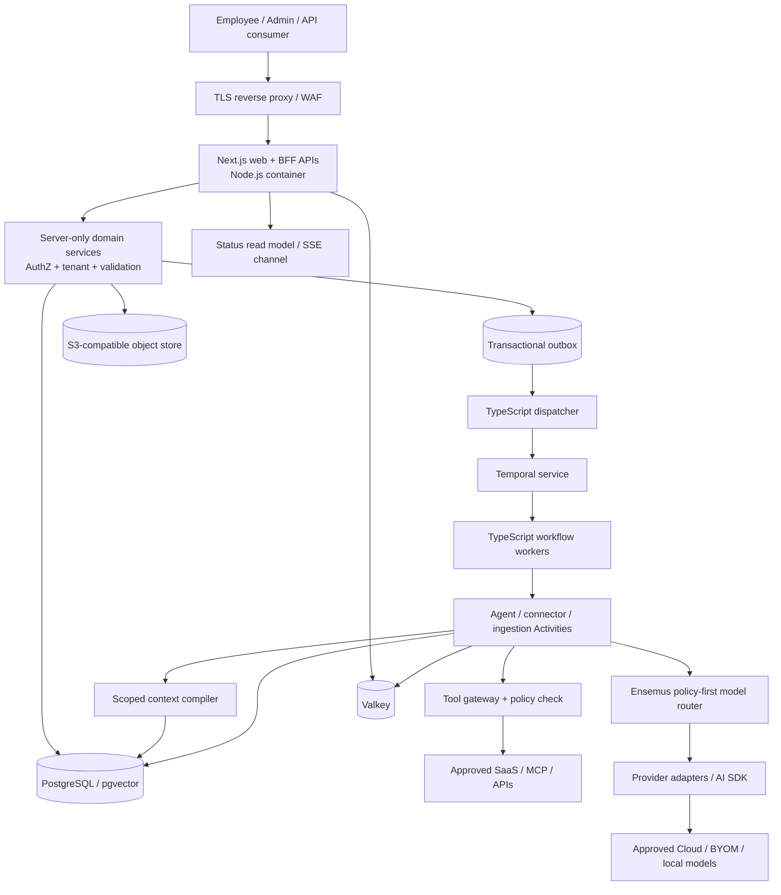

# System architecture — full-stack Next.js, TypeScript workers, portable infrastructure

**Baseline:** Next.js App Router (Node.js runtime) is the sole customer-facing application and API server. All product/business/AI code is TypeScript; separate Node processes run durable execution, integrations and indexing. The application does **not** use separate Python/Django/FastAPI services. This is a *logical architecture and proposed implementation*, not a deployed system.

## 1. System context

The diagram intentionally distinguishes the **web runtime** from **durable, headless worker runtimes**. They can run on one host in separate containers, but must not share a single event loop or compete for a fixed worker pool.

## 2. Runtime responsibilities

| Runtime / package | Owns | Does not own |
|---|---|---|
| `apps/web` (Next.js) | UI, RSC server reads, Server Actions, Route Handlers, session validation, request-size limits, web-specific caching, HTTP ingress | Long-running autonomous agents, persistent schedulers, CPU-intensive indexing, Temporal pollers |
| `packages/domain` | Pure business invariants, Work Unit transitions, services, inter-domain contracts | Framework-specific request/response or global tenant context |
| `packages/database` | Drizzle schema, SQL migrations, tenant-safe transaction helpers, query methods | Authorization decisions based solely on UI filters |
| `packages/policy`, `packages/secrets` | Policy evaluation, data classification and provider egress gates (`policy`); credential handles and the `SecretBroker` (`secrets`) | Raw secrets in shared browser bundles |
| `packages/intelligence` | Model registry, capability conformance, routing, provider adapters and metering | Vendor-specific model IDs in domain or UI contracts |
| `packages/agent-runtime` | Bounded agent loop, skills/tools, typed output, progress and receipts | Durable business workflow authority |
| `packages/knowledge` | Ingestion contracts, retrieval, source provenance, context compilation | Treating embeddings as authoritative access/ownership records |
| `workers/workflow` | Temporal workflow/Activity registries, durable timers and approval signals | New public application API |
| `workers/ingestion` | Parsing/indexing, external incremental sync | Serving interactive UI requests |
| `workers/dispatcher` | Publish committed domain events, deduplicate deliveries | Skipping PostgreSQL transaction boundary |

## 3. Truth ownership

- PostgreSQL: memberships, domain entities, Work Unit current business state, policies, approvals, entitlements, memory claims, audit anchors, idempotency receipts and event outbox.
- Temporal: durable process history, timers, retries, signals, workflow/version progression. Do **not** use workflow history as an alternative business database.
- Object store: immutable/versioned source files and generated artifacts; PostgreSQL holds signed manifests and ACL metadata.
- Provider / external SaaS: remains authoritative for records it owns unless an explicit import takes ownership.
- Derived indexes, cache, projections and possible graph DB: rebuildable; never confer access rights independently.

## 4. Standard execution paths

**Read:** RSC calls server-only domain query → resolve identity and tenant → enforce ABAC/RLS → optimized SQL or scoped retrieval → return bounded DTO with no raw secret fields. Server Components do **not** fetch Ensemus's own public Route Handlers.

**Mutation:** Server Action or Route Handler → input validation → request scoped identity → policy check → single database transaction for business state + outbox → response → asynchronous event dispatcher → durable process if needed.

**Autonomous work:** Event / scheduled trigger → service identity and delegation grant → policy/budget check → Temporal workflow → typed worker activities (LLM/tools/DB) → approval signal when needed → verify external receipts → update domain state and audit.

**Direct interactive chat:** HTTP streaming may remain request-bound if short; anything that must survive disconnection is created as an AgentRun + durable workflow with progress reattachment.

## 5. Security boundaries

- Browser receives only authorized DTOs. Mark private server modules with a server-only boundary; no `NEXT_PUBLIC_` for credentials or sensitive tenant state.
- Every backend entrance (RSC DAL, Server Action, Route Handler, worker tool) independently authenticates and authorizes. Proxy/middleware is not the only check.
- Every model request passes classification and provider policy before reaching any SDK/provider endpoint; no auto-fallback to another provider without policy approval.
- Tenant-aware compound foreign keys + RLS + object storage prefixes/ACLs + cache namespace + search prefilters + audit. Never trust model-provided tenant IDs.
- Document/connector payloads are untrusted instructions; agent policy never comes from retrieved content.

## 6. Failure and deployment boundaries

If model inference is unavailable, core CRUD, existing business data and policy administration remain available. If Temporal is unavailable, start/advance queues pause safely while ordinary non-workflow edits continue. Search failure degrades answers without bypassing document ACL. Never lie to users about success when an external action has not been verified.

Container images should be immutable/digest-pinned, run as non-root where viable, and contain no baked-in secrets. Cloud/BYOM use the same images and differ only in entitlements/model profiles. Sovereign deploys the same critical containers locally without mandatory vendor phone-home.

## 7. Explicit exclusions

No Python runtime requirement, no second HTTP microservice framework, no mandatory Vercel hosting or Vercel AI Gateway, no background work in `next start`, no requirement for Neo4j, Kafka, Kubernetes, or self-hosted LLMs. Each may be added via a benchmark- and cost-backed ADR.
