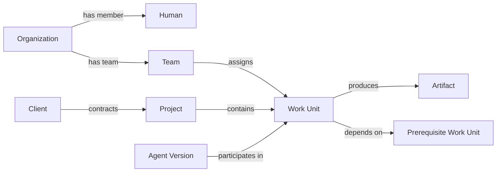

# Domain model — bounded contexts, aggregates, relationships

## 1. Domain boundaries

**Identity & Organization:** `Organization`, `Membership`, `Team`, `Role`, `Principal`, `ServiceIdentity`. Owns membership lifecycle, grants, and account deprovisioning. A human user can join multiple tenants but never carries one tenant's permissions into another.

**Work:** `WorkUnit`, `WorkAssignment`, `WorkDependency`, `WorkArtifact`, `Approval`, `Decision`. Owns business objectives, state, dependency consistency, and completion acceptance. Project is a grouping/relationship object, not a second competing task engine.

**Company Relationships:** `Client`, `Project`, `OrganizationEntity`, `RelationshipEdge`, `CustomObjectType`, `CustomRecord`. Knows business relationships without enforcing agent tool permissions itself.

**Knowledge:** `KnowledgeSource`, `Document`, `Chunk`, `Embedding`, `MemoryFact`, `EvidenceLink`, `ACLProjection`. Owns provenance, retrieval scope, facts and invalidation.

**Intelligence:** `AgentDefinition`, `AgentVersion`, `SkillVersion`, `AgentRun`, `ExecutionStep`, `ModelProfile`, `Evaluation`. Owns bounded model reasoning and agent lifecycle. Does not commit arbitrary business changes directly.

**Connectors:** `Connection`, `ExternalResource`, `SyncCursor`, `ToolDefinition`, `ExternalAction`. Owns provider OAuth, sync, rate limits, resource mapping, and external-side-effect reconciliation.

**Security & Governance:** `PolicyBundle`, `PrincipalGrant`, `DataClassification`, `AuditEvent`, `SecretHandle`, `AccessReview`. Owns authorization and egress decisions; publishes services consumed by all domains.

**Commerce:** `CommercialMode`, `Entitlement`, `License`, `UsageRecord`, `BillingPeriod`, `CreditAllocation`. Owns what an org may consume; cannot override policy/security.

## 2. Entity design rules

- Stable UUID IDs for user-facing entities; tenant-owned tables carry `organization_id` and tenant-composite uniqueness constraints.
- Foreign keys must include `organization_id` when connecting tenant data to avoid cross-tenant edges. Global identity exceptions are explicit and reviewed.
- `created_at`, `updated_at`, `version`, and `deleted_at` or history structures as appropriate; use UTC and store timezone preferences separately.
- Never store human-readable relationship names as unvalidated strings in place of typed/identified edges.
- Use JSONB only for schema-validated extensibility or output payloads; keep authorization-critical and join-critical columns typed.
- Soft delete is not a substitute for retention/purge. Encryption and derived-index erasure are independent lifecycle obligations.

## 3. Company graph representation

Typed domain references should be preferred for core edges. A generic `relationship_edges` table can support documented custom types, but must enforce allowed source/target types, ownership, tenant equality, and acyclicity where applicable.

## 4. Work aggregate semantics

A Work Unit has a business objective, versioned completion criteria, accountable owner (person or service role), current state, optional project, due date, evidence requirements, and dependency links. Assignment is separate from ownership: execution may be delegated, accountability cannot be delegated away silently. Completion is an explicit verified domain transition, not merely an agent claiming success.

Recommended invariant: one primary accountable owner; multiple contributors/agents may participate. State transitions use compare-and-swap versions to prevent concurrent overwrites; workflow signals include entity version/approval ID.

## 5. Universal custom objects

Store type definitions (`slug`, field schema, relation definitions, visibility classification, version) and records with structured identity and JSONB validated attributes. Restrict relation types and queryable/indexable fields. Promote a common custom object to a typed core domain when it gains platform-wide semantics; don't make billing, grants, approvals, or Work Unit state generic JSON entities.

Custom type changes require backward-compatible schema versioning, migration previews, ACL review, and safe rollback. A pack cannot create new global permissions without explicit approval.

## 6. Inter-domain communication

Within one transaction, use direct domain service contracts. Across durability/worker boundaries, emit versioned domain events via transactional outbox. Consumers must be idempotent and independent from request latency. Preserve trace ID, causation ID, actor principal, tenant, source entity/version, and classification in event envelopes.

## 7. Queries for universal behavior

- Why is an outcome blocked? Traverse Work Dependency DAG and authorized decisions; gather relevant evidence.
- Who should review? Resolve assignment, team ownership, and explicit approval policy (not model guess).
- What changed? Retrieve event/record versions and authorized source documents.
- Can this agent do it? Evaluate agent grant ∩ invoking principal delegation ∩ tenant policy ∩ resource ACL ∩ runtime risk.

## 8. Avoid architectural pitfalls

Do not create unlimited graph traversal across tenant data, arbitrary SQL generated and executed by agents, a shared global vector index without ACL-aware design, or a custom entity system so generic it loses relational integrity.
