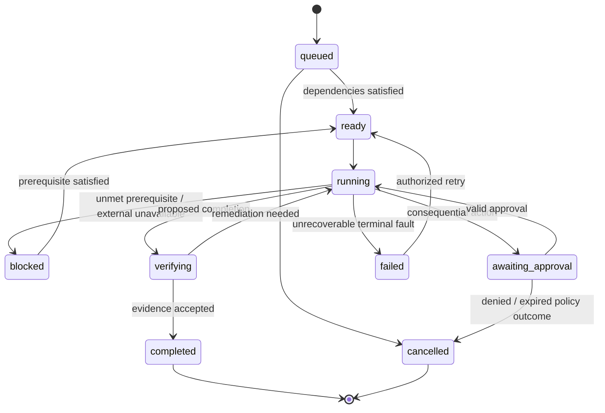

# Universal Work Kernel — execution state and work graph

## 1. Why Work Units exist

A Work Unit is a first-class, technology-independent business objective. A Work Unit may be completed manually, by deterministic workflow, by an agent, or through a combination. Agents do not own the business outcome; they carry out bounded attempts.

## 2. Canonical Work Unit contract

Fields: `id`, `organization_id`, `title`, `objective`, `description`, `accountable_owner`, `contributors`, `project_id`, `priority`, `start_at`, `due_at`, `status`, `completion_criteria`, `acceptance_evidence`, `data_classification`, `version`, `created_by`, timestamps. Optional: `parent_work_unit_id`, tags, relevant objects, origin event, budget allocation.

A completion criterion is testable: artifact exists, client record was created, specified reviewer approved, or external system's receipt confirms action. A model-written assertion without objective evidence is not sufficient for consequential completion.

## 3. State machine

Reject invalid transitions, record previous version, actor, reason, evidence, and trace correlation. A Work Unit can be reopened by authorized action with history preserved; do not silently change a completed artifact.

As built (M2): `work.work_transitions` holds each change's actor, reason and the version it started from, under the Work Unit's own access rules, and the reason goes into no event, audit entry or workflow. Rows from before migration 0009 have no version, and they are older than any that do. A request to run a plan moves the version too, and whoever asked is told if a person then withdraws it by moving the work. A pause starts when a review is requested and ends only on that review's decision: people with change rights cannot make either move directly, and one review at a time can be open. A review binds the Work Unit's text, through a digest, and its exact files, and it counts as evidence only while it still matches them and has not expired. Reopening closes earlier reviews. Finished work has to be reopened before its content or files change, though access can always be removed, and a file can be deleted from stopped work because stopped work can never be reopened. Plans stop at `verifying`: a person marks the work done, and a file a plan generated is not evidence.

Completion without evidence is refused or waits for a verifier (QA-006). Work with criteria completes only when they are met. Work with no criteria still has to pass through `verifying`, and there only its accountable owner can confirm it: they are its verifier, and the transition records `completion_basis = owner_confirmed`, which the page's history and the API's `completion.basis` state as confirmed by that person with no evidence requested. Retrying failed work needs a reason, like reopening completed work.

A review that runs out takes its work with it at the next periodic check, unless someone first asks a different person, which replaces it and keeps the work paused. A plan's named reviewer cannot be replaced, so a plan's review that runs out always ends the run. A request to run a plan cannot be repeated while it stands. The periodic check asks again for any request nothing has claimed after 5 minutes, because a request can meet an earlier run that is still open and can never claim it. Prerequisites a person cannot see still hold their work: the page gives a count and no names, and someone with change rights on the dependent work can remove the ones that were stopped, which can never finish.

Runs started before `run_id` existed (migration 0004) are not adopted. `patched('review-wait-loop')` lets their histories replay, but the Activities only act on work whose `run_id` matches the asking run, so such a run would end without moving its work and without reporting it. Plan runs must drain before upgrading across this change (see the deployment runbook). No deployment of that code exists yet, so this is recorded rather than migrated. The periodic check does not pick such work up, because planned work a person started by hand has the same empty `run_id` and no workflow behind it.

## 4. Work graph invariants

- Directed prerequisite graph is acyclic per organization. Reject direct self-edge and multi-hop cycle; validate under concurrent writes.
- Cross-tenant edges are impossible in database constraints.
- A Work Unit cannot enter `ready` if mandatory prerequisites are not satisfied.
- Dependencies can express `finish-to-start`, `approval-before`, or typed business preconditions; keep a small explicit vocabulary initially.
- Bulk dependency updates are transactional; detected cycles must roll back the whole change.
- Completion acceptance can require a human review or deterministic verifier; model self-verification cannot override required approval.

## 5. Human and agent assignment

Assignments identify a principal (human membership, agent service identity, or team queue), responsibility type, and effective dates. A human is accountable for approval-sensitive Work Units. An agent run uses a snapshot of permissions; revoked permissions must terminate or block future tool actions mid-run. The platform rechecks before every irreversible side effect.

As built (M2): an assignment holds a membership and a responsibility, and `actor_type` says who holds it, `human` or `agent`. Only `human` is written until agents arrive in M4, when the agent's service identity gets a column of its own, since every assignment today needs a membership. Effective dates and team queues are not built. What someone assigned may do is in `docs/04-security/04-authorization-and-approvals.md` section 6: they move the work along, and the accountable owner or an admin decides who answers for it, who else is on it, and whether it stops.

## 6. Durable workflow ownership

Temporal holds the live process machine and waits for signals (`approval_received`, `dependency_resolved`, `external_update`, `cancelled`). PostgreSQL stores the authoritative Work Unit business state. An activity writes a domain transaction and outbox event; workflow projections asynchronously reconcile actual process progress. Keep all nondeterministic operations (LLM, external tools, DB writes) in activities, not deterministic workflow code.

## 7. External side effects

Persist an `external_actions` intent with hash, target connector, idempotency key, and approval binding before calling provider. Use provider-native idempotency when available. If a timeout occurs after request dispatch, reconcile against provider by stable ID or query before retrying. Mark `unknown_external_state` if reliable reconciliation is impossible and require human intervention; never blindly retry a payment or send action.

## 8. Critical path and risk signals

Use DAG traversal to surface blockers and overdue prerequisites. Estimate critical paths only when durations are grounded; show a confidence/estimate range rather than presenting invented certainty. Alert prioritization should depend on business impact and time sensitivity, not arbitrary AI rankings.

## 9. Example execution

`opportunity.won` → create onboarding Work Unit → resolve legal check and account setup in parallel → proposed kickoff draft → approval of external message → send and reconcile external ID → evidence-backed Work Unit completion → memory records decided and verified facts.
