# Ensemus 2.0: end-to-end delivery plan

**Status, updated 2026-11-07:** approved by the project owner on 2026-11-05. M0's document changes are applied. Product code exists: **M4 is the current integration milestone.** The owner has requested continued implementation of the entire platform, including Claude's unfinished later milestones. M1's outside security review and signing-key custody decisions remain open. Legal entity/jurisdiction and data residency are deferred deployment settings at the owner's direction; no values have been invented. Only throwaway test credentials are used. In this plan, "you" means the project owner.

Implementation evidence is recorded separately from the planned scope below:

| Milestone | Observed state | Evidence / next gate |
|---|---|---|
| M1 | Foundation implemented; milestone remains open | [M1 report](evidence/M1-report.md), including outside review and owner decisions |
| M2 | Core implemented; committed baseline passed CI; continuation checks passed locally | [M2 report](evidence/M2-report.md). Exact email-recipient scenario QA-007 remains partial until M3; no overall sign-off claimed |
| M3 | Integrated with newer M2 fixes on `codex/platform-completion`; local integration, receipts, connector faults and offline gates passed | [M3 report](evidence/M3-report.md); independent and hosted acceptance remain open |
| M4 | Governed AI and shared interface integrated locally; runtime confidentiality, full replay and full browser gates passed | [M4 report](evidence/M4-report.md); isolation, upgrade and release checks continue |
| M5–M11 | Later branches contain active implementation and preserved partial work | [Platform progress](platform-completion-progress.md); knowledge and SaaS services are being implemented, and M6 source has been recovered. Branches and source checkpoints do not establish milestone acceptance |

Ticket IDs refer to the [reconciled backlog](../specifications/implementation-backlog.csv), whose `milestone` column is authoritative. Run `node specifications/tools/check-backlog.mjs` to validate it.

## Context

At approval, Ensemus was a specification with no product code or git repository. This plan sequences that starting point through launch. The private repository now exists at `atmyielts/ensemus`; current implementation evidence is linked above.

**Your inputs:**
- **Builder:** you, directing AI coding agents.
- **Target:** all three commercial plans (Cloud, BYOM, Sovereign) reach launch. None is dropped, so their order below follows technical dependencies, not a commercial preference.
- **Secrets:** built-in envelope encryption (ADR-024 D5). This needs a spec change and an outside security review.

**How this relates to the spec:** this plan sequences the approved vision and cuts no scope. It replaces the build plan's phase order only where noted. ADR-024's runtime contracts are assumed, with two corrections in M0.

**What the spec doesn't cover:** the spec is a strong engineering blueprint but not a complete business plan. A keyword check of the 87 backlog tickets finds no mention of payments, invoicing, signup, invitations, onboarding, a design system, notifications, SSO, MFA, retention or deletion. This plan adds them.

## Plan at a glance

```mermaid
flowchart LR
  M0[M0 Reconcile spec] --> M1[M1 Release skeleton]
  M1 --> M2[M2 Core without AI]
  M2 --> M3[M3 Verified side effects]
  M3 --> M4[M4 Governed AI]
  M4 --> M5[M5 Knowledge]
  M5 --> M6[M6 Sovereign rehearsal]
  M6 --> M7[M7 Full product depth]
  M7 --> M8[M8 SaaS operations and billing]
  M8 --> M9[M9 Independent assurance]
  M9 --> M10[M10 Launch all modes]
  M10 --> M11[M11 Expansion]
```

| # | Milestone | Size | Who can use it afterwards |
|---|---|---|---|
| M0 | Reconcile spec and backlog | S | Nobody; this sets up the work |
| M1 | Release skeleton | L | Nobody; it proves the pipeline |
| M2 | Core product without AI | XL | You: run your own company's work on it |
| M3 | Verified external actions | M | You |
| M4 | Governed AI | XL | You, with your own model keys |
| M5 | Company knowledge | XL | **BYOM pilot** |
| M6 | Sovereign rehearsal | L | **Sovereign pilot** |
| M7 | Full product depth | XL | All pilots widen |
| M8 | SaaS operations and billing | L | **Cloud pilot** |
| M9 | Independent assurance | M, plus vendor wait | Release candidate |
| M10 | Launch all three modes | S | Customers |
| M11 | Expansion | Ongoing | Customers |

**Time:** the spec forbids invented delivery dates, so these are sizes, not dates. My rough, unmeasured guess is 18–36 months of focused full-time work to M10, with your review capacity as the main constraint. Re-forecast from real data at the end of M2 and again at M5.

## Milestones

Every milestone must meet the spec's [Definition of Done](../06-delivery/03-acceptance-and-dod.md): UI, contract, enforcement, migration, negative tests, cost metrics, operator docs and mode parity. A milestone isn't finished because a screen exists.

### M0: Reconcile the spec (S)

**Outcome:** one backlog and one set of contracts that coding agents can follow without guessing.

- Accept ADR-024 and amend [`04-security/02-secrets-and-egress.md`](../04-security/02-secrets-and-egress.md) for D5.
- **Correct ADR-024 in two places:**
  - D5 and action item 6 put the secret broker in Slice 3, but `CONNECT-01` depends on `FOUND-05`, so it moves to M1.
  - D6's "BYOM first" becomes the pilot order in this plan.
- Apply the ADR's spec corrections and resolve the 14 overlapping ticket pairs. On review, 10 tickets were retired and 4 pairs were narrowed (see [`backlog-retired-tickets.csv`](../specifications/backlog-retired-tickets.csv)).
- Fix backlog dependencies:
  - `API-10` needs `FOUND-02` and `FOUND-03`.
  - `SEC-07` needs the whole release candidate, not only `SEC-01–04`.
  - `COM-10` needs `COMM-01` (resolved by merging it into `COMM-06`).
  - `COMM-04` needs agents and retrieval.
  - `SEC-11` applies to all modes.
  - `WORK-07` needs a replay test.
- Add the missing tickets listed in [New work](#new-work-the-backlog-is-missing).
- Build the Drizzle schema from [`03-data-model.md`](../02-architecture/03-data-model.md), not `schema.sql`. The reference DDL lacks catalogued tables such as `policy_bundles`, `work_assignments`, `work_comments`, `custom_object_types` and `license_records`.
- Create the [requirement → ticket → QA → threat trace file](../specifications/traceability.csv).
- Make the decisions listed under "Before M1" in [Decisions only you can make](#decisions-only-you-can-make).

**Exit:** every PRD requirement, QA scenario and threat maps to a ticket. The manifest is regenerated.

### M1: Release skeleton (L)

**Outcome:** an empty but secure product that builds, signs, runs offline and proves tenant isolation.

- pnpm monorepo using the [monorepo doc's](../02-architecture/11-monorepo-and-module-contracts.md) layout, with import-boundary lint rules.
- CI pipeline, Next.js and worker images, SBOM and signing. Decide the signing-root design now.
- Database roles, `withTenantTx` and the two-tenant test harness.
- **`SecretBroker` with envelope encryption.** The web tier can seal but not unseal.
- Audit and telemetry redaction with secret canaries.
- Auth library spike, then embedded OIDC and local accounts.
- License review of every bundled component before it is adopted, not at release.
- **Three gates, on from now on:** air-gapped Compose run in CI, two-tenant tests, and web-cannot-reach-Temporal.

**Tickets:** `FOUND-01–07`, `PLAT-11/12/15/16`, `SEC-10`, `ID-03`, `ASSUR-01/02`.

**Exit:** Phase 0 exit criteria pass. An outside reviewer has checked D4 and D5, and this must happen **before any real credential is stored**.

### M2: Core product without AI (XL)

**Outcome:** a useful work product with no models. You start running your own company's work on it.

- Organizations, teams, roles, invitations and signup.
- Work Units, dependencies, assignments, artifacts and approvals.
- Clients and projects.
- Outbox, dispatcher and the first deterministic workflow, plus the replay corpus.
- Design system, Home, Work, People, Clients and the approval center.
- Notifications, especially approval requests and reminders. An approval nobody hears about stalls the whole workflow, and the suite has no design for this.
- Tombstones and the deletion sequence, **before the first backup exists**.
- Reconnectable status over SSE.

**Tickets:** `WORK-01–07`, `API-10–13`, `SEC-12`, plus new Core UX, Identity and Data Lifecycle tickets.

**Exit:** Slice 1 passes. `QA-001–007` and `NEXT-01–04` pass. Tenant transaction overhead and dispatcher delay are measured, and a forecast is made from real numbers.

### M3: Verified external actions (M)

**Outcome:** the system can act in the outside world without duplicating or misreporting anything.

- Connector SDK, signed webhooks and external action intents.
- Reconciliation and a receipt UI that shows unknown state honestly.
- One real, low-risk connector for the side-effect path (email send is the natural choice).

**Tickets:** `CONNECT-01/02/06`, `WORK-08`.

**Exit:** Slice 2 passes. `QA-007`, `QA-008`, `QA-019` and `AI-TS-01` pass, with fault injection at timeout-after-send.

**How the exit is proved:** [ADR-027](../00-foundation/adr/ADR-027-verified-external-actions.md) holds the decisions, and [M3 slices](m3-slices.md) how the work was divided. `tests/stack/slice-2.test.ts` runs the exit on real containers, in CI's `connectors` job, with a test relay that takes mail and then goes silent. [The M3 report](evidence/M3-report.md) says what has actually run. M3 is not closed until that report shows it. Email here is an action a person approves. Notification email is not in M3.

### M4: Governed AI (XL)

**Outcome:** bounded agents that use approved models only and can't escalate their own permissions.

- Provider registry, policy-first router and egress enforcement.
- Hosted **and** local model adapters from the start. Local keeps Sovereign honest.
- Budget reservations and a usage ledger with idempotency keys, rate-card versions and entitlement checks. Billing comes later, but this history can't be backfilled.
- Versioned agents, the per-step workflow loop, tool gateway and approvals.
- Agent activity timeline and a stop control.
- Emergency kill switch, evaluation harness and red-team suite.
- BYOM credential capture.

**Tickets:** `MODEL-01–04/06`, `AI-13`, `AGENT-01–06/15/16`, `SEC-01/02/04/06/11/13/14`, `COMM-02`. Decisions are in [ADR-028](../00-foundation/adr/ADR-028-governed-ai.md), and who builds what is in [m4-slices.md](m4-slices.md).

**Exit:** Slice 3 passes. `QA-009/010/012–014` and `QA-018` pass. Gate C passes for one agent. You use it with your own keys.

### M5: Company knowledge (XL). Opens the BYOM pilot

**Outcome:** permission-aware, cited answers over company documents, and the first outside user.

- Ingestion workers, hybrid search and Context Compiler.
- Evidence-backed facts, revocation and purge.
- Google Workspace and Microsoft 365 connectors, plus the policy-gated MCP adapter.
- **Flagship workflow:** deal won → client onboarding, end to end.
- Hosted staging and small production environment. Use managed infrastructure wherever possible, since you're running it alone.
- Machine-readable egress ledger and egress simulator (Journey D).

**Tickets:** `KNOW-01–06`, `MODEL-05`, `AGENT-07/10/11/12`, `CONNECT-03–05`, `SEC-03`, `UX-18/22`, `OPS-20`, `LEGAL-01/02`.

**Exit:** Slice 4 passes. Gate D passes. pgvector recall is measured under ACLs. **BYOM pilot gate** is met (see [Pilot gates](#pilot-gates)).

### M6: Sovereign rehearsal (L). Opens the Sovereign pilot

**Outcome:** the real offline install, upgrade and restore path works. This moves ahead of the spec's Phase 5, because export, upgrade and restore flaws get much costlier as the schema grows.

- Signed offline license format and verifier. Mistakes here are very hard to fix, since lapsed customers may have no upgrade rights.
- Offline bundle, local inference and offline upgrade.
- Export, import, backup and restore, with no revoked content coming back.
- License issuance tool and diagnostic exporter.

**Tickets:** `COMM-03–05`, `OPS-02/03/11`, `SEC-05`, `SOV-01–06`.

**Exit:** the [offline acceptance test](../specifications/deployment/SOVEREIGN_OFFLINE_ACCEPTANCE.md) passes on built binaries, including a packet capture. Someone other than you runs a restore. **No sales claim of air-gap readiness yet**; the spec allows that only on released binaries.

### M7: Full product depth (XL)

**Outcome:** the complete product experience for non-technical users.

- Agent Studio (guided builder first, then visual workflow graph), with simulation and publishing review.
- Company Pulse, Knowledge UI, Assistants and the outcome composer.
- Custom objects, and onboarding (Journey A).
- The remaining bundled workflows, the first department pack and SSO/MFA.
- Accessibility work and usability studies with real participants.

**Tickets:** `AGENT-08/09`, `KNOW-07`, `WORK-09`, `OPS-05`, plus new tickets.

**Exit:** Phase 4 exit passes. Representative cross-department workflows finish with verified receipts and measured cost.

### M8: SaaS operations and billing (L). Opens the Cloud pilot

**Outcome:** you can run a hosted service and charge for it.

- Payment processor, invoicing, tax, rate cards, credits and top-ups.
- Provisioning, plan changes, suspension and tenant offboarding.
- Provider contracts for Ensemus-managed inference.
- Dashboards, alerting and runbooks.
- Incident process and status communication.
- Autoscaling and load tests against the three named profiles.
- Support desk, and a break-glass design. Default for launch: **no support access to customer content**, since break-glass needs a second authorizer.

**Tickets:** `COMM-01`, `PLAT-17`, `OPS-01/04/06`, plus new Billing and Operations tickets.

**Exit:** Gate E passes for Cloud and BYOM. Gate F drills pass. Measured cost per verified Work Unit feeds pricing.

### M9: Independent assurance (M, plus vendor wait)

**Outcome:** outside evidence that the claims hold, tested on a frozen release candidate.

- Penetration test, including agents and connectors.
- Accessibility audit against WCAG 2.2 AA.
- Legal review of all three agreement sets, the DPA and third-party licenses.
- Mode parity suite and retests.

**Tickets:** `SEC-07`, `COMM-06`, `UX-23`, `LEGAL-04/05`, `DOC-01/02`.

**Exit:** no unresolved critical findings. Gates A–F are signed with named evidence. Book vendors well ahead, because their calendars become your critical path.

### M10: Launch all three modes (S)

**Outcome:** customers can buy Cloud, BYOM and Sovereign from one signed release.

- Rerun Sovereign acceptance on released binaries.
- Canary rollout for Cloud and BYOM.
- Executed agreement templates, customer docs and release notes.

**Tickets:** `REL-01–03`.

If one mode fails its gate, it waits while the others launch. It can't launch on a weaker standard.

### M11: Expansion (ongoing)

These stay in scope. The catalog already marks several as later or advanced, and all can be reordered by demand: remaining department packs, CRM/ticketing/accounting connectors, meetings, skills catalog, user-code sandbox, marketplace, cross-org collaboration, dedicated tenant tiers and specialized regions.

## Pilot gates

Each pilot needs more than working software:

| Gate | BYOM (after M5) | Sovereign (after M6) | Cloud (after M8) |
|---|---|---|---|
| Security | Scoped outside review of tenancy, secrets, egress and agents | Same, plus signed bundle checks | Same, plus billing and metering |
| Legal | Pilot agreement and DPA from counsel | Pilot license, not perpetual yet | Pilot agreement, DPA and provider terms |
| Data | Low-sensitivity data; restricted class stays denied | Customer-run, on a non-critical deployment | Low-sensitivity data |
| Support | Published coverage hours you can actually meet | Named contact, no remote access by default | Published coverage hours |
| Recovery | Tested restore | Customer-run restore rehearsal | Tested restore |

## New work the backlog is missing

Add these in M0. I checked the backlog by keyword search, so review the list rather than treating it as exhaustive.

| Group | Tickets to add | Milestone |
|---|---|---|
| Core UX | Design system, Home, approval center, People, Clients, Projects, Knowledge UI, Assistants, outcome composer, notifications | M2, M5, M7 |
| Identity | Signup, invitations, session management, SSO/SAML, MFA for privileged actions | M1, M2, M7 |
| Data lifecycle | Retention rules, deletion sequence, legal hold, tenant offboarding | M2, M8 |
| Agents | Egress ledger and simulator, bundled workflows, pack format and first pack | M5, M7 |
| Billing | Payment processor, invoicing, tax, rate cards, top-ups | M8 |
| Operations | Environments, provisioning, support desk, status page, break-glass, disclosure process | M5, M8 |
| Sovereign commercial | License issuance, maintenance tracking, bundle delivery, advisories, supported branches, diagnostic exporter | M6 |
| Legal | Three agreement sets, DPA, subprocessor list, provider contracts | M5, M8, M9 |
| Docs | End-user and operator documentation | M2 onward |
| Assurance | ADR-024's acceptance tests that lack tickets | M1 |

## Decisions only you can make

The spec says these must not be invented during implementation, so each has a deadline.

| By | Decision | Why then |
|---|---|---|
| Before M1 | Legal entity and jurisdiction | Contracts and data roles depend on it |
| Before M1 | Signing-key custody, including a second holder or escrow | Compromise is a critical incident |
| Before M1 | Repository location and private GitHub remote | First commit |
| Before M2 | Data residency stance | It affects storage, backups, embeddings and telemetry in the schema |
| Before M5 | Flagship workflow (recommended: deal won → client onboarding) | It shapes the first pilot |
| Before M6 | Security patches after maintenance lapses, supported branches, major-version rights | The licence format encodes them |
| Before M6 | Which local model and embedding weights can be redistributed | Sovereign packaging |
| Before M8 | Prices, credits, SLA, RTO/RPO, SSO by plan | Billing and contracts; finance input needed |
| Before M9 | Regulated industries excluded at launch | Legal review scope |

## Help you need to buy

A solo builder can't honestly satisfy these alone:

| Need | When | Why |
|---|---|---|
| Security reviewer | M1, then before each pilot | D5 is security-critical code, and agents can't approve security changes |
| Software and privacy lawyer | M0 onward, mainly M5 and M9 | Agreements, DPA, perpetual license terms |
| Penetration tester | Book by M7, test at M9 | Must be independent |
| Accessibility auditor | M7 and M9 | The spec requires independent validation |
| Finance adviser | M8 | Pricing sign-off |
| Backup on-call and incident cover | Before the first pilot | One person can't be five incident roles; publish only the hours you can staff |
| Second person for restores and key custody | M6 onward | Independent restore test; no single point of failure |

## How you'll work with coding agents

Your review time is the critical path, so the method protects it.

- **One backlog ticket per agent task,** on its own branch, in small batches, following the workflow and return report in [`AGENTS.md`](../AGENTS.md).
- **Tests before code,** including denied and cross-tenant cases.
- **Machines check most of it:** format, types, import boundaries, RLS, secret canaries, replay and offline runs. A failed gate never reaches you.
- **Read these yourself, every time:** RLS and role SQL, `SecretBroker` and crypto, auth, workflow versioning, egress policy, approval hash binding, licence verification.
- **Skim the rest** using the agent's report and test evidence, with a separate review agent checking the diff first.
- **One writer per set of files.** Parallel agents only on work that shares no files.
- **No "done" without evidence:** commands run and actual results, per the spec's return contract.

## Biggest risks

| Risk | Response |
|---|---|
| Scope outruns one person | Sequence is by dependency, M2 gives real use early, and forecasts come from measured pace. If M2 runs far over, revisit hiring before M4 |
| Review falls behind agent output | Smaller batches and stricter gates. Never lower review on the "read yourself" list |
| Built-in encryption is rejected on review | The `SecretBroker` port lets a vault replace it without touching callers |
| Temporal is too heavy for small Sovereign installs | Measure footprint in M1, and write it into the hardware profile in M6 |
| A bundled component fails redistribution review late | Review on adoption in M1, not at release |
| Sovereign support burden grows per release | Publish a narrow supported-branch policy before M6 |
| Hosted uptime exceeds what one person can run | Managed infrastructure, no SLA beyond staffed hours, and paid cover |

## Verification

**This plan, in M0:** the trace file shows every PRD requirement, QA scenario, threat and Gate A–F item mapped to a ticket and a milestone. CI fails if a new requirement has no ticket.

**Each milestone:** its listed exit evidence, run in CI where possible, recorded in the spec's sign-off template.

**End to end, before M10:**
- Gates A–F signed in [`03-acceptance-and-dod.md`](../06-delivery/03-acceptance-and-dod.md).
- All 42 QA scenarios and 12 required fault scenarios pass, in the [release checklists](../06-delivery/04-release-checklists.md).
- The flagship workflow runs in all three modes, with outbound traffic blocked in Sovereign.

