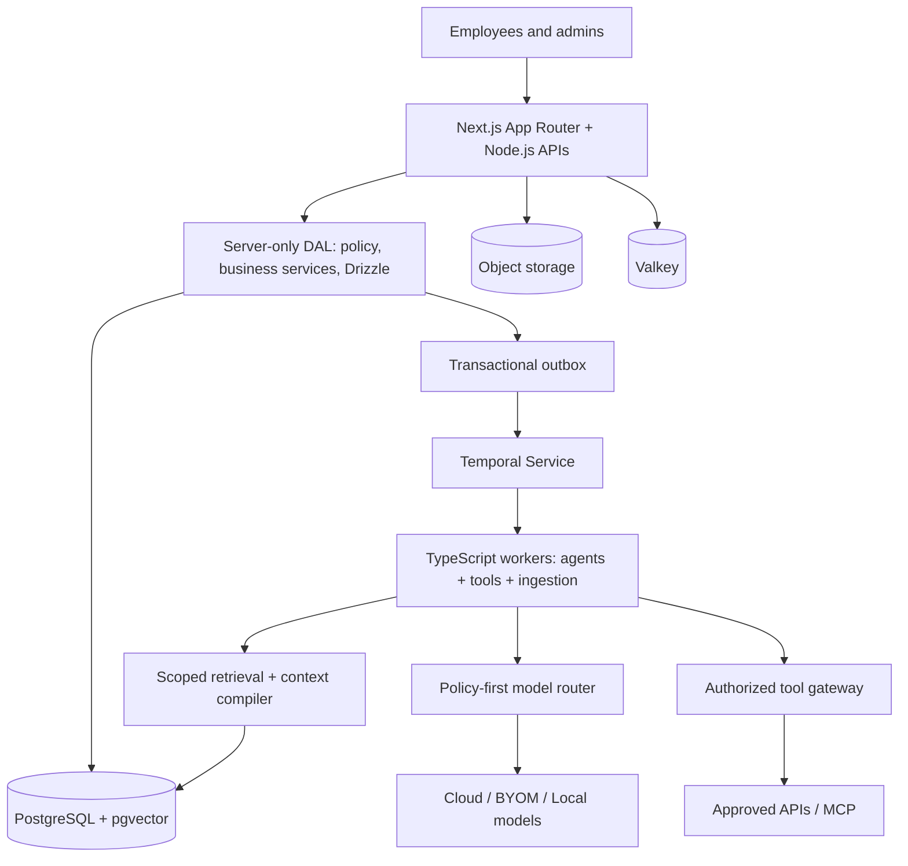

# Ensemus 2.0 — Architecture Overview

**Decision:** **Yes to Next.js full-stack**, **no to long-running work in its HTTP process**. One TypeScript monorepo, one public Next.js web/API server, and independently restartable Node/Temporal workers. Container-first for managed Cloud/BYOM and customer-controlled Sovereign.

## Architecture at a glance

## Why this implementation direction

The user-facing workspace benefits from Next.js rendering, server-side access and streamlined container packaging. A single language and shared domain contracts reduce duplication and deployment complexity. However, model calls, parsing and approval workflows can take seconds to days: they are not HTTP request work. Node worker processes and Temporal provide durable, independently scalable, observable execution without inventing a second business HTTP API. Web and worker containers can share one physical host in small installations.

## Platform domains

Organization/identity, work/project/client, relationship graph, knowledge/memory, agents/skills/tools, integrations, policy/audit, commercial entitlements. PostgreSQL stores canonical relationships and transactional state; Temporal stores workflow execution history; pgvector/FTS retrieve authorized text; object storage holds files. Do not add graph/vector/streaming databases until measurements justify them.

## Work execution

A user creates a Work Unit; Next.js validates identity/input and commits business state + an outbox event in one database transaction. A dispatcher starts an idempotent Temporal workflow. Its TypeScript Activity loads authorized context, selects an approved model, validates generated tool proposals, obtains exact-action approval if needed, performs an idempotent/reconciled external side effect and verifies a result. Status is persisted for UI reconnect; web process failures do not lose execution state.

## Model neutrality and memory

Ensemus's own model registry and router enforce data-class, region, tenancy, capability, cost and quality policy **before** using any SDK or provider. AI SDK/direct adapters are replaceable. Three modes differ by who hosts and pays for models, not permission semantics. Retrieval uses authoritative SQL plus permission-scoped lexical/vector candidates and source citations. No global company vector dump or unscoped semantic search.

## Secrets and tenant isolation

Server-only credential broker, envelope encryption/KMS or customer vault, restricted model egress, compound tenant foreign keys, PostgreSQL RLS, ABAC, per-action approvals, immutable receipts, non-verbose redacted logs. `NEXT_PUBLIC_*` is treated as public. RSC and Actions are not authorization exemptions. Cache/objects/embeddings/backups inherit tenant permissions and deletion/revocation behavior.

## Hosting and cost

Container-first runtime: Next.js standalone web image and one or more Node worker image roles; depend on PostgreSQL, Temporal service, Valkey, S3-compatible store, identity and vault. In Cloud and BYOM Ensemus operates the runtime. Sovereign customers receive signed offline images/config/license and operate their own dependencies. Cloud has platform subscription plus disclosed AI allowance; BYOM is platform-only subscription with customer provider bills; Sovereign is one-time perpetual use with separate optional maintenance, without remote kill switch.

## Speed and scaling

Optimize p95 API/read speed, frontend navigation, model round trips, DB query plans, retrieval recall, Temporal queue delay, worker concurrency and *cost per verified business outcome*. Avoid server-to-own-API round trips from RSC. Keep ingestion CPU loads off the web event loop. Multi-replica Next.js caching and tenant revocation require explicit tests. Performance targets remain **engineering hypotheses until benchmarked**, not guarantees.

## Implementation order

1. Repo, runtime isolation, signed images, DB/RLS/security, core org identities.
2. Work Units, approvals, outbox, TypeScript Temporal worker and complete deterministic workflow.
3. Model registry, routing, BYOM vault, bounded agents and policy-gated tools.
4. Memory/context compiler, connectors, Agent Studio, evaluations and cross-team workflows.
5. Sovereign offline packaging, restore/upgrade tests, configurable company objects and universality extensions.

## Where to start

[README](README.md) in the directory distribution, then `AGENTS.md` and backlog. See [v1 to v2 transition](08-migration/01-v1-to-v2-architecture-transition.md) for exact changes from the prior Python architecture. No production software or certificates are asserted to exist.
